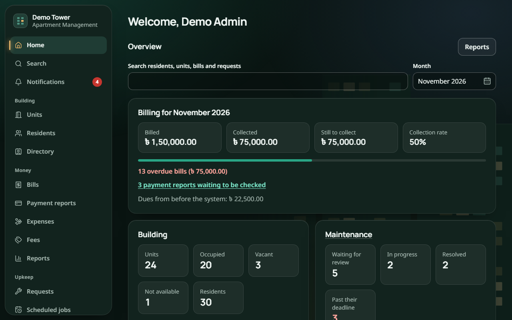
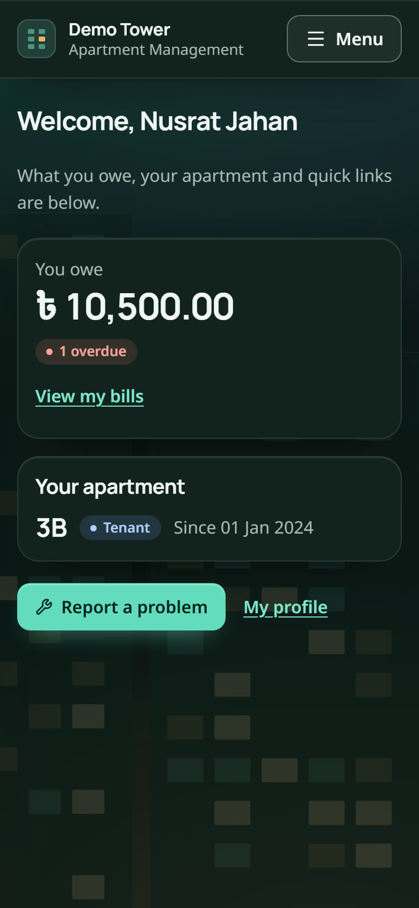
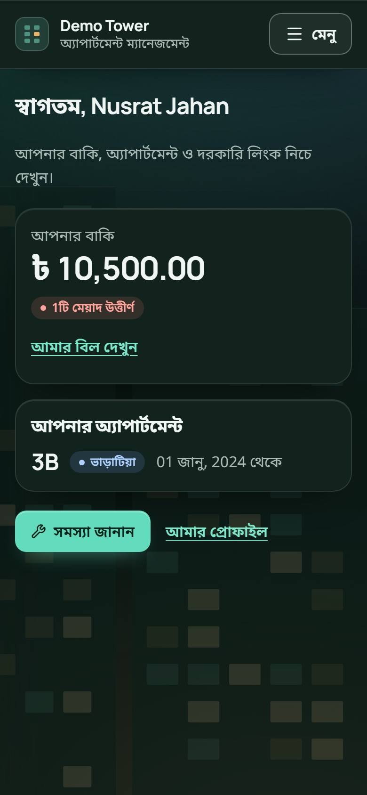
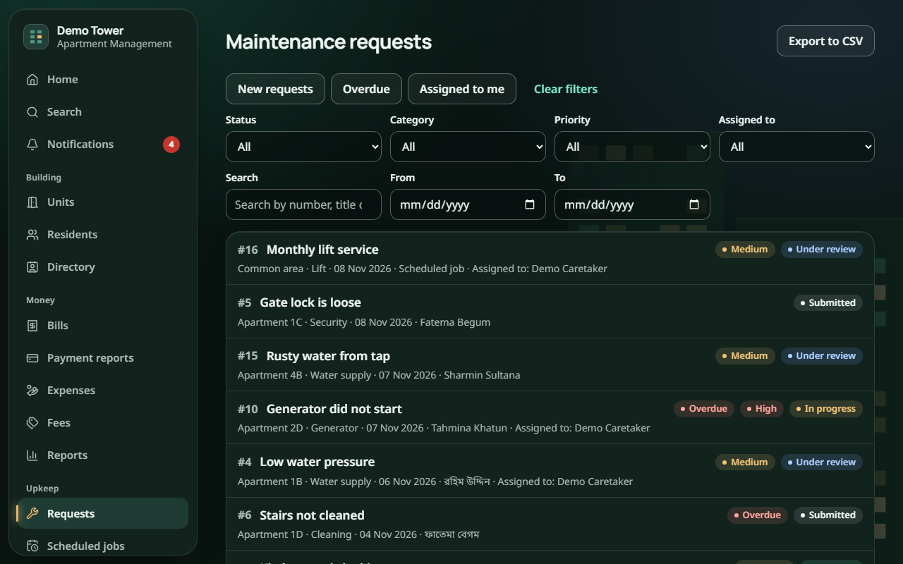
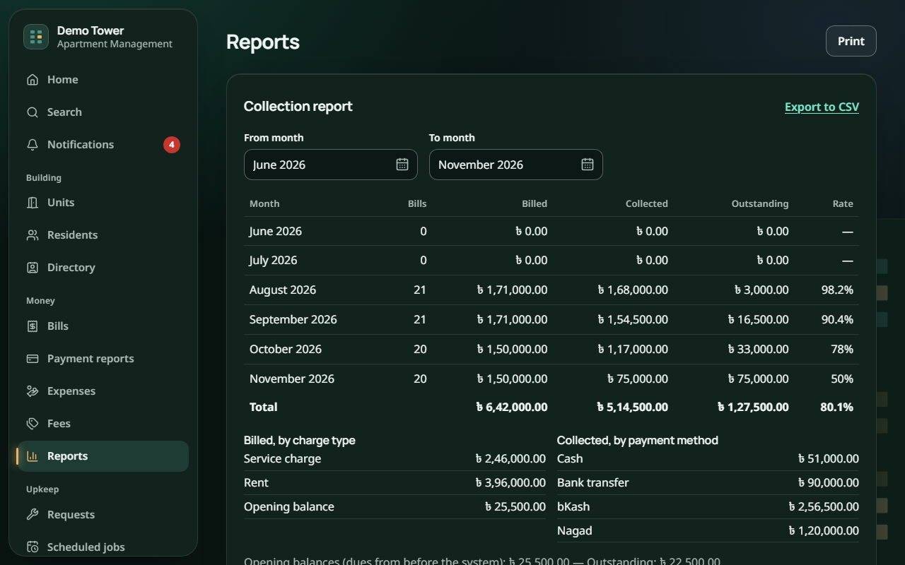
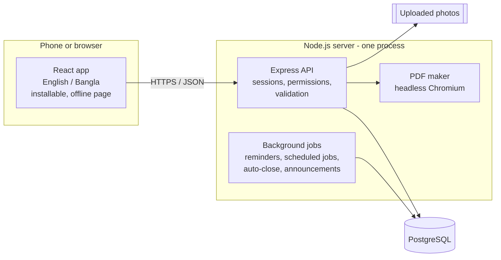

# Apartment Management

A web app for running a residential apartment building in Bangladesh. Owners and tenants see their bills, report payments and raise maintenance requests from their phones. Staff handle the work, and the management committee gets dues tracking, finance reports and notices in one place. It works in **English and Bangla** and can be **installed on a phone like an app**.

Built for **CSE327 (Software Engineering)**. Everything it uses is free.

**Live demo:** <https://apartment-management-tp48.onrender.com>
The demo runs on a free server that sleeps when nobody is using it, so the first visit can take up to a minute. Log in with any of the [demo accounts](#demo-accounts).

| Admin dashboard | Resident on a phone (English and Bangla) |
|---|---|
|  |   |

| Maintenance requests | Collection report |
|---|---|
|  |  |

---

## Contents

- [The problem](#the-problem)
- [Features](#features)
- [Built for Bangladesh](#built-for-bangladesh)
- [Tech stack](#tech-stack)
- [How it fits together](#how-it-fits-together)
- [Run it locally](#run-it-locally)
- [Demo accounts](#demo-accounts)
- [Configuration](#configuration)
- [Tests](#tests)
- [Deploying](#deploying)
- [Project layout](#project-layout)
- [Documentation](#documentation)

## The problem

Many apartment committees track service charges in notebooks or spreadsheets. They collect payments in cash or through bKash and Nagad, and they hear about broken lifts and leaking pipes through phone calls. Residents can't easily see what they owe, the committee can't easily see who is behind, and repair requests get lost.

This app keeps it all in one shared, permission-controlled place:

- every bill and payment has a receipt,
- every repair request has a status, an assignee and a deadline,
- every notice reaches the right people.

## Features

Three kinds of users see different things. Staff only see the parts their permissions allow.

### Residents (owners, tenants and household members)

- See what they owe, their bills and their full payment history
- **Report a payment** made by bKash, Nagad, bank transfer or cash, for the committee to confirm
- Download **receipts**, a **statement of account** and a **no-dues certificate** as PDFs
- **Report a problem** with photos, follow its progress, then confirm, reopen or rate the work
- Read announcements and get in-app notifications
- See the building's **emergency numbers, even offline**
- Choose English or Bangla, and normal or large text

### Staff

- A task list of the repair requests assigned to them, with status updates and notes
- Optional permissions for billing, payments, residents, units, the directory and reports, set per person by the administrator

### Administrators and the committee

- **Building setup:** units, residents, owners and tenants, household members with their own logins, and bulk import from CSV
- **Billing:**
  - fee setup and monthly bill generation for every unit
  - one-off bills and opening balances
  - recording and voiding payments, and checking reported payments
  - automatic overdue tracking and reminders
- **Move-out wizard:** settle dues, issue the certificate and end the stay in one flow
- **Expenses** and an income-versus-expense report
- **Maintenance:**
  - review, prioritise and assign requests, with deadlines by priority
  - an overdue view and a maintenance report
  - **scheduled jobs** that create requests automatically (for example, the monthly lift service)
- **Announcements:**
  - to everyone, to particular units or to resident groups
  - scheduled to publish and expire later
  - printable as notices
- **Dashboard:** the month's billing, collection rate, overdue bills, building occupancy and maintenance load
- **Reports:**
  - collection and dues reports
  - a monthly **committee report PDF**
  - **CSV exports** that open correctly in Excel, Bangla included
- **Global search** across residents, units, bills and requests
- **Activity log:** a record of who did what, which can't be edited or deleted

## Built for Bangladesh

- **Bangla throughout:** screens, notifications, error messages and PDFs. PDFs are made by a real browser engine, so Bangla conjuncts render correctly.
- **Taka formatting** with lakh grouping (`৳ 1,50,000.00`). Money is stored as whole poisha, so there are no rounding errors.
- **Western digits in both languages**, so amounts and phone numbers read the same everywhere.
- **Payment methods people actually use:** cash, bank transfer, bKash and Nagad.
- **Works on cheap phones and weak connections:**
  - installable as an app
  - an offline page with emergency numbers
  - large touch targets and a large-text setting
- **Accessibility:** the main pages are scanned automatically against WCAG 2.1 AA, at desktop and phone size.

## Tech stack

| Layer | Technology |
|---|---|
| Language | TypeScript everywhere |
| Front end | React 18, Vite, React Router, TanStack Query, react-i18next, Tailwind CSS v4, lucide icons, installable PWA (vite-plugin-pwa) |
| Back end | Node.js 22, Express, Zod validation shared with the front end |
| Database | PostgreSQL 16+, Prisma ORM and migrations, plus hand-written SQL where speed or correctness needs it |
| Security | bcrypt password hashing, server-side sessions stored in PostgreSQL, CSRF tokens, login rate limiting, Helmet security headers, upload checks on real file content |
| Documents | Headless Chromium (playwright-core) renders HTML to PDF, so Bangla text shapes correctly |
| Tests | Vitest, Supertest, Playwright, axe-core accessibility scans |
| Hosting | Docker on Render, PostgreSQL on Neon |

## How it fits together



The repository is an npm workspace with three packages:

- `packages/shared`: validation rules, permissions, money formatting, and the English and Bangla text. Both the server and the web app use it, so a rule is written once.
- `server`: the API, grouped into modules for users, billing, expenses, maintenance, announcements, notifications, reports, activity and settings.
- `web`: the React app.

In production the server also serves the built web app, so one process on one port runs everything.

## Run it locally

You need **Node.js 22+** and **PostgreSQL 16+**. If you'd rather not install PostgreSQL, Docker can run it: `docker compose up -d`.

```bash
cp .env.example .env                                           # then set SESSION_SECRET to a long random string
powershell -ExecutionPolicy Bypass -File scripts/setup-db.ps1  # Windows: creates the database user and database
npm install
npx playwright install chromium                                # the browser engine used to make PDFs
npm run db:deploy                                              # creates the tables
npm run seed                                                   # adds the demo building
npm run app                                                    # builds the site and serves it
```

Open <http://localhost:4000>. With `DEMO_MODE=true` in `.env`, the login page has one-click buttons for an administrator, a staff member and a resident.

**For development**, run `npm run dev` instead. The API runs on port 4000 and the web app on <http://localhost:5173>, and both reload when you save.

`npm run demo:reset` **deletes everything in the database** and rebuilds the demo in about 10 seconds. It only runs with `DEMO_MODE=true`, and never in production.

## Demo accounts

| Role | Login | Password | Can do |
|---|---|---|---|
| Administrator | `admin@demo.local` | `Admin1234` | Everything |
| Maintenance manager | `manager@demo.local` | `Manager1234` | See, review and assign all requests; record payments |
| Cashier | `billing@demo.local` | `Billing1234` | Manage bills and record payments |
| Bill viewer | `viewer@demo.local` | `Viewer1234` | See bills, but not change them |
| Office staff | `office@demo.local` | `Office1234` | Manage units and residents; see the directory |
| Caretaker | `staff@demo.local` | `Staff1234` | Their own assigned tasks only |
| Resident | `resident@demo.local` | `Resident1234` | Their own bills, payments and requests |
| Household member | `family@demo.local` | `Resident1234` | A family member with their own login |

The demo building has 24 units, about 30 residents, several months of bills and payments, and a set of maintenance requests.

## Configuration

Settings are read from `.env` at the repository root. See [.env.example](.env.example).

| Variable | Purpose | Default |
|---|---|---|
| `DATABASE_URL` | PostgreSQL connection string | (required) |
| `SESSION_SECRET` | Signs login cookies. Use a long random string; the server refuses the example value in production. | (required) |
| `PORT` | Port to listen on | `4000` |
| `NODE_ENV` | `production` makes login cookies HTTPS-only and hides the demo buttons | `development` |
| `DEMO_MODE` | Shows one-click demo logins and allows `demo:reset` (never in production) | `false` |
| `SERVE_WEB` | Serve the built web app from the API server | `false` |
| `TRUST_PROXY` | Set to `true` behind a hosting proxy that handles HTTPS (such as Render) | `false` |
| `UPLOAD_DIR` | Where uploaded photos are kept | `./uploads` |

## Tests

```bash
npm test            # shared, API and web unit/integration tests (the API uses its own apartment_test database)
npm run test:e2e    # browser tests at desktop and phone size, with accessibility scans
npm run test:pwa    # the built site: install, offline page, security policy
```

None of these touch your development data.

| Suite | What it covers | Tests |
|---|---|---|
| Server (Vitest + Supertest) | API routes, business rules and permission checks, against a real PostgreSQL database | 520 |
| Shared | Validation, permissions, money formatting, translations | 20 |
| Web | The API client: errors, sessions, security tokens | 10 |
| Browser (Playwright) | Full user journeys on desktop and a phone screen, plus axe accessibility scans of the main pages | 152 |
| PWA | Production build: install, offline page and emergency numbers, content security policy | 5 |

GitHub Actions runs them on every push ([.github/workflows/ci.yml](.github/workflows/ci.yml)).

## Deploying

The repository includes a [Dockerfile](Dockerfile) and a Render blueprint ([render.yaml](render.yaml)). The container holds the API, the web app and the Chromium used for PDFs. On every start it applies database migrations and adds the demo building if the database is empty.

[docs/deploy-render.md](docs/deploy-render.md) walks through it: create a free PostgreSQL database on Neon, then a free web service on Render, and paste the database address. It also lists what the free plan means in practice, such as sleeping when idle and uploaded photos not surviving a restart.

For any other host, run behind HTTPS with `NODE_ENV=production`, `TRUST_PROXY=true` and a long random `SESSION_SECRET`.

## Project layout

```
packages/shared   validation, permissions, money formatting, English and Bangla text
server            Express API, Prisma schema and migrations, PDFs, background jobs
web               React app (installable PWA)
e2e, e2e-pwa      Playwright browser tests
scripts           database setup, backup and restore (PowerShell and shell)
docs              requirements, diagrams, deployment, test results
```

## Documentation

- [Software Requirements Specification](docs/SRS.md): 58 requirements (29 Must, 19 Should, 10 Could) plus business rules and quality targets
- [Project specification](project_spec.md): architecture, data model, API and delivery plan
- [Diagrams](docs/diagrams/README.md)
- [Deploying on Render](docs/deploy-render.md)
- [Backup and restore](docs/backup-and-restore.md), with restore test results
- [Performance results](docs/performance-results.md)
- [Usability test kit](docs/usability-test.md)
- [Demo script](docs/demo-script.md)
