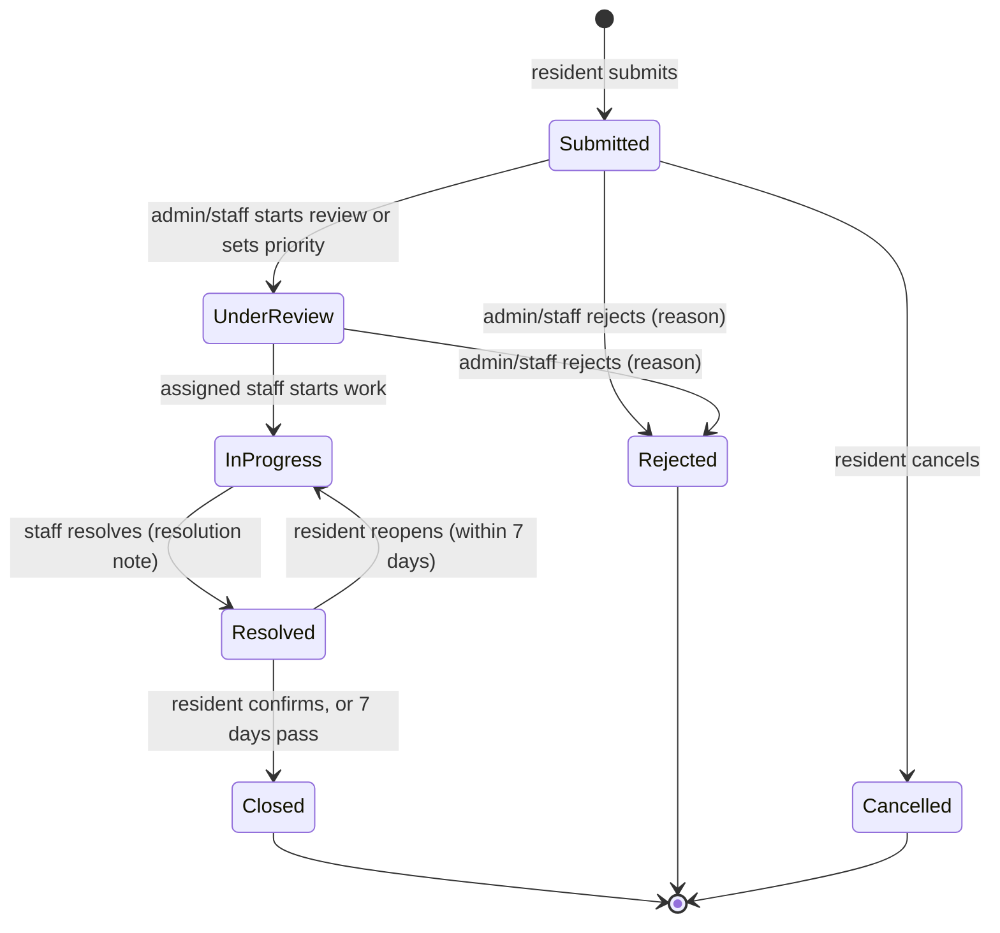
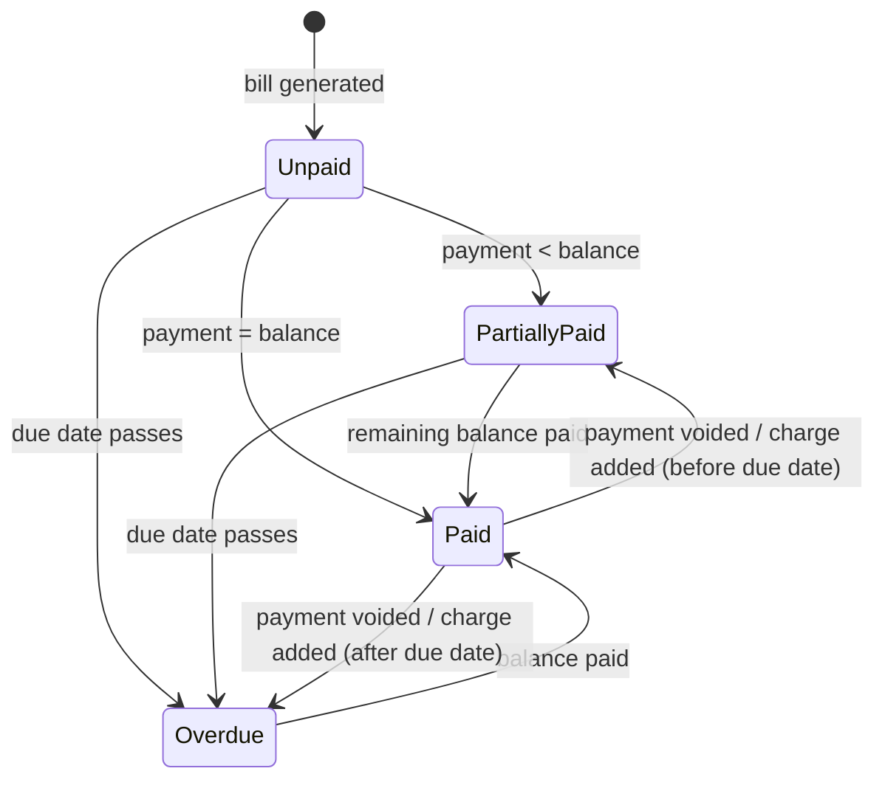

# Software Requirements Specification — Apartment Management

**A Complete Apartment Operations Platform**

| | |
|---|---|
| Course | CSE327 – Software Engineering |
| Prepared by | [Your Name / Team Members and IDs] |
| Submitted to | [Instructor Name] |
| Version | 1.3 |
| Date | November 2026 |

### Revision History

| Version | Date | Author | Changes |
|---|---|---|---|
| 1.0 | October 2026 | Team | First draft. |
| 1.1 | November 2026 | Team | Added definitions, references, business rules, priorities, interface requirements, permission matrix, state models, traceability matrix, and open questions. Made NFRs measurable. Fixed gaps and conflicts (see Appendix D). |
| 1.2 | November 2026 | Team | Added resident payment reports, opening balances, bulk import, building expenses, statements, no-dues certificates, Bangla interface, installable web app, and several *Could* features (FR-39–FR-54, BR-21–BR-28). Removed national ID field. See Appendix D.2. |
| 1.3 | November 2026 | Team | Added larger-text setting, move-out wizard, monthly committee report, and collection-rate trend (FR-55–FR-58, BR-29). Fixed opening-balance visibility and scheduled-task deadlines. See Appendix D.3. |

---

## Table of Contents

1. [Introduction](#1-introduction)
2. [Overall Description](#2-overall-description)
3. [Business Rules](#3-business-rules)
4. [Functional Requirements](#4-functional-requirements)
5. [External Interface Requirements](#5-external-interface-requirements)
6. [Non-Functional Requirements](#6-non-functional-requirements)
7. [Data Requirements](#7-data-requirements)
- [Appendix A — State Models](#appendix-a--state-models)
- [Appendix B — Permission Matrix](#appendix-b--permission-matrix)
- [Appendix C — Traceability Matrix](#appendix-c--traceability-matrix)
- [Appendix D — Changes from Version 1.0](#appendix-d--changes-from-version-10)
- [Appendix E — Open Questions](#appendix-e--open-questions)

---

## 1. Introduction

### 1.1 Purpose

This document describes what the Apartment Management system will do and how well it must do it. The system is a web application that brings the daily work of an apartment building into one place: resident records, bills and payments, maintenance requests, and announcements.

In many apartment buildings today, these tasks are handled with paper records, phone calls, chat apps, and separate payment channels. This leads to late replies, billing mistakes, and requests that get forgotten. This SRS sets out the requirements for a simple, central system that fixes these problems. It is written with apartment communities in Bangladesh in mind, but it can fit other residential buildings as well.

### 1.2 Intended Audience

- **Developers** use it to build the system.
- **Testers** use it to write test cases. Every functional requirement has confirmation criteria that can be turned directly into tests.
- **Project team members and the course instructor** use it to review the scope and progress of the project.
- **Future maintainers** use it to understand why the system works the way it does.

### 1.3 Intended Use

The team uses this SRS as the main reference throughout the project. It guides the system design (UML diagrams, ERD, architecture), the implementation, and the testing. The implementation-level details (tech stack, data model, API) are in [`project_spec.md`](../project_spec.md), which must stay consistent with this document.

When a new feature idea comes up, it is checked against this document first. If it is accepted, this document is updated, the version number is raised, and the change is recorded in the revision history.

### 1.4 Product Scope

The Apartment Management system is a browser-based platform for a **single apartment building** with three types of users: residents, building administrators, and authorized building staff. Each user sees only the screens and data that match their role.

**Goals and benefits**

| Goal | Measured by |
|---|---|
| Keep all apartment, resident, and staff records in one central database. | All units and residents of the demo building are entered and searchable. |
| Make billing clear. | Each resident can see their outstanding balance in 2 clicks or fewer after logging in. |
| Let residents report maintenance problems and follow their progress. | Every request has a visible status and history. No request stays in *Submitted* longer than its review deadline without being flagged. |
| Give management one channel for announcements. | Admin can see the read status of each announcement. |
| Give administrators dashboards and reports. | Dashboard figures match the underlying records exactly. |
| Show residents where their service charge goes. | A monthly income vs expense report is available (FR-44). |
| Work for residents with low technical skill. | Resident screens are available in Bangla, and the app can be installed on a phone home screen (FR-47, FR-48). |

**In scope (version 1):** user and resident management, apartment units and occupancy, bulk import, billing and payment records, opening balances, resident-reported payments with verification, receipts, statements of account, no-dues certificates, building expense tracking, maintenance management, announcements and in-app notifications, administrative dashboard and reports, English and Bangla interface, installable web app.

**Out of scope (version 1):** visitor management, facility and amenity booking, smart-home or IoT features, hardware device control, live online payment processing, SMS and email delivery of notifications, chat, polls and voting, native mobile apps, and managing more than one building. In this version, payments that happen outside the system are only *recorded* inside it.

### 1.5 Definitions and Acronyms

| Term | Meaning |
|---|---|
| Unit / Apartment | A single flat in the building, identified by a unit number (e.g. `4B`). |
| Resident | A person who owns or rents a unit and has a resident account. |
| Owner | A resident who owns the unit. |
| Tenant | A resident who rents the unit. |
| Occupancy | A record linking a resident to a unit for a period of time (start date, optional end date). An occupancy with no end date is *active*. |
| Administrator (Admin) | The building manager or committee member who runs the system. |
| Staff | A caretaker or office employee who helps the admin, with permissions the admin chooses. |
| Bill | The statement for one unit for one billing month. It is made up of one or more charges. |
| Charge | One line item on a bill (e.g. service charge, water, rent), with a type, amount, and description. |
| Balance | Bill total minus the sum of valid (non-voided) payments against it. |
| Payment | A record of money received against a bill, entered by the admin or permitted staff. |
| Void | Marking a payment or expense as cancelled, with a reason. A voided record stays visible in history but no longer counts. |
| Payment report | A resident's claim that they paid a bill outside the system (e.g. by bKash), with a transaction ID and optional screenshot. It becomes a payment only after verification. |
| Opening balance | Dues a unit already owed before the building started using the system. |
| Expense | Money the building spends (e.g. guard salaries, generator fuel), recorded by the admin. |
| Statement of account | A printable list of a unit's bills and payments over a period, with a running balance. |
| No-dues certificate | A document confirming that a unit has no outstanding dues, often needed when a flat is sold or a tenant moves out. |
| Household member | A family member linked to a resident's occupancy who has their own login. |
| Scheduled task | A recurring maintenance job (e.g. monthly lift servicing) that the system turns into a request when it is due. |
| PWA | Progressive Web App: a website that can be installed on a phone's home screen and opened like an app. |
| Collection rate | For a billing month, the share of the amount billed that has been paid so far (BR-29). |
| Move-out | Ending a resident's stay in a unit: closing the occupancy, settling dues, and optionally issuing a certificate and deactivating the account (FR-56). |
| Maintenance request | A report of a problem in a unit or common area, submitted by a resident. |
| SLA | Service-level target: the maximum time allowed to resolve a request of a given priority. |
| Announcement | A message published by the admin to an audience of residents. |
| Notification | An in-app alert sent to one user (e.g. about a new announcement, a bill deadline, or a request update). |
| Resident group | A named set of residents used as an announcement audience (e.g. "Owners", "Floor 3"). |
| BDT / ৳ | Bangladeshi Taka, the currency used for all amounts. |
| RBAC | Role-based access control. |
| MoSCoW | Priority scale: **Must**, **Should**, **Could**, **Won't (this version)**. |

### 1.6 References

1. IEEE Std 830-1998, *Recommended Practice for Software Requirements Specifications*.
2. ISO/IEC/IEEE 29148:2018, *Requirements engineering*.
3. OWASP Top 10 (2021) and OWASP Application Security Verification Standard 4.0, Level 1.
4. W3C *Web Content Accessibility Guidelines (WCAG) 2.1*.
5. [`project_spec.md`](../project_spec.md): implementation specification for this project.

### 1.7 Risks

Each risk links to the requirements that reduce it.

| ID | Risk | What could go wrong | Reduced by |
|---|---|---|---|
| R1 | Unauthorized access to data | A resident sees another resident's bills or personal details, for example by changing an ID in the URL. | FR-01, FR-02, FR-31, NFR-01–NFR-07, NFR-23, NFR-24 |
| R2 | Wrong billing records | A bill or payment is recorded wrongly, entered twice, or half-saved when an operation fails, or old dues are missing at launch. | BR-04–BR-09, BR-22, FR-09–FR-11, FR-32, FR-33, FR-41, NFR-14 |
| R3 | Lost maintenance requests | A request is forgotten or never reaches the right person. | BR-11–BR-13, FR-18–FR-20, FR-29 |
| R4 | Missed announcements | Residents do not see an important notice. | FR-25, FR-26 |
| R5 | Data loss | Records are lost because of a system failure or a mistaken delete. | BR-15, NFR-15, NFR-16, FR-34 |
| R6 | Schedule overrun | The small team cannot finish every feature in the course timeline. | MoSCoW priorities on every requirement. *Must* items are built first. |
| R7 | False payment reports | A resident reports a payment that never happened, or reuses an old screenshot. | BR-21, FR-40: every report is checked by a person against bank or mobile-banking records, never auto-approved; duplicate transaction IDs are flagged. |

---

## 2. Overall Description

### 2.1 Product Perspective

This is a new, stand-alone web application. It does not replace an existing software product. It replaces the manual and scattered methods (paper, phone calls, messaging apps) that apartment buildings use today. It has no required integration with outside systems in version 1.

### 2.2 Product Functions (Summary)

| Module | Main functions |
|---|---|
| Users & Residents | Login, password management, roles and staff permissions, resident profiles, household members, units, occupancy, bulk import, directory, language choice |
| Billing & Finances | Fee setup, opening balances, monthly bill generation, charges, payment recording and voiding, resident payment reports and verification, status tracking, receipts, statements, no-dues certificates, building expenses, finance reports |
| Maintenance | Submit, review, prioritize, assign, update, close, rate, and report on requests; scheduled recurring tasks |
| Announcements & Notifications | Publish targeted and scheduled announcements, printable notices, emergency contacts, in-app notifications, read tracking |
| Dashboard & Reports | Building, billing, and maintenance overviews, activity log, global search |

### 2.3 User Classes and Characteristics

| User class | Who they are | What they can do |
|---|---|---|
| Resident | Owners or tenants living in the building. Technical skill may be low to medium. Mostly use a phone. Use the system occasionally (a few times a month). | View their profile, unit, bills, and payment history. Report payments they made. Download receipts, statements, and no-dues certificates. Submit, track, and rate maintenance requests. Receive announcements and notifications. |
| Building Administrator | The building manager or committee member in charge. Uses a computer, daily. | Everything: manage residents, units, staff, fees, bills, payments, maintenance, announcements, and reports. Configure the system. |
| Authorized Building Staff | Caretakers or office staff who help the admin. Mostly use a phone. | Only what the admin permits (see Appendix B). By default: see and update the maintenance requests assigned to them. |

There is no separate external maintenance-worker role. Administrators and staff coordinate all maintenance work. There is exactly one administrator account type. Several people may hold admin accounts.

### 2.4 User Needs

- **Residents** need a simple way to see what they owe, report problems, and stay informed without calling anyone.
- **Administrators** need accurate records, a quick view of dues and pending work, and one channel to reach all residents.
- **Staff** need a clear list of the tasks assigned to them and an easy way to update progress from a phone.

### 2.5 Operating Environment

- The system is a web application used through the latest two major versions of Chrome, Firefox, Edge, or Safari, on a computer, tablet, or phone.
- It needs an internet connection, or a local network for the demonstration setup.
- The server side consists of a web server, a backend application exposing a REST API, a relational database, and file storage for uploaded photos.
- No special hardware is required.

### 2.6 Constraints

- The project must be finished within the course timeline by a small student team.
- The system is web-based only. A native mobile app is not part of this version.
- Payments are only recorded. There is no live payment gateway.
- Only established, free, open-source technologies are used, because of the limited budget.
- Passwords must be stored hashed, and access to personal and financial data must follow role-based rules.
- All amounts are in BDT. All dates and times use the Asia/Dhaka time zone (UTC+6).
- The user interface is available in English and Bangla (FR-47). Names, addresses, and free-text fields must accept Bangla (Unicode) text.

### 2.7 Assumptions and Dependencies

- Every user has a device with a web browser and some internet access.
- The administrator enters correct apartment, resident, and billing information during setup.
- Each resident has a valid email address or phone number that can serve as their login ID.
- Payments happen outside the system (cash, bank transfer, or mobile banking such as bKash or Nagad). Afterwards, either the resident reports the payment for verification (FR-39) or the admin or permitted staff record it directly (FR-11).
- The admin can check reported payments against the building's bank and mobile-banking records.
- Staff update maintenance statuses honestly and on time.
- The system is demonstrated in a test environment with a small amount of data (about 1 building, up to 100 units and 300 users).
- Because there is no email or SMS delivery in version 1, initial passwords and password resets are handed to users by the administrator in person (see FR-31).

If any of these turn out to be false, some requirements, especially around payment recording, account setup, and notifications, may need to change.

---

## 3. Business Rules

These rules apply across several requirements. Requirements refer to them by ID so each rule is defined in one place only.

### Accounts and access

- **BR-01 — Login ID.** Each user logs in with a unique email address or phone number. Phone numbers are stored in the format `+8801XXXXXXXXX`.
- **BR-02 — Passwords and lockout.** Passwords must be at least 8 characters and contain at least one letter and one digit. After 5 failed logins in a row, the account is locked for 15 minutes.
- **BR-03 — Deactivation.** A deactivated user cannot log in. Their records (bills, payments, requests, history) are kept. Deactivating a resident requires an end date for each of their active occupancies.
- **BR-27 — Household members.** A household member is linked to one resident's occupancy (e.g. spouse, adult child) and has their own login. While that occupancy is active, they can see the same bills, receipts, statements, and announcements as the resident, and the maintenance requests submitted by anyone in the same household. They can submit maintenance requests and report payments. They cannot be the billing contact. When the occupancy ends or the member is removed, they lose access to new records.
- **BR-28 — Language.** Each user chooses English or Bangla. The choice is saved to their account; the default is English. Only interface text is translated; data that users type (names, descriptions) is shown as entered. Amounts and dates use Western digits in both languages, to match receipts and bank records.

### Units and occupancy

- **BR-04 — Unit identity.** Unit numbers are unique within the building (case-insensitive, so `4b` and `4B` are the same unit).
- **BR-05 — Occupancy status.** A unit is **Occupied** while it has at least one active occupancy and **Vacant** otherwise. This is calculated, not typed in. The admin can separately mark a unit **Unavailable** (e.g. under renovation), which stops it from receiving new occupancies.
- **BR-06 — Occupancy dates.** An occupancy's end date cannot be before its start date. The same resident cannot have two overlapping occupancies of the same unit. Each occupied unit has exactly one occupancy marked as the **billing contact**.

### Billing and payments

- **BR-07 — One bill per unit per month.** There is at most one bill per unit per billing month. Rent, utilities, and other fees are added to that bill as charges. Within one bill, each recurring charge type (service charge, rent, water, gas, electricity) can appear at most once. Charges of type *Other* may appear several times.
- **BR-08 — Bill visibility.** A resident can see a bill if they had an occupancy of that unit at any time during the bill's month, or are a household member of such an occupancy (BR-27). This lets residents see bills from units they have since left, and stops new residents from seeing a previous occupant's bills.
- **BR-09 — Bill status.** A bill's status is calculated from its balance and due date, and is always exactly one of:
  - **Paid** — balance is 0.
  - **Partially paid** — some amount paid, balance > 0, due date not passed.
  - **Unpaid** — nothing paid, due date not passed.
  - **Overdue** — balance > 0 and today is after the due date.
- **BR-10 — Due date.** The default due date is the 10th day of the billing month. The admin can change this default in settings and can override it when generating bills.
- **BR-11 — Payment amount.** A payment must be greater than ৳0 and no more than the bill's current balance. Overpayments and advance payments are not supported in version 1.
- **BR-12 — Bill changes after payment.** Charges can be added to a bill after payments are recorded. A charge cannot be changed or removed if doing so would make the bill total less than the amount already paid.
- **BR-13 — No deletion of payments.** Payments are never deleted. A wrong payment is **voided** with a reason. Voided payments are shown in history, crossed out, and are not counted in balances or reports.
- **BR-14 — Receipts.** Every valid payment has a receipt with a unique number in the format `RCPT-YYYY-NNNNN` (sequence restarts each year). A voided payment's receipt is marked **VOID**.
- **BR-15 — Money format.** Amounts are stored exactly (no floating-point rounding) to 2 decimal places and shown with Bangladeshi lakh grouping, e.g. `৳ 12,500.00` and `৳ 1,25,000.00`.
- **BR-21 — Payment reports.** A resident can report a payment against a bill they can see. A report needs the amount, payment date, method, and transaction ID or reference. A screenshot (JPG, PNG, WEBP, or PDF, up to 5 MB) is optional but encouraged. A report stays **Pending** until an admin or permitted staff member **verifies** or **rejects** it. Only verification creates a payment; pending reports do not change the bill balance. The amount must meet BR-11 when the report is submitted and again when it is verified. The total of pending reports on a bill cannot exceed its balance. Reports are never verified automatically.
- **BR-22 — Opening balance.** When the building starts using the system, the admin can record each unit's unpaid dues from before as an **opening balance**. It is stored as a bill for the month before the go-live month, with one charge of type *Opening balance*. Its due date is chosen by the admin (default: the go-live date). Each unit can have at most one opening balance, and only an admin can enter it. An opening-balance bill is visible to every resident (and household member) whose access to the unit is active on the go-live date. This overrides BR-08, which would otherwise hide it from residents whose occupancy was entered as starting on the go-live date.
- **BR-23 — Expenses.** An expense has a date, category (Staff salary, Generator fuel, Common-area electricity, Water, Cleaning, Lift, Security, Repairs, Other), amount (> ৳0), payee, optional description, and optional receipt photo. Expenses are never deleted; a wrong one is voided with a reason, as in BR-13.
- **BR-24 — No-dues certificate.** A certificate can be issued for a unit only when the unit's total balance across all its bills is ৳0 on the day of issue. Each certificate has a unique number `NDC-YYYY-NNNNN`, the unit, the resident it is issued to, the latest billed month it covers, the issue date, and the issuer. It does not cover months that have not been billed yet.
- **BR-29 — Collection rate.** The collection rate for billing month M = (valid payments made so far against M's regular bills) ÷ (total of M's regular bills) × 100, rounded to one decimal place. Opening-balance bills are excluded. Because late payments still count toward their bill's month, the rate for past months can rise over time; reports show it "as of" the date they are viewed.

### Maintenance

- **BR-16 — Request statuses.** A request is in one of: **Submitted, Under review, In progress, Resolved, Closed, Rejected, Cancelled.** Allowed moves are shown in Appendix A. *Closed, Rejected,* and *Cancelled* are final.
- **BR-17 — Resolution targets (SLA).** A request is **overdue** when it is not yet Resolved and:

  | Priority | Must be resolved within (from submission) |
  |---|---|
  | High | 24 hours |
  | Medium | 3 days |
  | Low | 7 days |
  | Not yet set | Must be reviewed within 2 days |

  The admin can change these values in settings.
- **BR-18 — Auto-close.** A Resolved request is closed automatically 7 days after it was resolved, unless the resident reopens it first.
- **BR-19 — Attachments.** A request may have up to 3 photos, each JPG, PNG, or WEBP and no larger than 5 MB.
- **BR-25 — Scheduled tasks.** A scheduled task has a title, category, repeat interval (1–24 months), next due date, and optional default assignee. Seven days before the next due date, the system creates a common-area maintenance request (priority Medium, status Under review, submitted by "System", assigned to the default assignee if set) and moves the next due date forward by the interval. The request's deadline is the task's due date, not the BR-17 target (otherwise it would be overdue before the job was even due). Paused tasks create nothing.
- **BR-26 — Ratings.** The resident who submitted a request can rate it once, 1 to 5 stars with an optional comment, when they confirm it or within 7 days after it is closed. A rating cannot be changed.

### Notifications

- **BR-20 — Bill reminders.** A resident gets a notification 3 days before a bill's due date if it is not fully paid, and again on the day it becomes overdue.

---

## 4. Functional Requirements

Requirements are written as user stories. Each has **confirmation** criteria that describe how to check the story is done, and a **priority** (MoSCoW). The IDs FR-01 to FR-30 are kept from version 1.0. New requirements start at FR-31.

### 4.1 User and Resident Management

#### FR-01: Log in securely — *Must*
**User story:** As a user (resident, administrator, or staff), I want to log in with my account and password so that I can reach my own information safely.
**Confirmation:**
- If I enter correct details, I am taken to the home page for my role.
- If I enter wrong details, I see "Incorrect login ID or password" (the message does not say which one was wrong), and I am not logged in.
- After 5 wrong attempts in a row, I am locked out for 15 minutes and told so (BR-02).
- My password is masked while I type and is stored hashed (NFR-01).
- I can log out at any time, and after logging out the browser's Back button does not show my private pages.
- If I am inactive for 30 minutes, I am logged out automatically (NFR-03).

#### FR-02: Role-based access — *Must*
**User story:** As an administrator, I want each user to see only the pages and actions for their role so that private information stays protected.
**Confirmation:**
- A resident cannot open admin or staff pages, even by typing the address. They see an "Access denied" page.
- A resident cannot read another resident's data by changing an ID in the address or in an API call. The server returns "not found".
- A staff member can only use the features the admin has granted (Appendix B).
- Menus show only the items the user is allowed to use.

#### FR-03: Register and manage residents — *Must*
**User story:** As an administrator, I want to add, edit, and deactivate resident profiles so that the building records are always correct.
**Confirmation:**
- I can create a resident with full name, login ID (email or phone), phone number, and optional fields (alternate phone, emergency contact). The system does not collect national ID numbers (NFR-25).
- Creating a resident creates their login account with a temporary password that I can hand to them. They must change it at first login (FR-31).
- I can edit a resident's details, and the changes are saved.
- I can deactivate a resident who has moved out without deleting their history (BR-03).
- I can reactivate a deactivated resident.
- If required fields are missing or the login ID is already used, the form shows which field to fix.

#### FR-04: Manage apartment units — *Must*
**User story:** As an administrator, I want to add and edit apartment units so that the building structure is stored in the system.
**Confirmation:**
- I can add a unit with unit number, floor, size (sq ft), and number of bedrooms.
- I can edit unit details and mark a unit Available or Unavailable (BR-05).
- A duplicate unit number is rejected with a clear message (BR-04).
- I cannot delete a unit that has bills or occupancy history. I can only mark it Unavailable.

#### FR-05: Assign residents to apartments and keep occupancy records — *Must*
**User story:** As an administrator, I want to assign a resident to an apartment and record the start and end of their stay so that I know who lives where.
**Confirmation:**
- I can link a resident to a unit as an owner or a tenant, with a start date.
- I can choose which occupant is the billing contact (BR-06).
- The unit shows as Occupied after assignment and as Vacant after its last occupant's end date is recorded (BR-05).
- Past occupancy records are kept and can be viewed per unit and per resident.
- Invalid dates or overlapping occupancies are rejected (BR-06).

#### FR-06: Manage staff accounts — *Must*
**User story:** As an administrator, I want to create and manage staff accounts and their permissions so that only trusted people can help with operations.
**Confirmation:**
- I can create, edit, deactivate, and reactivate a staff account.
- I can tick which permissions each staff member has, from the list in Appendix B.
- Permission changes take effect on the staff member's next request, without them logging out.
- A deactivated staff member can no longer log in, and any open requests assigned to them are shown to me as "needs reassignment".

#### FR-07: View my profile and apartment information — *Must*
**User story:** As a resident, I want to view my profile and apartment details so that I can check that my information is correct.
**Confirmation:**
- After logging in I can see my personal details, my unit(s), and my role in each unit (owner or tenant).
- I cannot see any other resident's profile through this page.

#### FR-08: Resident directory — *Should*
**User story:** As an administrator or permitted staff member, I want to search a resident directory so that I can quickly find who lives in which unit.
**Confirmation:**
- I can search by name, unit number, or phone number. Partial matches work (e.g. "rah" finds "Rahman").
- Results show name, unit, owner/tenant, and phone number. Financial data is not shown.
- Only admins and staff with the `directory.view` permission can open the directory. Residents cannot.

#### FR-31: Change and reset password — *Must* (new)
**User story:** As a user, I want to change my password, and get help if I forget it, so that my account stays secure.
**Confirmation:**
- I can change my password by entering my current password and a new one that meets BR-02.
- I must change a temporary password at first login before I can use anything else.
- An admin can reset any user's password to a new temporary password. This is recorded in the activity log.
- Changing or resetting a password ends all of that user's other active sessions.

#### FR-37: Update my contact details — *Could* (new)
**User story:** As a resident, I want to update my phone number and emergency contact so that management can reach me.
**Confirmation:**
- I can edit my phone number, alternate phone, and emergency contact.
- I cannot change my name, login ID, or unit. Those are changed by the admin.

#### FR-42: Bulk import units and residents — *Should* (new)
**User story:** As an administrator setting up the system, I want to import units and residents from a spreadsheet so that I do not have to type each one by hand.
**Confirmation:**
- I can download a CSV template for units and one for residents (including unit number, owner or tenant, and start date).
- When I upload a filled-in CSV, the system checks every row and shows a preview before saving anything. Each error shows the line number, the field, and what is wrong.
- I can import only when there are no errors. The import is all-or-nothing (NFR-14).
- A units file can have up to 2,000 rows and a residents file up to 200 rows. Larger sets are split into several files.
- A residents file can place each resident in a unit (owner or tenant, with a start date) or leave them unassigned. The first resident placed in a unit without a billing contact becomes its billing contact (BR-06), and a file cannot name a second one.
- Units must be imported before the residents who live in them. A file cannot create staff or administrator accounts.
- Imported residents get temporary passwords, shown once in a printable list for me to hand out (FR-31).
- Bangla text in a UTF-8 CSV is imported correctly.

#### FR-54: Household members — *Could* (new)
**User story:** As an administrator, I want to give a resident's family members their own logins so that they do not share one password.
**Confirmation:**
- I can add a household member to a resident's active occupancy with their name, relation, and login ID. They get a temporary password (FR-31).
- The member can log in and see and do what BR-27 allows, and nothing more.
- I can remove a member. Removing a member or ending the occupancy stops their access; their history is kept.

#### FR-56: Move-out wizard — *Should* (new)
**User story:** As an administrator, I want one guided flow for when a resident moves out so that no step (dues, billing contact, certificate, account) is forgotten.
**Confirmation:**
- I start the wizard from a resident's active occupancy and enter the move-out date.
- The wizard shows the unit's outstanding balance, any pending payment reports, and the resident's open maintenance requests. If there are unpaid dues, I can record a payment, or continue anyway after confirming and entering a note.
- If the resident is the billing contact and other occupants remain, I must choose a new billing contact (BR-06).
- The resident's household members are removed automatically when the occupancy ends (BR-27).
- If the balance is ৳0, I can issue a no-dues certificate in the same flow (FR-46, BR-24).
- If the resident has no other active occupancy, the "Deactivate account" option is ticked by default (BR-03).
- Before I confirm, a summary shows every change that will be made. Confirming applies all of them together or none of them (NFR-14), and they are recorded in the activity log.
- If the unit has no remaining occupants, it shows as Vacant (BR-05).

### 4.2 Billing, Payments, and Building Finances

#### FR-32: Configure fees — *Must* (new)
**User story:** As an administrator, I want to set up the standard monthly charges for each unit so that bills can be generated automatically.
**Confirmation:**
- I can set a default monthly service charge for the building, and override it for individual units.
- I can add other recurring charges per unit (e.g. rent, gas) with a type and amount.
- Changing a fee affects only bills generated after the change, never existing bills.

#### FR-09: Generate monthly bills — *Must*
**User story:** As an administrator, I want to generate monthly bills for apartments so that I do not have to prepare each bill by hand.
**Confirmation:**
- I can generate bills for all occupied units for a chosen month in one action.
- Before confirming, I see a preview: number of bills, total amount, and any units skipped with the reason.
- Each bill shows the unit, billing contact, billing month, its charges, the total, and the due date (BR-10).
- Units that already have a bill for that month are skipped, not duplicated (BR-07). Running the generation twice for the same month creates no duplicates.
- If generation fails for any unit, no bills are created for that run (NFR-14).
- Billing contacts get a notification for each new bill.

#### FR-10: Record rent, utilities, and other fees — *Must*
**User story:** As an administrator, I want to add rent, utility charges, and other fees to a unit's bill so that residents see the full amount they owe.
**Confirmation:**
- I can add a charge to a bill with a type (Service charge, Rent, Water, Gas, Electricity, Other), an amount, and a description.
- I can create a one-off bill for a unit and month that has no bill yet.
- The bill total and balance update correctly after charges are added, changed, or removed (BR-12).
- A second recurring charge of the same type on one bill is rejected (BR-07).

#### FR-41: Record opening balances — *Must* (new)
**User story:** As an administrator, when we start using the system I want to enter each unit's existing unpaid dues so that balances and reports are correct from day one.
**Confirmation:**
- I can enter an opening balance amount and a note for each unit (BR-22).
- Residents see it as a bill labelled "Opening balance" and it can be paid like any other bill.
- A second opening balance for the same unit is rejected.
- Finance reports and the dashboard include opening balances in outstanding totals and show them separately from regular monthly bills.

#### FR-11: Record payments — *Must*
**User story:** As an administrator or permitted staff member, I want to record a payment with its date, amount, and method so that the payment history is complete.
**Confirmation:**
- I can enter the payment date, amount, method (Cash, Bank transfer, bKash, Nagad, Rocket, Other), and an optional reference (e.g. transaction ID).
- The bill balance is reduced by the amount paid, and the bill status updates (BR-09).
- An amount that is zero, negative, non-numeric, or larger than the balance is rejected with a message saying why (BR-11).
- A payment date in the future is rejected.
- If the same reference number was already used for this method, I am warned before saving, to avoid entering the same payment twice.
- The resident gets a notification and a receipt becomes available (FR-14).

#### FR-33: Void a payment — *Should* (new)
**User story:** As an administrator, I want to void a wrongly entered payment so that records can be corrected without losing history.
**Confirmation:**
- I can void a payment by giving a reason. Only admins can do this.
- The bill balance and status are recalculated (BR-13).
- The voided payment stays in the history, marked as void, with who voided it, when, and why.

#### FR-39: Report a payment — *Should* (new)
**User story:** As a resident, I want to report a payment I made by bKash, Nagad, bank, or cash so that the office can record it without me sending screenshots on WhatsApp.
**Confirmation:**
- On a bill with a balance, I can tap "I've paid" and enter the amount, date, method, and transaction ID, and optionally attach a screenshot (BR-21).
- My report shows as "Waiting for verification", and the bill balance does not change until it is verified.
- I cannot report more than the bill's balance minus my other pending reports for that bill.
- I am notified when my report is verified or rejected. If it is rejected, I see the reason.

#### FR-40: Verify reported payments — *Should* (new)
**User story:** As an administrator or permitted staff member, I want a queue of reported payments so that I can check and record them quickly.
**Confirmation:**
- I can see all pending reports, oldest first, with the unit, bill, amount, method, transaction ID, and screenshot.
- **Verify** creates a payment with the reported details (I can correct the date or amount first). All FR-11 rules apply, a receipt is created, and the resident is notified.
- **Reject** requires a reason, which the resident sees.
- I am warned if the transaction ID was already used on another payment or report.
- Only users with `payments.record` (or admins) can verify or reject.

#### FR-12: Track paid, partially paid, unpaid, and overdue bills — *Must*
**User story:** As an administrator, I want to see which bills are paid, partially paid, unpaid, or overdue so that I can follow up on dues.
**Confirmation:**
- Every bill shows exactly one status (BR-09).
- A bill becomes Overdue automatically the day after its due date if it is not fully paid. No manual step is needed.
- I can filter bills by status, month, and unit, and sort by balance or due date.

#### FR-13: View my bills and payment history — *Must*
**User story:** As a resident, I want to see my current bills and past payments so that I always know what I owe.
**Confirmation:**
- My home page shows my total outstanding balance.
- I can see a list of my bills (BR-08), each with its charges, total, amount paid, balance, due date, and status.
- I can see the date, amount, method, and receipt number of each payment.
- I cannot see any other resident's billing information (NFR-24).

#### FR-14: Download receipts — *Must*
**User story:** As a resident, I want to download a receipt for a payment so that I have proof that I paid.
**Confirmation:**
- A PDF receipt is available for every recorded payment (BR-14).
- The receipt shows the receipt number, building name, resident name, unit, bill month, amount paid, payment date, method, reference, remaining balance, and who recorded it.
- The file opens correctly in standard PDF readers and prints on A4.
- Admins can download any receipt. Residents can download only receipts for bills they can see (BR-08).

#### FR-45: Statement of account — *Should* (new)
**User story:** As a resident, I want a statement of my unit's bills and payments over a period so that I can check my account or show it to someone else.
**Confirmation:**
- I can choose a period and see every bill and every valid payment in date order, with a running balance, the opening balance at the start, and the closing balance at the end.
- The closing balance for "up to today" matches my outstanding balance (FR-13).
- I can download the statement as a PDF.
- Residents can get statements only for bills they can see (BR-08). Admins can get one for any unit.

#### FR-46: No-dues certificate — *Should* (new)
**User story:** As an administrator, I want to issue a no-dues certificate for a unit so that an owner selling the flat or a tenant moving out has proof that nothing is owed.
**Confirmation:**
- The "Issue certificate" action is available only when BR-24 is met. Otherwise it shows the outstanding amount.
- The PDF shows the certificate number, building name, unit, resident, latest billed month covered, issue date, issuer name, and space for a committee signature and seal.
- The resident it was issued to can download it from their account.
- Each unit shows a list of certificates issued for it. An admin can look up a certificate number to confirm it is genuine.

#### FR-15: Collection and dues reports — *Must*
**User story:** As an administrator, I want reports on collections and outstanding dues so that I can understand the building's finances.
**Confirmation:**
- I can choose a date range and see total billed, total collected, and total outstanding, broken down by charge type and by payment method.
- I can see a list of units with unpaid dues, the amount owed, and how many months overdue.
- The report numbers match the recorded bills and payments exactly, and exclude voided payments and pending payment reports.
- Opening balances (FR-41) are shown as a separate line.
- I can print the report or export it as CSV (FR-38).

#### FR-43: Record building expenses — *Should* (new)
**User story:** As an administrator or permitted staff member, I want to record what the building spends so that the committee knows where the money goes.
**Confirmation:**
- I can record an expense with the details in BR-23, and attach a photo of the receipt.
- I can edit an expense, or void it with a reason.
- I can list expenses and filter them by category and month.

#### FR-44: Income and expense report — *Should* (new)
**User story:** As an administrator, I want to compare money collected with money spent so that I can report to the committee and residents.
**Confirmation:**
- For a chosen period I can see total collected (valid payments), total expenses by category, and the difference, with a month-by-month table.
- The numbers match the payment and expense records exactly, excluding voided ones.
- If I turn on "Share summary with residents", residents see a monthly summary by category. They do not see payee names or receipt photos.
- I can print the report or export it as CSV.

### 4.3 Maintenance Management

#### FR-16: Submit a maintenance request — *Must*
**User story:** As a resident, I want to submit a maintenance request with a title, description, category, and optional photos so that building management can fix the problem.
**Confirmation:**
- I can choose a category (Plumbing, Electrical, Lift, Generator, Water supply, Gas, Cleaning, Security, Common area, Other), write a title and description, and attach up to 3 photos (BR-19).
- I can say whether the problem is inside my unit or in a common area.
- I cannot submit if the title, description, or category is missing. The form says which field is missing.
- A photo of the wrong type or too large is rejected with a clear message.
- After submitting, I see the request in my list with status **Submitted** and a request number.
- Admins (and staff with `maintenance.view_all`) get a notification.

#### FR-17: Automatic resident and apartment details — *Must*
**User story:** As a resident, I want the system to attach my name and apartment to my request automatically so that I do not have to type them every time.
**Confirmation:**
- Every new request stores the resident who submitted it, their unit, and the submission time.
- If I have more than one active unit, I choose which one. Otherwise it is filled in for me.
- These details cannot be changed by the resident after submission.

#### FR-18: Review and prioritize requests — *Must*
**User story:** As an administrator or permitted staff member, I want to review new requests and set their priority so that urgent problems are handled first.
**Confirmation:**
- I can see a list of all new requests, oldest first, with overdue ones highlighted (BR-17).
- I can set a priority (Low, Medium, High) on each request.
- Setting the priority or opening a request with "Start review" changes its status to **Under review**.
- I can reject a request with a reason (e.g. duplicate, not the building's responsibility). The resident is notified.

#### FR-19: Assign requests to staff — *Must*
**User story:** As an administrator, I want to assign a request to a staff member so that someone is clearly responsible for it.
**Confirmation:**
- I can choose an active staff member from a list and assign the request. I can reassign it later.
- The assigned staff member sees the request in their task list and gets a notification.
- The request shows who it is assigned to, and the assignment history is kept.

#### FR-20: Update status and progress — *Must*
**User story:** As a staff member, I want to update the status and add progress notes on my assigned requests so that everyone knows how the work is going.
**Confirmation:**
- I can move a request only along the allowed paths in Appendix A. Other moves are not offered.
- Moving to **Resolved** requires a resolution note.
- I can add progress notes at any time while the request is open, and optionally attach photos (BR-19).
- Each update is saved with the date, time, and name of the person who made it, and cannot be edited afterwards.
- I can mark a note as **internal**, which hides it from the resident.

#### FR-35: Cancel, confirm, or reopen my request — *Should* (new)
**User story:** As a resident, I want to cancel a request I no longer need, and reopen one that was not really fixed, so that the request list stays accurate.
**Confirmation:**
- I can cancel my request while it is still **Submitted**.
- When my request is **Resolved**, I can either confirm it (it becomes **Closed**) or reopen it within 7 days (it goes back to **In progress**) with a comment.
- If I do nothing, it closes automatically after 7 days (BR-18).

#### FR-21: Track my requests — *Must*
**User story:** As a resident, I want to see the current status and updates of my requests so that I do not need to call the office.
**Confirmation:**
- I can see the status, priority, assigned person's name, and non-internal progress notes of each of my requests.
- I am notified when the status of my request changes.
- I cannot see requests from other residents (NFR-24).

#### FR-22: Maintenance history and reports — *Should*
**User story:** As an administrator, I want to see the history of maintenance requests and basic reports so that I can find repeated problems and measure how fast we respond.
**Confirmation:**
- I can view past requests and filter by status, category, unit, assigned staff, priority, and date range.
- I can see counts of requests in each status.
- I can see the average time from submission to resolution, overall and per category.
- I can see which units and categories have the most requests in a chosen period.

#### FR-49: Scheduled maintenance tasks — *Could* (new)
**User story:** As an administrator, I want to set up recurring jobs such as monthly lift servicing or six-monthly water tank cleaning so that routine upkeep is never forgotten.
**Confirmation:**
- I can create, edit, pause, and resume a scheduled task (BR-25).
- When a task falls due, a request is created automatically, appears in the request lists, and the default assignee is notified.
- I can see a list of tasks due in the next 90 days.

#### FR-50: Rate a resolved request — *Could* (new)
**User story:** As a resident, I want to rate how well my request was handled so that management knows how the team is doing.
**Confirmation:**
- When I confirm a resolved request, or within 7 days after it closes, I am asked to rate it 1–5 stars with an optional comment (BR-26).
- The admin and the assigned staff member can see the rating.
- The maintenance report (FR-22) shows the average rating overall, per category, and per staff member.

### 4.4 Announcements and Notifications

#### FR-23: Publish announcements — *Must*
**User story:** As an administrator, I want to publish announcements about maintenance work, meetings, service interruptions, and building rules so that residents are well informed.
**Confirmation:**
- I can write a title and message, choose a category (General, Maintenance, Meeting, Service interruption, Rules), and publish it.
- I can mark an announcement as **Important** so it is pinned at the top of residents' pages.
- Published announcements appear on the pages of their audience, newest first.
- I can edit an announcement. Residents see that it was edited and when.
- I can archive an announcement. It disappears from residents' pages but is kept for my records.

#### FR-24: Targeted announcements — *Should*
**User story:** As an administrator, I want to send an announcement to specific apartments or groups so that residents only get messages that matter to them.
**Confirmation:**
- I can choose the audience: all residents, selected units, a floor, owners only, tenants only, or a resident group (FR-36).
- Only active residents in the chosen audience at the time of publishing can see the announcement.

#### FR-51: Schedule and expire announcements — *Could* (new)
**User story:** As an administrator, I want to set when an announcement appears and when it ends so that notices like "Gas off Tuesday 10am–2pm" do not stay up after they are over.
**Confirmation:**
- I can set an optional future publish time and an optional end time.
- A scheduled announcement is not visible, and sends no notifications, until its publish time.
- After its end time, it moves from residents' main list to "Past announcements".

#### FR-36: Manage resident groups — *Could* (new)
**User story:** As an administrator, I want to create named groups of residents so that I can send announcements to them.
**Confirmation:**
- I can create, rename, and delete a group, and add or remove residents.
- Deleting a group does not affect announcements already sent to it.

#### FR-25: In-app notifications — *Must*
**User story:** As a user, I want in-app notifications for bill deadlines, maintenance updates, and announcements so that I do not miss anything.
**Confirmation:**
- A notification is created when: an announcement is published for me; a new bill is generated for me; a bill is near its due date or becomes overdue (BR-20); a payment is recorded for me; a payment I reported is verified or rejected; a request I submitted or am assigned to changes status or gets a note; a scheduled task creates a request assigned to me.
- Admins and staff with `payments.record` are notified when a new payment report arrives.
- A bell icon on every page shows the number of unread notifications.
- Unread notifications are visually marked.
- Clicking a notification opens the related bill, request, or announcement.

#### FR-26: Notification history and read status — *Must*
**User story:** As a user, I want to see my past notifications and whether I have read them so that I can go back to earlier messages.
**Confirmation:**
- I can open a list of all my past notifications, newest first.
- A notification is marked as read when I open it. I can also mark all as read.
- An administrator can see, for each announcement, how many in the audience have read it and which residents have not.

#### FR-52: Emergency contacts — *Could* (new)
**User story:** As a resident, I want one place with important phone numbers so that I can get help quickly in an emergency.
**Confirmation:**
- The admin can add, edit, reorder, and remove contacts, each with a name, role (e.g. guard desk, lift company, fire service 999), phone number, and available hours.
- All logged-in users can open the contacts page from the main menu in one tap.
- On a phone, tapping a number starts a call.
- The page still opens without internet once it has been loaded before (FR-48).

#### FR-53: Printable notice — *Could* (new)
**User story:** As an administrator, I want to print an announcement as a notice for the lift lobby so that residents who do not use the app still see it.
**Confirmation:**
- One click turns an announcement into an A4 PDF with the building name, title, message, and date, in large, easy-to-read text.
- Bangla text prints correctly (NFR-28), and the notice is readable on a black-and-white printer.

### 4.5 Administrative Dashboard and Reporting

#### FR-27: Building overview — *Must*
**User story:** As an administrator, I want a dashboard that shows the total apartments, occupied units, and registered residents so that I get a quick picture of the building.
**Confirmation:**
- The dashboard shows total units, occupied, vacant, and unavailable units, and active residents.
- The numbers are correct and reflect any change the next time the dashboard loads.

#### FR-28: Billing summary — *Must*
**User story:** As an administrator, I want a summary of collected payments and outstanding bills on the dashboard so that I can watch the money side at a glance.
**Confirmation:**
- The dashboard shows, for the current month, total billed, total collected, total outstanding, and the number of overdue bills.
- These numbers match the billing report (FR-15) for the same period.
- The dashboard shows the number of payment reports waiting for verification (FR-40), linked to the queue.

#### FR-58: Collection-rate trend — *Should* (new)
**User story:** As an administrator, I want to see what share of each month's bills has been collected, and how that is changing, so that I can spot a payment problem early.
**Confirmation:**
- The dashboard shows the current month's collection rate (BR-29) and a chart of the last 6 billing months showing amount billed, amount collected, and the rate.
- The numbers match the finance report (FR-15) for the same months.
- The chart has a table view with the same numbers, for screen readers and printing (NFR-12).

#### FR-29: Maintenance overview — *Must*
**User story:** As an administrator, I want to see the number of open, in-progress, and overdue maintenance requests so that I know where the team needs to focus.
**Confirmation:**
- The dashboard shows counts for each request status.
- Overdue requests (BR-17) are counted and highlighted, and clicking the count opens the list of them.

#### FR-30: Recent activity and search — *Should*
**User story:** As an administrator, I want to see recent announcements and activities and search the records so that I can find information quickly.
**Confirmation:**
- The dashboard lists the 5 most recent announcements and the 10 most recent activities (from FR-34).
- A single search box finds residents (by name or phone), units (by number), bills (by unit and month), and requests (by number or title), with results grouped by type.
- The dashboard links to the billing (FR-15) and maintenance (FR-22) reports.

#### FR-34: Activity log — *Should* (new)
**User story:** As an administrator, I want a record of important actions so that I can see who changed what and when.
**Confirmation:**
- The system records who did it, when, and what changed for: logins and failed logins; creating, editing, or deactivating users, units, and occupancies; generating bills; entering opening balances; bulk imports; adding or changing charges; recording or voiding payments; verifying or rejecting payment reports; recording, editing, or voiding expenses; issuing no-dues certificates; adding or removing household members; completing a move-out; changing request status or assignment; publishing, editing, or archiving announcements; changing permissions or settings; and password resets.
- I can view and filter the log by user, action type, and date.
- Log entries cannot be edited or deleted through the application.

#### FR-38: Export reports — *Could* (new)
**User story:** As an administrator, I want to export reports and lists to CSV so that I can share them with the building committee.
**Confirmation:**
- Billing reports, the dues list, and the maintenance request list can be exported to CSV.
- The CSV opens correctly in Excel and Google Sheets, including Bangla text.

#### FR-57: Monthly committee report — *Could* (new)
**User story:** As an administrator, I want a one-click monthly report for the building committee meeting so that I do not have to put it together by hand.
**Confirmation:**
- I choose a month and download one PDF in my chosen language.
- It contains: occupancy (total, occupied, vacant units); billing (billed, collected, collection rate (BR-29), outstanding, and the 10 units with the highest dues); expenses by category and the net result (if FR-43 is built); maintenance (requests opened, resolved, overdue, average time to resolve, and average rating if FR-50 is built); and the number of announcements published.
- Every figure matches the corresponding report (FR-15, FR-22, FR-44) for that month.
- Only admins and staff with `reports.view` can download it.

### 4.6 General

#### FR-47: Choose language — *Should* (new)
**User story:** As a user, I want to use the app in English or Bangla so that I can understand it easily.
**Confirmation:**
- I can switch language on the login page and from the user menu. My choice is remembered (BR-28).
- All resident and staff screens, system-generated notifications, error messages, and the labels on receipts, statements, and certificates are available in both languages. Admin-only screens may stay English-only in version 1.
- Bangla displays correctly everywhere (NFR-28).

#### FR-48: Install on phone — *Should* (new)
**User story:** As a resident, I want to add the app to my phone's home screen so that I can open it like any other app.
**Confirmation:**
- On Android (Chrome) and iPhone (Safari), I can add the app to my home screen. It opens full-screen with the building app's name and icon.
- Without internet, I see a friendly "You are offline" page instead of a browser error.
- Private data (bills, payments, requests, profiles) is not stored on the phone for offline use. Only the app shell and the emergency contacts page (FR-52) are cached.

#### FR-55: Larger text — *Should* (new)
**User story:** As a resident with weak eyesight, I want to make the text bigger so that I can read the app comfortably.
**Confirmation:**
- I can switch between Normal and Large text from the user menu and from the login page.
- Large text makes all text and buttons about 25% bigger, and every page still works on a 360 px phone screen without sideways scrolling (NFR-10).
- My choice is saved to my account and used on any device I log in from.

---

## 5. External Interface Requirements

### 5.1 User Interfaces

- **UI-01:** Each role has its own home page: residents see their balance, open requests, and latest announcements; staff see their task list; admins see the dashboard.
- **UI-02:** A consistent layout on every page: top bar with building name, notification bell, and user menu; navigation menu showing only allowed items.
- **UI-03:** Layout adapts to screens from 360 px wide (phones) to desktop. On phones, navigation collapses into a menu and tables become stacked cards.
- **UI-04:** Every form shows errors next to the field that needs fixing, and keeps what the user already typed.
- **UI-05:** Destructive or important actions (deactivate, void, reject, generate bills) ask for confirmation.
- **UI-06:** Statuses use both a color and a text label (never color alone).
- **UI-07:** Long lists are paginated (25 per page by default).
- **UI-08:** A language switch (English / বাংলা) is on the login page and in the user menu (FR-47).
- **UI-09:** Phone numbers are shown as tap-to-call links.
- **UI-10:** A text-size switch (A / A+) is in the user menu and on the login page (FR-55).

### 5.2 Software Interfaces

- **SI-01:** The frontend talks to the backend only through a documented REST API using JSON over HTTPS.
- **SI-02:** The backend stores data in a relational database that supports transactions and foreign keys.
- **SI-03:** Uploaded photos are stored in file storage outside the database. The database stores only file references.
- **SI-04:** Receipts are generated as PDF on the server.

### 5.3 Communication Interfaces

- **CI-01:** All traffic uses HTTPS in any deployment beyond a local demo machine.
- **CI-02:** No email, SMS, or push notification service is used in version 1.

### 5.4 Hardware Interfaces

None.

---

## 6. Non-Functional Requirements

Each NFR has a way to check it.

### 6.1 Security

| ID | Requirement | How it is checked |
|---|---|---|
| NFR-01 | Passwords are stored only as salted hashes using bcrypt (cost ≥ 10) or Argon2id. Never in plain text, never in logs. | Inspect database and logs. |
| NFR-02 | Every API endpoint checks the user's role and permissions on the server before doing anything. Hiding a button in the UI is not enough. | Automated tests call every endpoint as each role. |
| NFR-03 | Users must log in before using any feature. Sessions end on logout or after 30 minutes of inactivity. Session cookies are `HttpOnly`, `Secure` (when on HTTPS), and `SameSite=Lax`. | Test with expired and missing sessions. |
| NFR-04 | All user input is validated on the server. Database queries use parameters (no string-built SQL). | Code review and tests. |
| NFR-05 | Output is escaped to prevent cross-site scripting. State-changing requests are protected against cross-site request forgery. | Test with script payloads in text fields. |
| NFR-06 | Uploaded files are checked by content type and size (BR-19), stored with generated names, and never executed. | Upload a renamed `.exe` and confirm rejection. |
| NFR-07 | Login is rate-limited (BR-02). | Script 6 wrong logins and confirm lockout. |

### 6.2 Usability

| ID | Requirement | How it is checked |
|---|---|---|
| NFR-08 | The interface is simple enough for users with low technical skill. | Usability test with at least 3 people who did not build it. |
| NFR-09 | A new resident can find their outstanding balance and submit a maintenance request within 3 minutes, without training or help. | Same usability test, timed. |
| NFR-10 | All pages work on phone (≥ 360 px) and computer screens with no horizontal scrolling. | Test in browser device mode. |
| NFR-11 | Error messages say what went wrong and how to fix it, in plain language, without technical codes. | Review all error messages. |
| NFR-12 | The UI meets basic WCAG 2.1 AA: text contrast ≥ 4.5:1, all actions usable by keyboard, form fields have labels, images have alt text. | Lighthouse accessibility score ≥ 90. |
| NFR-28 | Bangla text, including conjunct letters (যুক্তবর্ণ), displays correctly on screen, in all PDFs (receipts, statements, certificates, notices), and in CSV exports. | Check 5 sample Bangla names with conjuncts in each output. |

### 6.3 Reliability

| ID | Requirement | How it is checked |
|---|---|---|
| NFR-13 | The system is available during the demonstration and testing periods. | Demo runs without restart. |
| NFR-14 | Operations that change several records (bill generation, recording a payment, voiding, status changes with notifications) are all-or-nothing database transactions. If any step fails, nothing is saved. | Tests that force a failure mid-operation. |
| NFR-15 | The database is backed up automatically at least once a day, and the last 7 daily backups are kept. | Check backup files. |
| NFR-16 | A backup can be restored into a fresh database, and the restore is tested at least once before the final demo. | Documented restore test. |

### 6.4 Performance

| ID | Requirement | How it is checked |
|---|---|---|
| NFR-17 | Common actions (opening a page, saving a record) respond within 2 seconds for 95% of requests, with 20 concurrent users and the demo data volume (§2.7). | Load test. |
| NFR-18 | Search and filter results return within 1 second for up to 500 units and 2,000 residents. | Test with generated data. |
| NFR-19 | Generating bills for 500 units completes within 10 seconds. | Test with generated data. |

### 6.5 Maintainability

| ID | Requirement | How it is checked |
|---|---|---|
| NFR-20 | Code is divided into modules (users, billing, maintenance, announcements, dashboard) with clear boundaries, so one can change without breaking others. | Code review. |
| NFR-21 | The API is documented (OpenAPI), and the README explains how to set up, run, test, and back up the system. | A new team member can run it from the README alone. |
| NFR-22 | Business rules (BR-xx) have automated tests. Overall backend test coverage is at least 60%. | Coverage report. |

### 6.6 Privacy

| ID | Requirement | How it is checked |
|---|---|---|
| NFR-23 | Personal and financial information is visible only to authorized users (Appendix B). Payment screenshots and expense receipt photos are visible only to the reporting household (screenshots only), admins, and staff with the matching permission. | Role-based tests. |
| NFR-24 | A resident can never see another resident's bills, payments, maintenance requests, or profile, including by guessing IDs. | Tests that try each resource with another resident's IDs. |
| NFR-25 | Only the data needed to run the building is collected. In particular, national ID numbers are not collected. | Review of data fields. |

### 6.7 Scalability and Portability

| ID | Requirement | How it is checked |
|---|---|---|
| NFR-26 | The design allows more units, residents, and features to be added later without major redesign. Every table that holds building data can later be extended with a building ID to support multiple buildings. | Design review. |
| NFR-27 | The system can be set up on Windows, macOS, or Linux using the README. | Set up on two different OSes. |

---

## 7. Data Requirements

### 7.1 Main Data Entities

User, Resident profile, Household member, Staff permission, Unit, Occupancy, Fee setting, Bill, Charge, Payment, Payment report, Expense, No-dues certificate, Maintenance request, Request update, Request rating, Scheduled task, Attachment, Announcement, Announcement audience, Resident group, Emergency contact, Notification, Activity log entry, System setting.

The full data model (fields, keys, and relations) is in [`project_spec.md`](../project_spec.md#5-data-model).

### 7.2 Retention

- Bills, payments, and receipts are kept permanently (never deleted, only voided).
- Expenses (including voided ones) and no-dues certificates are kept permanently.
- Verified payment reports and their screenshots are kept as long as the payment they created. Rejected reports are kept for 1 year.
- Maintenance requests and their updates are kept permanently.
- Deactivated users are kept, with all their history.
- Activity log entries are kept for at least 2 years.
- Read notifications older than 1 year may be removed.

### 7.3 Data Integrity

- Every bill belongs to exactly one unit. Every payment belongs to exactly one bill. Every request belongs to exactly one submitting resident.
- Records referenced by other records cannot be deleted (enforced by foreign keys).
- Unique constraints: unit number; user login ID; (unit, billing month) for bills; receipt number; no-dues certificate number; one opening balance per unit; one rating per request.

---

## Appendix A — State Models

### A.1 Maintenance request

| From | To | Who |
|---|---|---|
| Submitted | Under review | Admin; staff with `maintenance.review` |
| Submitted | Cancelled | Submitting resident |
| Submitted, Under review | Rejected | Admin; staff with `maintenance.review` |
| Under review | In progress | Admin; assigned staff |
| In progress | Resolved | Admin; assigned staff |
| Resolved | Closed | Submitting resident; system (auto-close); admin, for requests created by a scheduled task |
| Resolved | In progress | Submitting resident (reopen) |

### A.2 Bill status (calculated)

Status is always recalculated from the rules in BR-09. The diagram shows the common paths. For example, if voiding removes every payment before the due date, the bill goes back to **Unpaid**.

---

## Appendix B — Permission Matrix

✔ = allowed, ✘ = not allowed, **P** = staff only if granted that permission, **Own** = only their own records (BR-08 for bills).

| Action | Resident | Staff | Admin |
|---|---|---|---|
| View own profile, bills, payments, receipts | Own | — | ✔ (all) |
| Manage residents and occupancies | ✘ | P `residents.manage` | ✔ |
| Manage units | ✘ | P `units.manage` | ✔ |
| Manage staff accounts and permissions | ✘ | ✘ | ✔ |
| View resident directory | ✘ | P `directory.view` | ✔ |
| Configure fees, generate bills, edit charges | ✘ | P `billing.manage` | ✔ |
| Record payments | ✘ | P `payments.record` | ✔ |
| Void payments | ✘ | ✘ | ✔ |
| View all bills and finance reports | ✘ | P `billing.view` (also granted to staff holding `billing.manage` or `payments.record`, who must see bills to do their job) | ✔ |
| Submit / cancel / reopen maintenance request | Own | ✘ | ✘ |
| View all maintenance requests | ✘ | P `maintenance.view_all` | ✔ |
| Review, prioritize, reject requests | ✘ | P `maintenance.review` | ✔ |
| Assign requests | ✘ | P `maintenance.assign` | ✔ |
| Update assigned requests, add notes | ✘ | ✔ (default) | ✔ |
| Publish / edit / archive announcements | ✘ | P `announcements.manage` | ✔ |
| View announcement read status | ✘ | P `announcements.manage` | ✔ |
| View dashboard and reports | ✘ | P `reports.view` | ✔ |
| View activity log, change settings, reset passwords | ✘ | ✘ | ✔ |
| Report a payment | Own | ✘ | ✘ |
| Verify or reject payment reports | ✘ | P `payments.record` | ✔ |
| Enter opening balances, bulk import, issue no-dues certificates | ✘ | ✘ | ✔ |
| Download statements and no-dues certificates | Own | P `billing.view` | ✔ |
| Record, edit, and void building expenses | ✘ | P `expenses.manage` | ✔ |
| View income and expense report | Summary, if shared (FR-44) | P `reports.view` | ✔ |
| Manage scheduled maintenance tasks | ✘ | P `maintenance.assign` | ✔ |
| Rate a resolved request | Own | ✘ | ✘ |
| Manage emergency contacts | ✘ | P `announcements.manage` | ✔ |
| View emergency contacts | ✔ | ✔ | ✔ |
| Add or remove household members | ✘ | P `residents.manage` | ✔ |
| Run the move-out wizard | ✘ | ✘ | ✔ |
| Download monthly committee report | ✘ | P `reports.view` | ✔ |
| Change own text size and language | ✔ | ✔ | ✔ |

A new staff account has no `P` permissions until the admin grants them. Household members have the same access as the resident they are linked to, within the limits of BR-27.

---

## Appendix C — Traceability Matrix

| Risk / Need | Requirements | Business rules | NFRs |
|---|---|---|---|
| R1 Unauthorized access | FR-01, FR-02, FR-06, FR-07, FR-08, FR-13, FR-21, FR-31 | BR-02, BR-03, BR-08 | NFR-01–07, NFR-23, NFR-24 |
| R2 Wrong billing records | FR-09, FR-10, FR-11, FR-12, FR-32, FR-33, FR-41, FR-42 | BR-07, BR-09–BR-15, BR-22 | NFR-14 |
| R7 False payment reports | FR-39, FR-40 | BR-21 | NFR-23 |
| R3 Lost maintenance requests | FR-16–FR-22, FR-29, FR-35 | BR-16–BR-18 | — |
| R4 Missed announcements | FR-23–FR-26 | BR-20 | — |
| R5 Data loss | FR-34 | BR-13 | NFR-15, NFR-16 |
| Residents: see what they owe | FR-13, FR-14, FR-25 | BR-08, BR-09 | NFR-09 |
| Residents: report problems | FR-16, FR-17, FR-21, FR-35 | BR-19 | NFR-09 |
| Admin: accurate records and overview | FR-03–FR-06, FR-15, FR-22, FR-27–FR-30, FR-34 | — | — |
| Staff: clear task list | FR-19, FR-20, FR-49 | BR-16, BR-25 | NFR-10 |
| Residents: pay without WhatsApp screenshots | FR-39, FR-45, FR-46 | BR-21, BR-24 | — |
| Residents: low technical skill | FR-47, FR-48, FR-52, FR-53 | BR-28 | NFR-08, NFR-09, NFR-28 |
| Committee: show where money goes | FR-43, FR-44, FR-57 | BR-23 | — |
| Admin: spot payment problems early | FR-28, FR-58 | BR-29 | — |
| Admin: no forgotten steps at move-out | FR-56 | BR-03, BR-05, BR-06, BR-24, BR-27 | NFR-14 |
| Residents: weak eyesight | FR-55 | — | NFR-10, NFR-12 |

---

## Appendix D — Changes from Version 1.0

| # | Area | Problem in v1.0 | Change in v1.1 |
|---|---|---|---|
| 1 | Bill status | FR-11 allows partial payments, but FR-12 only had Paid / Unpaid / Overdue. A half-paid bill had no correct status. | Added **Partially paid** (BR-09). |
| 2 | Bill uniqueness | FR-09 said "two bills of the same type", but FR-10 adds several charge types to one bill. Unclear whether rent is a separate bill. | One bill per unit per month, with charges as line items (BR-07). |
| 3 | Bill amounts | FR-09 generated bills but never said where the amounts come from. | Added fee configuration (FR-32). |
| 4 | Bill ownership | Unclear which resident sees a unit's bills (owner vs tenant, past vs current occupant). | Added billing contact (BR-06) and visibility rule (BR-08). |
| 5 | Payment mistakes | No way to correct a wrongly entered payment without deleting it (conflicts with R2). | Added void with reason (FR-33, BR-13). Overpayment rule added (BR-11). |
| 6 | Maintenance overdue | FR-29 highlighted "overdue" requests but never defined overdue. | Added SLA by priority (BR-17). |
| 7 | Maintenance statuses | No way to reject, cancel, close, or reopen a request. Allowed moves between statuses not defined. | Added states and transition table (BR-16, Appendix A, FR-35). |
| 8 | Staff permissions | FR-02/FR-06 said "permitted features" without listing them. | Added permission list and matrix (Appendix B). |
| 9 | Directory | FR-08 "authorized user" undefined. | Admin and permitted staff only; fields listed. |
| 10 | Passwords | No requirement for first password, password change, or reset. | Added FR-31 and BR-02. |
| 11 | Resident groups | FR-24 used "resident group" without any way to create one. | Added audience options and FR-36. |
| 12 | Bill reminders | "Near its deadline" undefined. | 3 days before and on the overdue day (BR-20). |
| 13 | Recent activity | FR-30 showed "activities" but nothing recorded them. | Added activity log (FR-34). |
| 14 | Unit status | Occupied/vacant could be typed manually and conflict with occupancy records. | Occupied/Vacant is calculated; only Unavailable is manual (BR-05). |
| 15 | NFRs | Many were not testable ("quickly", "regular backups", "period of inactivity"). | Every NFR has a number and a check method. |
| 16 | Priorities | No priorities, so no way to cut scope if time runs short (new risk R6). | MoSCoW priority on every FR. |
| 17 | Structure | No definitions, references, interface requirements, data requirements, or traceability. | Added §1.5, §1.6, §5, §7, Appendix C. |
| 18 | Locale | Currency, time zone, and language not stated. | BDT, Asia/Dhaka, English UI with Bangla text support (§2.6). Local mobile banking methods listed (FR-11). |

### D.2 Version 1.1 → 1.2

| # | Addition | Why |
|---|---|---|
| 1 | Resident payment reports and a verification queue (FR-39, FR-40, BR-21) | Most residents pay by bKash or Nagad and send screenshots on WhatsApp. This moves that into the app, cuts admin typing, and keeps proof attached to each payment. |
| 2 | Opening balances (FR-41, BR-22) | Buildings already have unpaid dues on launch day; without them every report is wrong. |
| 3 | Bulk import (FR-42) | Setting up a building by hand takes too long. |
| 4 | Building expenses and income vs expense report (FR-43, FR-44, BR-23) | Residents' most common question to committees is where the service charge goes. |
| 5 | Statement of account and no-dues certificate (FR-45, FR-46, BR-24) | No-dues certificates are routinely needed when a flat is sold or a tenant leaves. |
| 6 | Bangla interface (FR-47, BR-28, NFR-28) | Many residents, especially older ones, are more comfortable in Bangla. |
| 7 | Installable web app (FR-48) | App-like experience without building a native app. |
| 8 | *Could:* scheduled tasks, ratings, scheduled announcements, emergency contacts, printable notices, household members (FR-49–FR-54, BR-25–BR-27) | Useful extras that can be dropped without affecting the rest. |
| 9 | Removed national ID field (FR-03, NFR-23, NFR-25) | No feature used it, and storing it adds privacy risk. |
| 10 | New risk R7 (false payment reports) | Comes with feature 1. |
| 11 | Opening-balance visibility exception (BR-22) | Under BR-08 alone, residents whose occupancy starts on the go-live date could not see their own opening balance. |
| 12 | Scheduled-task requests use the task's due date as their deadline; admin can close them (BR-25, Appendix A) | Otherwise they are overdue the moment they are created, and they have no resident to confirm them. |
| 13 | Lakh grouping for amounts (BR-15) | Matches how amounts are written in Bangladesh. |

### D.3 Version 1.2 → 1.3

| # | Addition | Why |
|---|---|---|
| 1 | Larger text (FR-55) | Many residents are older; a one-tap size switch costs little and helps NFR-08. |
| 2 | Move-out wizard (FR-56) | Move-out touches five separate rules (occupancy, billing contact, household, certificate, account). One guided, all-or-nothing flow prevents missed steps. |
| 3 | Monthly committee report (FR-57) | Committees meet monthly and currently assemble these figures by hand. |
| 4 | Collection-rate trend (FR-58, BR-29) | A falling collection rate is the earliest sign of a dues problem. |

---

## Appendix E — Open Questions

These need a decision from the team or instructor. Until decided, the default shown is assumed.

| # | Question | Default assumed |
|---|---|---|
| Q1 | Is **rent** collected by building management? In many Bangladeshi buildings the management committee collects only service charges, and rent goes directly from tenant to owner. | Rent is supported as an optional charge type, used only where management collects it. |
| Q2 | Should a staff member be able to record cash payments, or only the admin? | Only if granted `payments.record`. |
| Q3 | Should owners who do not live in the building (and rent out the unit) get accounts and see their unit's bills? | Yes, if they have an occupancy record as owner. |
| Q4 | Is a late fee charged on overdue bills? | No late fees in version 1. |
| Q5 | Should notifications also be sent by SMS or email in a later version? | Out of scope for version 1; the notification design should allow adding them later. |
| Q6 | Should residents see the building's income and expense summary? | Off by default; the admin can turn it on (FR-44). |
| Q7 | Should Bangla screens show amounts and dates in Bangla digits (১২,৫০০)? | No. Western digits everywhere, to match receipts and bank records (BR-28). |
| Q8 | Can residents add their own household members, or only the admin? | Only the admin, in version 1 (FR-54). |
| Q9 | Can a resident be moved out while they still owe money? | Yes, with a note from the admin; the dues stay on the unit's bills and in the dues report (FR-56). |
