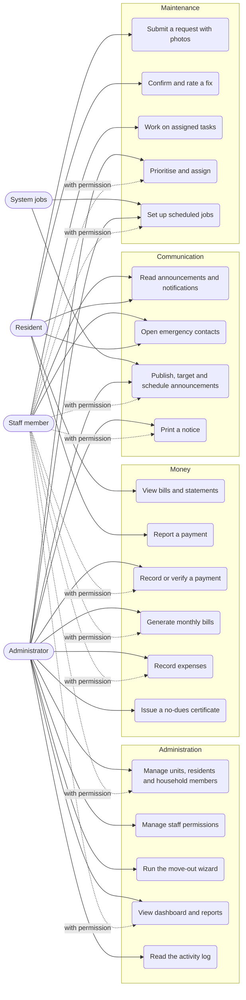
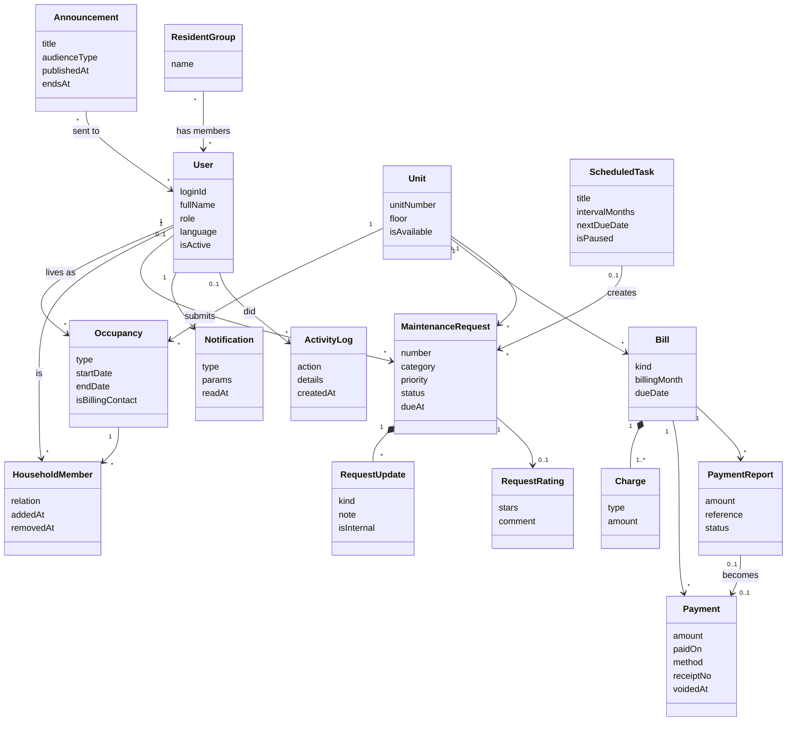
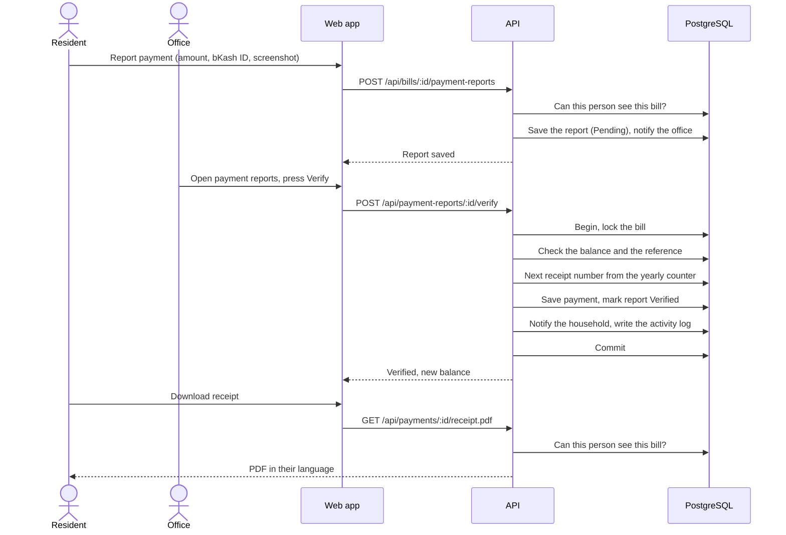
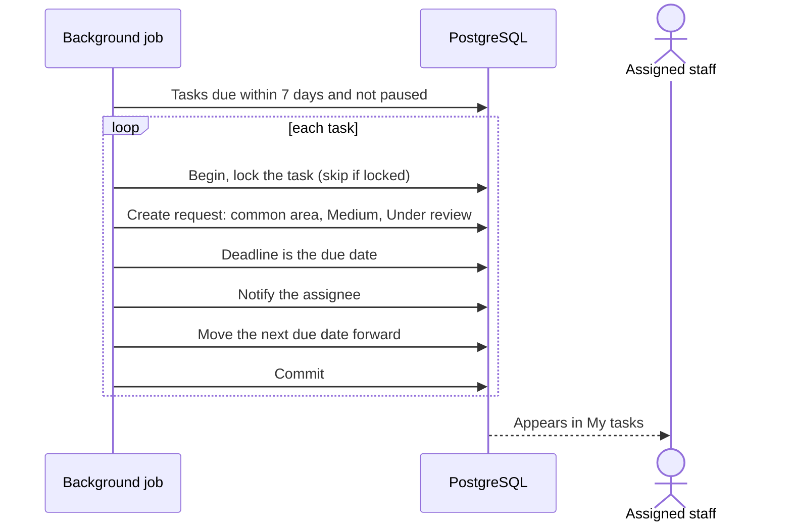
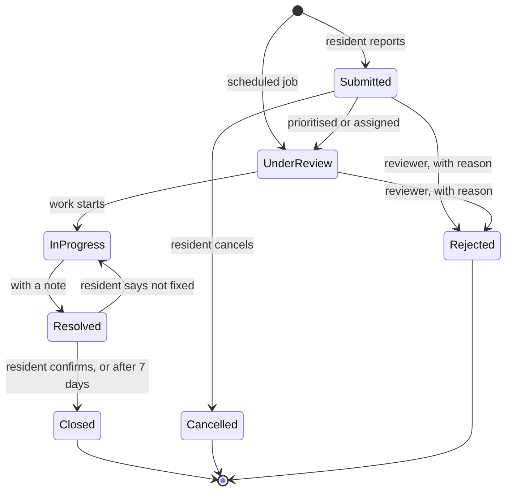
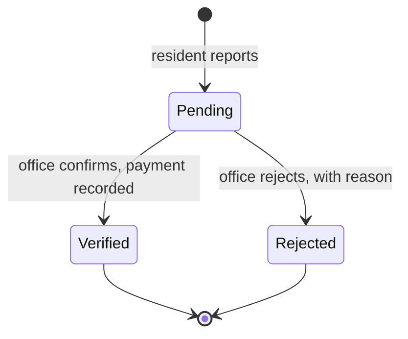
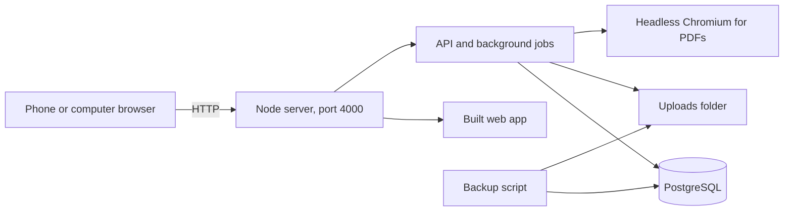

# Diagrams

These are written in Mermaid, so GitHub draws them and they stay easy to change. They show the system as built.

## Use cases

Mermaid has no use-case diagram, so this one uses a flowchart: people on the left, what they can do on the right. Household members can do what a resident does, except that they are never the billing contact.

## Classes

The main entities. Bill status, balances and who may see what are worked out from these rather than stored.

## Sequence: a resident's payment is verified

This is the path where mistakes cost the most. One transaction covers everything from the lock onwards, so a failure leaves nothing half done.

## Sequence: a scheduled job becomes a request

## State: a maintenance request

## State: a payment report

## Deployment

