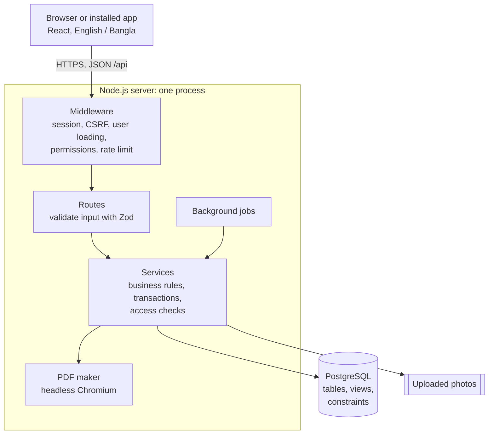
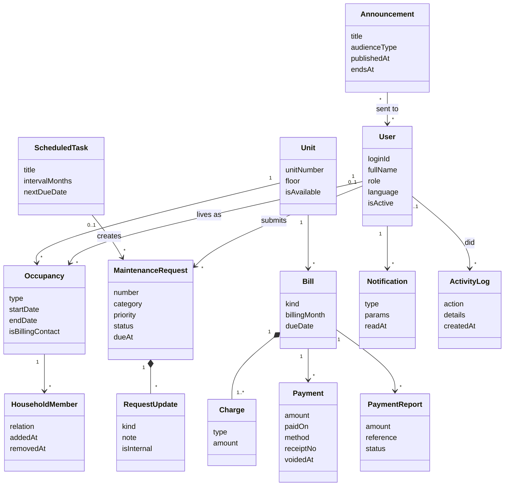
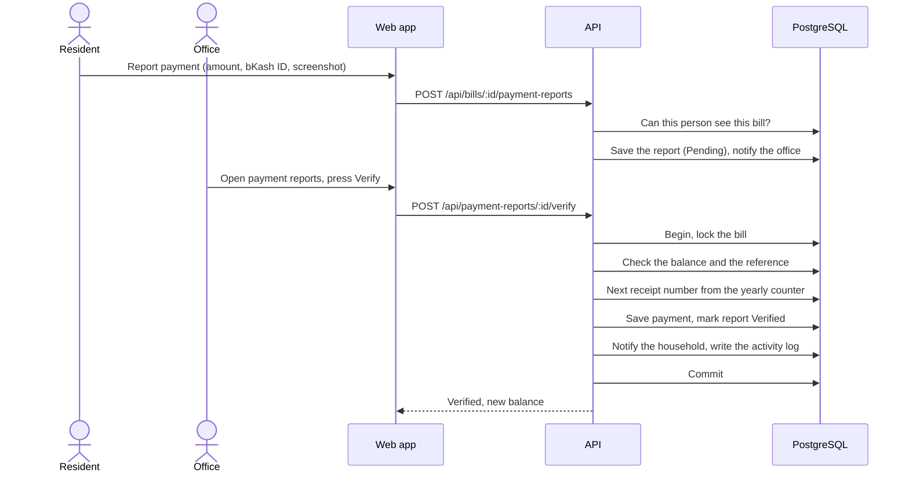
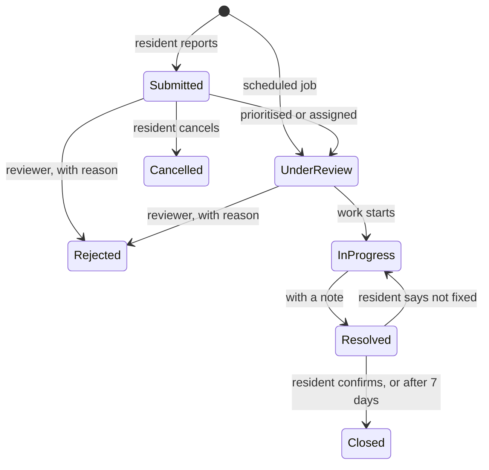
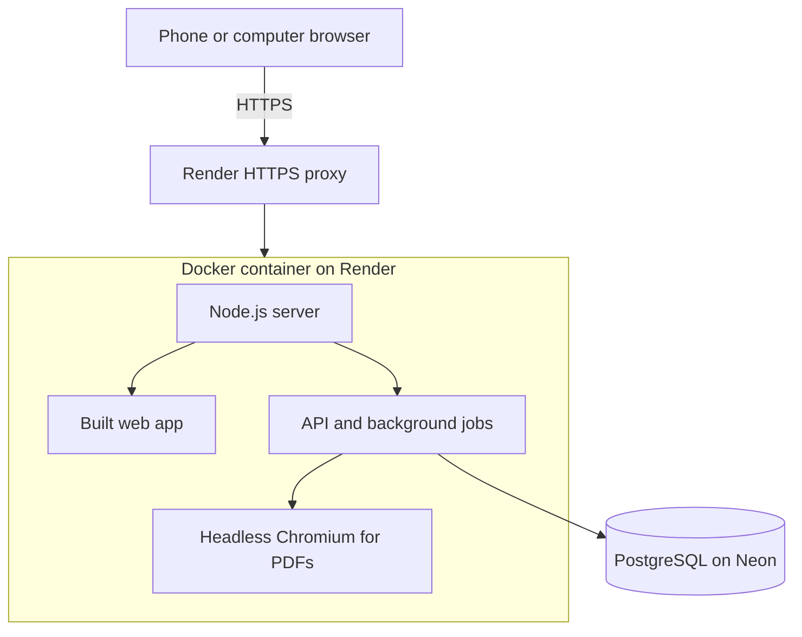

# 2. Software Design Specification (SDS)

This page describes how the system is built: its architecture, modules, data, interfaces, key algorithms and deployment. It describes the system **as built and deployed**. The full implementation specification is in [project_spec.md](https://github.com/srwrrr/Apartment-Management/blob/main/project_spec.md), and the requirements it satisfies are on the [SRS page](01-Software-Requirements-Specification).

## 2.1 Purpose and scope

The SRS states *what* the system must do: 58 functional requirements (29 Must, 19 Should, 10 Could), business rules (BR-xx) and quality targets (NFR-xx). This SDS states *how*: which parts the system is made of, how they communicate, how data is stored, and how the most important operations work. Requirement IDs (FR-xx, BR-xx, NFR-xx) are used throughout so every design decision can be traced back to a requirement.

## 2.2 System overview

The system is a **single-building web application** with three roles:

| Role | Uses the system to |
|---|---|
| Resident (owner, tenant, household member) | See bills and payment history, report payments, download receipts, report and follow repair problems, read notices |
| Staff | Work on assigned repair tasks; with extra permissions, handle billing, payments, residents or reports |
| Administrator / committee | Run the building: units, residents, billing, expenses, maintenance, announcements, reports, settings |

It is used mostly on phones, in English or Bangla, often on weak connections, so it is a **responsive, installable Progressive Web App** with an offline page.

## 2.3 Architecture

The system follows a **layered, modular client-server architecture** (explained in detail on the [Architectural Pattern page](04-Architectural-Pattern)).

| Tier | Technology | Responsibility |
|---|---|---|
| Presentation | React 18, TypeScript, Vite, TanStack Query, react-i18next, Tailwind CSS, vite-plugin-pwa | Screens, forms, client-side validation, English/Bangla text, offline page |
| Application | Node.js 22, Express, Zod, express-session, Helmet | HTTP API, authentication, permissions, business rules, transactions, PDFs, background jobs |
| Data | PostgreSQL 16+, Prisma ORM, SQL views and constraints | Persistent storage, integrity (unique keys, CHECK constraints), access views |
| Shared | `packages/shared` (TypeScript) | Validation schemas, permission list, money formatting and both languages' text, used by **both** client and server |

## 2.4 Module design

The server is divided into feature modules. Each module has a **routes** file (the HTTP interface) and one or more **service** files (business logic).

| Module | Main responsibilities | Requirements |
|---|---|---|
| `users` | Login, sessions, accounts, roles, staff permissions, residents, units, occupancy, household members, move-out, bulk CSV import, directory | FR-01–08, 31, 37, 42, 47, 54–56 |
| `billing` | Fees, opening balances, monthly bill generation, charges, payments, voids, payment reports, receipts, statements, no-dues certificates | FR-09–15, 32, 33, 39–41, 45, 46 |
| `expenses` | Building expenses, income vs expense report | FR-43, 44 |
| `maintenance` | Requests, photos, review, assignment, status updates, deadlines (SLA), ratings, scheduled jobs | FR-16–22, 35, 49, 50 |
| `announcements` | Announcements to everyone, units or groups, scheduling, printable notices, resident groups, emergency contacts | FR-23, 24, 36, 51–53 |
| `notifications` | In-app notifications, read status | FR-25, 26 |
| `reports` | Dashboard, collection and dues reports, committee PDF, CSV exports, global search | FR-15, 27–30, 38, 57, 58 |
| `activity` | Unchangeable activity log | FR-34 |
| `settings` | Building name, go-live date, default due day | used by FR-09, FR-41 |

Shared server services: `lib/` (database client, dates in Asia/Dhaka time, CSV, file checks, errors), `middleware/` (session, CSRF, authentication and permissions), `pdf/` (HTML to PDF with Chromium and embedded Bangla fonts) and `jobs/` (background jobs).

The web app mirrors this in `web/src/features/` (35 page components) with shared building blocks in `web/src/components/` (buttons, fields, dialogs, the month picker) and `web/src/lib/` (API client, formatting, translations).

## 2.5 Data design

The database has **29 tables** (Prisma models) and **4 SQL views**. The main entities and relationships:

**Key data decisions**

| Decision | Reason |
|---|---|
| Money is stored as **whole poisha** (integers), never decimals | No rounding errors in balances (BR-15) |
| A bill's **status and balance are calculated, not stored** (`bill_summary` view) | They can never disagree with the payments |
| **Who may see a unit's records** is defined once, in the `unit_access` view | Billing, maintenance and announcements all use the same rule, so they cannot drift apart (BR-08, BR-22, BR-27) |
| A unique key on (unit, billing month) | A unit can never get two regular bills for one month, even if two people generate at once (BR-07) |
| Receipt numbers come from a per-year counter row updated inside the payment transaction | Receipt numbers never repeat and have no gaps (BR-14) |
| Payments are **voided, never deleted** | The history stays complete for audits (BR-13) |

## 2.6 Interface design

### User interface

The UI is described on the [UI Design page](07-UI-Design). All pages work from 360 px phone width upwards (NFR-10), in English and Bangla (FR-47), and with a larger-text setting (FR-55).

### Application programming interface (HTTP)

The client talks to the server through a JSON API under `/api`. Every request passes through session, CSRF and user-loading middleware first.

| Area | Base path | Examples |
|---|---|---|
| Authentication | `/api/auth` | log in, log out, change password, current user |
| The signed-in user | `/api/me` | own profile, own bills and balance, own requests, preferences |
| Building | `/api/units`, `/api/residents`, `/api/occupancies`, `/api/household-members`, `/api/directory`, `/api/import` | manage units and residents, import CSV |
| Staff | `/api/staff`, `/api/users` | staff accounts and permissions, password resets |
| Money | `/api/fees`, `/api/bills`, `/api/charges`, `/api/payments`, `/api/payment-reports`, `/api/certificates`, `/api/expenses` | generate bills, record and void payments, receipts, certificates |
| Maintenance | `/api/requests`, `/api/scheduled-tasks`, `/api/attachments` | requests, status changes, photos, scheduled jobs |
| Communication | `/api/announcements`, `/api/groups`, `/api/emergency-contacts`, `/api/notifications` | notices, groups, notifications |
| Overview | `/api/dashboard`, `/api/reports`, `/api/search`, `/api/activity`, `/api/settings` | dashboard, reports, CSV and PDF exports, search, activity log |

**Conventions:** input is validated with the same Zod schemas the web app uses. Errors have one shape, `{ "error": { "code": "...", "fields": { ... } } }`, and the web app turns the code into a plain-language message in the user's language (NFR-11). A record the user may not see returns **404, not 403**, so record IDs cannot be probed (NFR-24).

## 2.7 Key algorithms and behaviour

### Generating monthly bills (FR-09)

1. The administrator picks a month and presses **Preview**. Nothing is saved yet.
2. The server lists every occupied, available unit. Each gets the building's default fees, with the unit's own fees replacing the same charge type.
3. Units already billed for the month, empty units and units with no fees are **skipped, with a reason**, and shown in the preview.
4. On **Confirm**, all bills, charges, notifications to billing contacts and the activity-log entry are saved in **one transaction**. If anything fails, nothing is saved (NFR-14).

### Recording a payment (FR-11)

1. The bill row is **locked**, so two cashiers cannot pay the same bill at the same moment.
2. The amount is checked against the current balance; overpaying is refused with the exact balance (BR-11).
3. A reused bKash/Nagad/bank transaction ID triggers a warning, and the payment is saved only if the cashier confirms.
4. The next receipt number comes from the yearly counter, then the payment, notifications and activity log are saved together.

The full flow for a payment reported by a resident and verified by the office:

### Maintenance request life cycle (BR-16)

### Background jobs

Jobs start with the server and repeat on a timer: hourly for request auto-closing, bill reminders and scheduled maintenance, and every five minutes for scheduled announcements. Each job is safe to run twice: running it again does nothing new. So if the server was asleep or restarted, the next run simply catches up.

## 2.8 Security design

| Threat | Design |
|---|---|
| Stolen or guessed passwords | bcrypt hashing (cost 12), login rate limiting, temporary passwords that must be changed (NFR-01, FR-31) |
| Session theft | Server-side sessions stored in PostgreSQL, HTTP-only and Secure cookies, a 30-minute inactivity timeout (NFR-03) |
| Cross-site request forgery | A CSRF token is required on every change (NFR-05) |
| Seeing other people's data | Permission checks on every route, plus record-level checks through the `unit_access` view; 404 for records you may not see (NFR-02, NFR-24) |
| Malicious uploads | File type checked from the file's real content, size and count limits, random stored names (BR-19, NFR-06) |
| Browser attacks | Helmet security headers and a strict Content Security Policy (NFR-07) |

## 2.9 Deployment design

On every start, the container applies any new database migrations, makes sure the demo accounts exist, and serves the API and the web app on one port. Backup and restore scripts for a self-hosted install are in `scripts/` and tested in [docs/backup-and-restore.md](https://github.com/srwrrr/Apartment-Management/blob/main/docs/backup-and-restore.md).

More diagrams (use cases, full class diagram, a scheduled-job sequence and the payment-report state model) are in [docs/diagrams](https://github.com/srwrrr/Apartment-Management/blob/main/docs/diagrams/README.md).
