# 2. Software Design Specification (SDS)

This page describes how the system is built: its architecture, modules, data, interfaces, key algorithms and deployment. It describes the system **as built and deployed**. The full implementation specification is in [project_spec.md](https://github.com/srwrrr/Apartment-Management/blob/main/project_spec.md), the core requirements are on the [SRS page](01-Software-Requirements-Specification), and every requirement ID used below is listed in the full [docs/SRS.md](https://github.com/srwrrr/Apartment-Management/blob/main/docs/SRS.md).

## 2.1 Purpose and scope

The SRS states *what* the system must do: functional requirements (FR-xx), business rules (BR-xx) and quality targets (NFR-xx). This SDS states *how*: which parts the system is made of, how they communicate, how data is stored, and how the most important operations work. Requirement IDs (FR-xx, BR-xx, NFR-xx) are used throughout so every design decision can be traced back to a requirement.

## 2.2 System overview

The system is a **single-building web application** with three roles:

| Role | Uses the system to |
|---|---|
| Resident (owner, tenant, household member) | See bills and payment history, report payments, download receipts, report and follow repair problems, read notices |
| Staff | Work on assigned repair tasks; with extra permissions, handle billing, payments, residents or reports |
| Administrator / committee | Run the building: units, residents, billing, expenses, maintenance, announcements, reports, settings |

It is used mostly on phones, in English or Bangla, often on weak connections, so it is a **responsive, installable Progressive Web App** with an offline page.

## 2.3 Architecture

The system follows a **layered, modular client-server architecture** (explained in detail on the [Architectural Pattern page](04-Architectural-Pattern)).

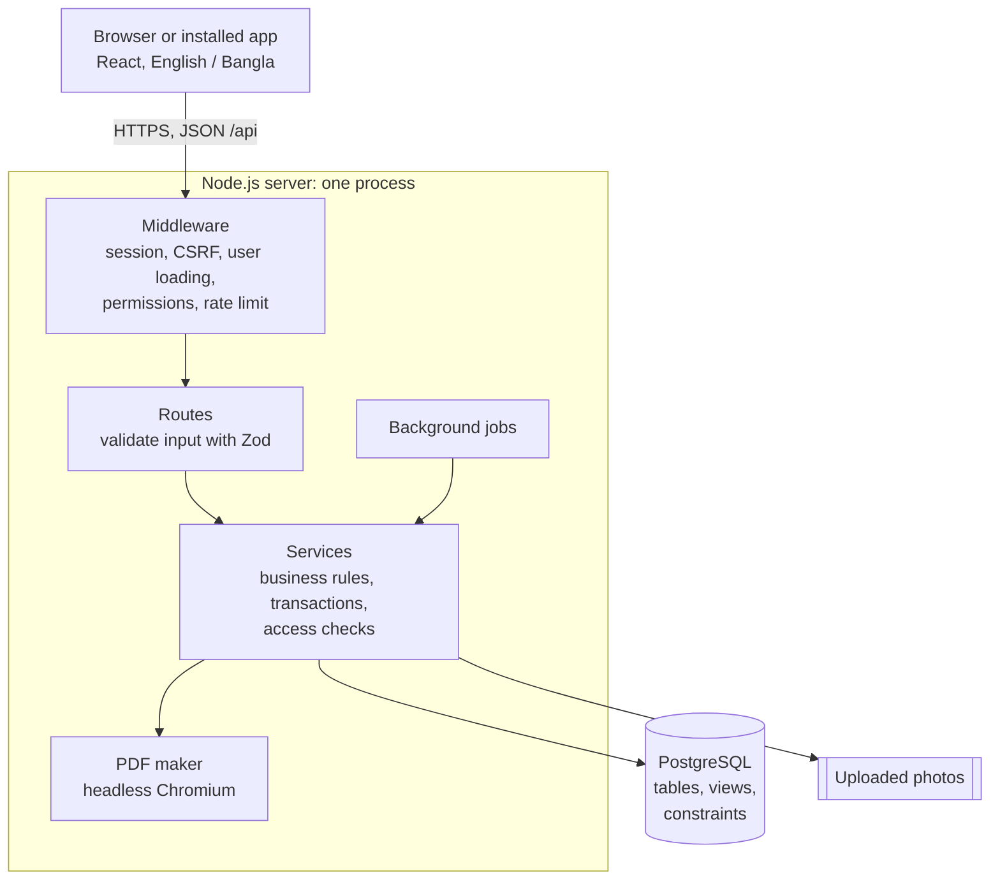

| Tier | Technology | Responsibility |
|---|---|---|
| Presentation | React 18, TypeScript, Vite, TanStack Query, react-i18next, Tailwind CSS, vite-plugin-pwa | Screens, forms, client-side validation, English/Bangla text, offline page |
| Application | Node.js 22, Express, Zod, express-session, Helmet | HTTP API, authentication, permissions, business rules, transactions, PDFs, background jobs |
| Data | PostgreSQL 16+, Prisma ORM, SQL views and constraints | Persistent storage, integrity (unique keys, CHECK constraints), access views |
| Shared | `packages/shared` (TypeScript) | Validation schemas, permission list, money formatting and both languages' text, used by **both** client and server |

## 2.4 Module design

The server is divided into feature modules. Each module has a **routes** file (the HTTP interface) and one or more **service** files (business logic).

| Module | Main responsibilities | Requirements |
|---|---|---|
| `users` | Login, sessions, accounts, roles, staff permissions, residents, units, occupancy, household members, move-out, bulk CSV import, directory | FR-01–08, 31, 37, 42, 47, 54–56 |
| `billing` | Fees, opening balances, monthly bill generation, charges, payments, voids, payment reports, receipts, statements, no-dues certificates | FR-09–15, 32, 33, 39–41, 45, 46 |
| `expenses` | Building expenses, income vs expense report | FR-43, 44 |
| `maintenance` | Requests, photos, review, assignment, status updates, deadlines (SLA), ratings, scheduled jobs | FR-16–22, 35, 49, 50 |
| `announcements` | Announcements to everyone, units or groups, scheduling, printable notices, resident groups, emergency contacts | FR-23, 24, 36, 51–53 |
| `notifications` | In-app notifications, read status | FR-25, 26 |
| `reports` | Dashboard, collection and dues reports, committee PDF, CSV exports, global search | FR-15, 27–30, 38, 57, 58 |
| `activity` | Unchangeable activity log | FR-34 |
| `settings` | Building name, go-live date, default due day | used by FR-09, FR-41 |

Shared server services: `lib/` (database client, dates in Asia/Dhaka time, CSV, file checks, errors), `middleware/` (session, CSRF, authentication and permissions), `pdf/` (HTML to PDF with Chromium and embedded Bangla fonts) and `jobs/` (background jobs).

The web app mirrors this in `web/src/features/` (35 page components) with shared building blocks in `web/src/components/` (buttons, fields, dialogs, the month picker) and `web/src/lib/` (API client, formatting, translations).

## 2.5 Data design

The database has **29 tables** (Prisma models) and **4 SQL views**. The main entities and relationships:

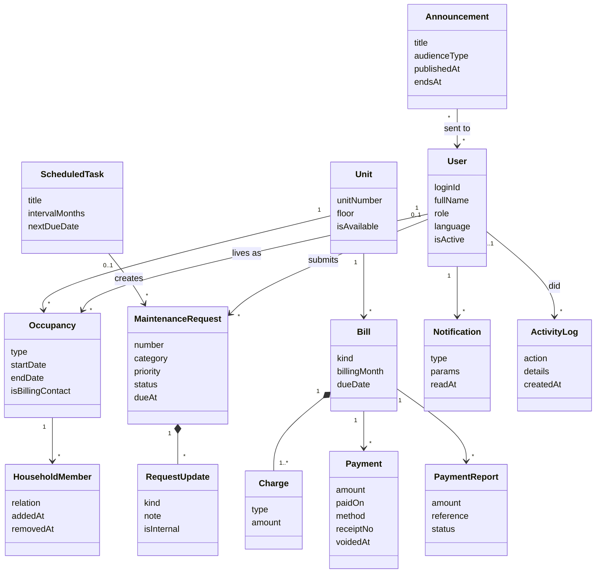

**Key data decisions**

| Decision | Reason |
|---|---|
| Money is stored as **whole poisha** (integers), never decimals | No rounding errors in balances (BR-15) |
| A bill's **status and balance are calculated, not stored** (`bill_summary` view) | They can never disagree with the payments |
| **Who may see a unit's records** is defined once, in the `unit_access` view | Billing, maintenance and announcements all use the same rule, so they cannot drift apart (BR-08, BR-22, BR-27) |
| A unique key on (unit, billing month) | A unit can never get two regular bills for one month, even if two people generate at once (BR-07) |
| Receipt numbers come from a per-year counter row updated inside the payment transaction | Receipt numbers never repeat and have no gaps (BR-14) |
| Payments are **voided, never deleted** | The history stays complete for audits (BR-13) |

## 2.6 Interface design

### User interface

The UI is described on the [UI Design page](07-UI-Design). All pages work from 360 px phone width upwards (NFR-10), in English and Bangla (FR-47), and with a larger-text setting (FR-55).

### Application programming interface (HTTP)

The client talks to the server through a JSON API under `/api`. Every request passes through session, CSRF and user-loading middleware first.

| Area | Base path | Examples |
|---|---|---|
| Authentication | `/api/auth` | log in, log out, change password, current user |
| The signed-in user | `/api/me` | own profile, own bills and balance, own requests, preferences |
| Building | `/api/units`, `/api/residents`, `/api/occupancies`, `/api/household-members`, `/api/directory`, `/api/import` | manage units and residents, import CSV |
| Staff | `/api/staff`, `/api/users` | staff accounts and permissions, password resets |
| Money | `/api/fees`, `/api/bills`, `/api/charges`, `/api/payments`, `/api/payment-reports`, `/api/certificates`, `/api/expenses` | generate bills, record and void payments, receipts, certificates |
| Maintenance | `/api/requests`, `/api/scheduled-tasks`, `/api/attachments` | requests, status changes, photos, scheduled jobs |
| Communication | `/api/announcements`, `/api/groups`, `/api/emergency-contacts`, `/api/notifications` | notices, groups, notifications |
| Overview | `/api/dashboard`, `/api/reports`, `/api/search`, `/api/activity`, `/api/settings` | dashboard, reports, CSV and PDF exports, search, activity log |

**Conventions:** input is validated with the same Zod schemas the web app uses. Errors have one shape, `{ "error": { "code": "...", "fields": { ... } } }`, and the web app turns the code into a plain-language message in the user's language (NFR-11). A record the user may not see returns **404, not 403**, so record IDs cannot be probed (NFR-24).

## 2.7 Key algorithms and behaviour

### Generating monthly bills (FR-09)

1. The administrator picks a month and presses **Preview**. Nothing is saved yet.
2. The server lists every occupied, available unit. Each gets the building's default fees, with the unit's own fees replacing the same charge type.
3. Units already billed for the month, empty units and units with no fees are **skipped, with a reason**, and shown in the preview.
4. On **Confirm**, all bills, charges, notifications to billing contacts and the activity-log entry are saved in **one transaction**. If anything fails, nothing is saved (NFR-14).

### Recording a payment (FR-11)

1. The bill row is **locked**, so two cashiers cannot pay the same bill at the same moment.
2. The amount is checked against the current balance; overpaying is refused with the exact balance (BR-11).
3. A reused bKash/Nagad/bank transaction ID triggers a warning, and the payment is saved only if the cashier confirms.
4. The next receipt number comes from the yearly counter, then the payment, notifications and activity log are saved together.

The full flow for a payment reported by a resident and verified by the office:

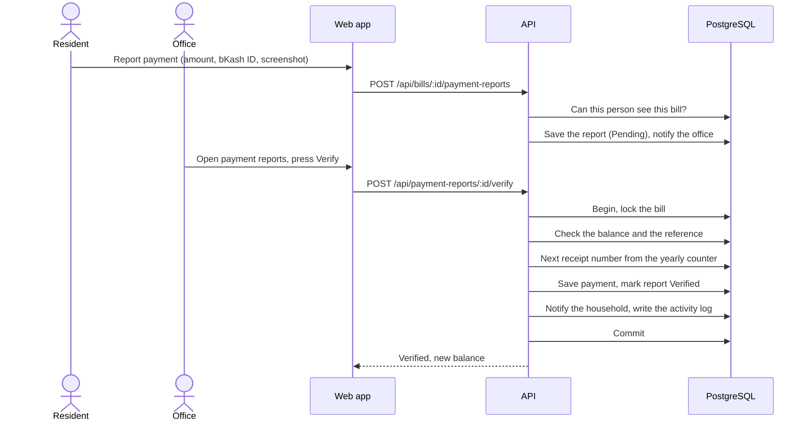

### Maintenance request life cycle (BR-16)

The states of a maintenance request and the moves between them are shown in section 2.11.

### Background jobs

Jobs start with the server and repeat on a timer: hourly for request auto-closing, bill reminders and scheduled maintenance, and every five minutes for scheduled announcements. Each job is safe to run twice: running it again does nothing new. So if the server was asleep or restarted, the next run simply catches up.

## 2.8 Security design

| Threat | Design |
|---|---|
| Stolen or guessed passwords | bcrypt hashing (cost 12), login rate limiting, temporary passwords that must be changed (NFR-01, FR-31) |
| Session theft | Server-side sessions stored in PostgreSQL, HTTP-only and Secure cookies, a 30-minute inactivity timeout (NFR-03) |
| Cross-site request forgery | A CSRF token is required on every change (NFR-05) |
| Seeing other people's data | Permission checks on every route, plus record-level checks through the `unit_access` view; 404 for records you may not see (NFR-02, NFR-24) |
| Malicious uploads | File type checked from the file's real content, size and count limits, random stored names (BR-19, NFR-06) |
| Browser attacks | Helmet security headers and a strict Content Security Policy (NFR-07) |

## 2.9 Deployment design

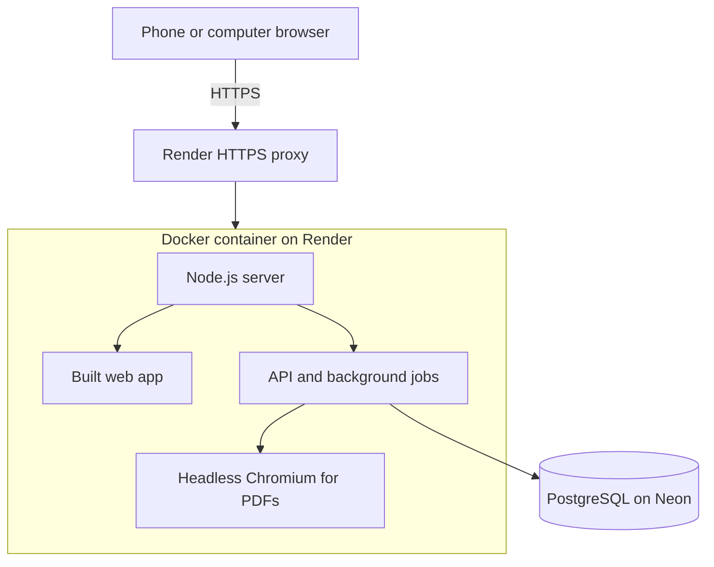

On every start, the container applies any new database migrations, makes sure the demo accounts exist, and serves the API and the web app on one port. Backup and restore scripts for a self-hosted install are in `scripts/` and tested in [docs/backup-and-restore.md](https://github.com/srwrrr/Apartment-Management/blob/main/docs/backup-and-restore.md).

More diagrams (the full class diagram and sequence diagrams) are in [docs/diagrams](https://github.com/srwrrr/Apartment-Management/blob/main/docs/diagrams/README.md).

## 2.10 Use case model

### Use case diagram

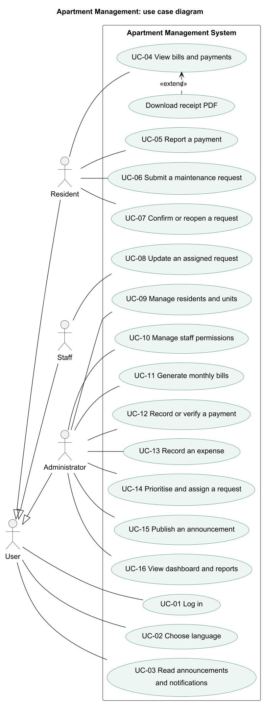

Resident, Staff and Administrator are all kinds of User, so all three can log in, choose a language and read announcements. Staff can also carry out the administrator's use cases that the administrator has given them permission for (for example UC-12 with `payments.record`). The diagram source is [docs/diagrams/use-case-diagram.puml](https://github.com/srwrrr/Apartment-Management/blob/main/docs/diagrams/use-case-diagram.puml).

### Use case narratives

> **TO COMPLETE:** write the **Main flow** of each use case in your own words, as numbered steps (what the actor does, what the system does). Delete this note when done.

#### UC-01 Log in

| Item | Details |
|---|---|
| Actor | User (Resident, Staff or Administrator) |
| Related requirement | FR-01, BR-02 |
| Precondition | The user has an active account. |
| Main flow | [Write the steps in your own words] |
| Alternative flows | Wrong login ID or password: one general error, nothing says which part was wrong. Five wrong attempts in a row: the account is locked for 15 minutes. Deactivated account: login refused. Temporary password: the user must set a new password before anything else. |
| Postcondition | The user is logged in and sees the home page for their role. |

#### UC-02 Choose language

| Item | Details |
|---|---|
| Actor | User |
| Related requirement | FR-47, BR-28 |
| Precondition | None (the switch is on the login page and in the user menu). |
| Main flow | [Write the steps in your own words] |
| Alternative flows | Text that users typed (names, descriptions) stays as entered; only the interface is translated. |
| Postcondition | The interface is shown in English or Bangla, and a logged-in user's choice is saved to their account. |

#### UC-03 Read announcements and notifications

| Item | Details |
|---|---|
| Actor | User |
| Related requirement | FR-23, FR-25, FR-26 |
| Precondition | The user is logged in. |
| Main flow | [Write the steps in your own words] |
| Alternative flows | Nothing new: an empty list is shown. Announcement past its end time: it appears under past announcements. |
| Postcondition | Opened notifications are marked as read; the unread count on the bell goes down. |

#### UC-04 View bills and payments

| Item | Details |
|---|---|
| Actor | Resident |
| Related requirement | FR-13, FR-14, BR-08 |
| Precondition | The resident is logged in and has, or had, an occupancy in a unit. |
| Main flow | [Write the steps in your own words] |
| Extension point | **Download receipt PDF**: for any payment on a bill the resident can see. |
| Alternative flows | No bills yet: an empty list is shown. A bill of another unit opened by changing the address: "not found". |
| Postcondition | Nothing changes; this use case only reads data. |

#### UC-05 Report a payment

| Item | Details |
|---|---|
| Actor | Resident |
| Related requirement | FR-39, BR-21 |
| Precondition | The resident can see a bill that still has a balance. |
| Main flow | [Write the steps in your own words] |
| Alternative flows | Amount more than the balance minus other pending reports: refused. Missing transaction ID or date: the form shows the field to fix. Screenshot of the wrong type or over 5 MB: refused. |
| Postcondition | A report is saved as **Pending**; the bill balance does not change until the office verifies it; the office is notified. |

#### UC-06 Submit a maintenance request

| Item | Details |
|---|---|
| Actor | Resident |
| Related requirement | FR-16, FR-17, BR-19 |
| Precondition | The resident is logged in and lives in a unit. |
| Main flow | [Write the steps in your own words] |
| Alternative flows | Missing title, description or category: the form shows which. More than 3 photos, or a photo of the wrong type or over 5 MB: refused. Resident with more than one unit: chooses the unit. |
| Postcondition | The request is saved as **Submitted** with a request number; the administrator is notified. |

#### UC-07 Confirm or reopen a request

| Item | Details |
|---|---|
| Actor | Resident |
| Related requirement | FR-35, FR-50, BR-18, BR-26 |
| Precondition | The resident's own request is **Resolved**. |
| Main flow | [Write the steps in your own words] |
| Alternative flows | No action for 7 days: the request closes automatically. Reopen: a comment is required and the request goes back to **In progress**. Optional 1–5 star rating when confirming. |
| Postcondition | The request is **Closed**, or back **In progress**. |

#### UC-08 Update an assigned request

| Item | Details |
|---|---|
| Actor | Staff |
| Related requirement | FR-20 |
| Precondition | The request is assigned to this staff member. |
| Main flow | [Write the steps in your own words] |
| Alternative flows | Marking it **Resolved** without a resolution note: refused. A note marked internal: hidden from the resident. Moves not allowed by the state diagram (2.11) are not offered. |
| Postcondition | The update is saved with the date, time and name; the resident is notified of status changes. |

#### UC-09 Manage residents and units

| Item | Details |
|---|---|
| Actor | Administrator (or staff with `residents.manage` / `units.manage`) |
| Related requirement | FR-03, FR-04, FR-05, BR-04, BR-06 |
| Precondition | The administrator is logged in. |
| Main flow | [Write the steps in your own words] |
| Alternative flows | Unit number already used, or login ID already used: refused with the field shown. Overlapping occupancy or end date before start date: refused. Deactivating a resident: their history is kept. |
| Postcondition | The record is saved; a new resident gets a temporary password; the change is in the activity log. |

#### UC-10 Manage staff permissions

| Item | Details |
|---|---|
| Actor | Administrator |
| Related requirement | FR-06 |
| Precondition | The administrator is logged in. |
| Main flow | [Write the steps in your own words] |
| Alternative flows | Deactivating a staff member: they are logged out and can no longer log in. |
| Postcondition | The new permissions apply from the staff member's next action, without logging out. |

#### UC-11 Generate monthly bills

| Item | Details |
|---|---|
| Actor | Administrator (or staff with `billing.manage`) |
| Related requirement | FR-09, BR-07, BR-10 |
| Precondition | Fees are set up and there are occupied units. |
| Main flow | [Write the steps in your own words] |
| Alternative flows | A unit already billed for that month, unavailable, or with no fees: skipped, with the reason shown in the preview. Any failure while saving: no bills are created. |
| Postcondition | One bill per occupied unit for the month; billing contacts are notified. |

#### UC-12 Record or verify a payment

| Item | Details |
|---|---|
| Actor | Administrator (or staff with `payments.record`) |
| Related requirement | FR-11, FR-40, BR-11, BR-14 |
| Precondition | The bill has a balance, or a resident's payment report is pending. |
| Main flow | [Write the steps in your own words] |
| Alternative flows | Amount zero, negative or above the balance: refused, with the balance shown. Date in the future: refused. Reference already used: a warning. Rejecting a report: a reason is required and the resident sees it. |
| Postcondition | The payment is saved with a receipt number; the bill balance and status update; the resident is notified. |

#### UC-13 Record an expense

| Item | Details |
|---|---|
| Actor | Administrator (or staff with `expenses.manage`) |
| Related requirement | FR-43, BR-23 |
| Precondition | The administrator is logged in. |
| Main flow | [Write the steps in your own words] |
| Alternative flows | Missing amount, date, category or payee: the form shows which. A wrong expense: voided with a reason, never deleted. |
| Postcondition | The expense is saved and appears in the expense list and the income and expense report. |

#### UC-14 Prioritise and assign a request

| Item | Details |
|---|---|
| Actor | Administrator (or staff with `maintenance.review` / `maintenance.assign`) |
| Related requirement | FR-18, FR-19, BR-17 |
| Precondition | A request is **Submitted** or **Under review**. |
| Main flow | [Write the steps in your own words] |
| Alternative flows | Rejecting the request: a reason is required and the resident is notified. Reassigning: the assignment history is kept. |
| Postcondition | The request is **Under review** with a priority and an assigned staff member, who is notified. |

#### UC-15 Publish an announcement

| Item | Details |
|---|---|
| Actor | Administrator (or staff with `announcements.manage`) |
| Related requirement | FR-23, FR-24, FR-51 |
| Precondition | The administrator is logged in. |
| Main flow | [Write the steps in your own words] |
| Alternative flows | Missing title or message: the form shows which. A future publish time: hidden, with no notifications, until then. |
| Postcondition | The audience can see the announcement and gets a notification. |

#### UC-16 View dashboard and reports

| Item | Details |
|---|---|
| Actor | Administrator (or staff with `reports.view`) |
| Related requirement | FR-15, FR-27, FR-28, FR-29 |
| Precondition | The administrator is logged in. |
| Main flow | [Write the steps in your own words] |
| Alternative flows | No data for the chosen period: the figures show zero. The report can be exported as CSV or printed. |
| Postcondition | Nothing changes; this use case only reads data. |

## 2.11 State diagrams

### Maintenance request

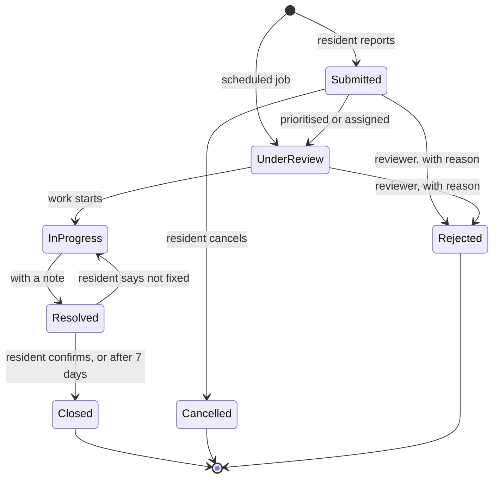

### Bill

A bill's status is never typed in; it is calculated from the balance and the due date (BR-09).

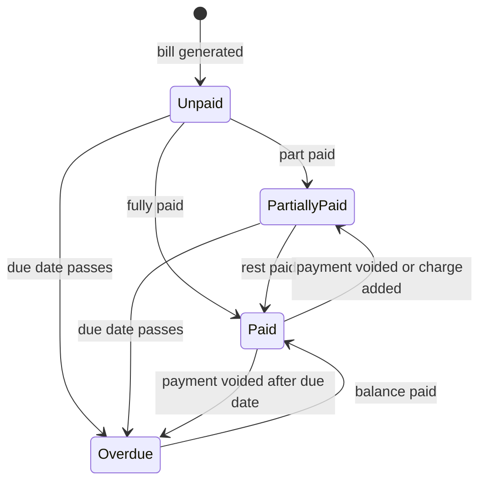

### Payment report

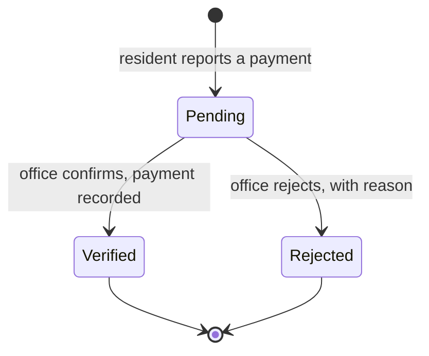

### User account

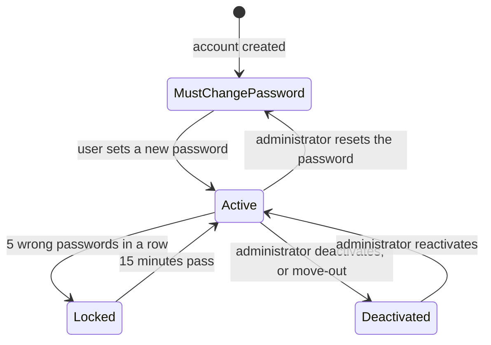

## 2.12 Data flow diagrams

### DFD Level 0 (context diagram)

The whole system is one process. It exchanges data with three external entities.

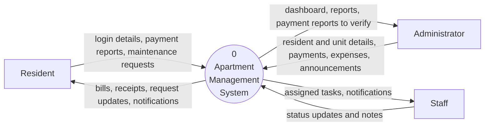

### DFD Level 1

The same system split into its main processes and data stores.

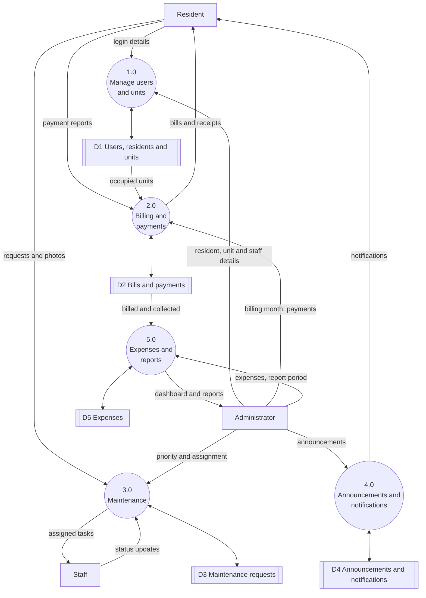
