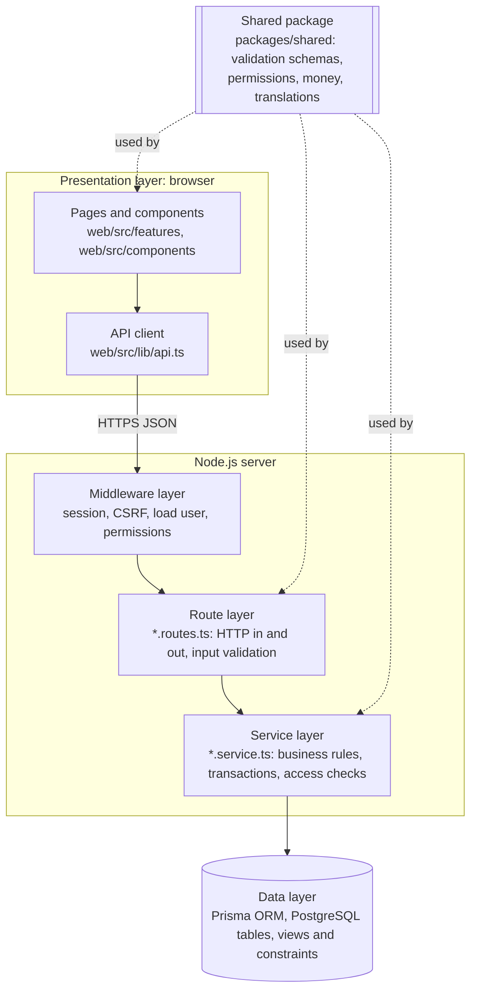

# 4. Architectural Pattern

## 4.1 The pattern

The system uses a **layered architecture inside a client-server system**, organised into **feature modules** (often called a *modular monolith*).

- **Client-server:** a React single-page app in the browser (the client) talks to one Node.js/Express server over HTTPS using JSON. The server owns all data and all business rules. The client only shows data and collects input.
- **Layered:** inside the server, every request passes through the same layers in order. Each layer has one job and only talks to the layer directly below it.
- **Modular:** the code is split by business area (users, billing, maintenance, announcements and so on). Each module has its own routes and services, so a change to billing stays inside the billing folder.



## 4.2 Why this pattern

| Need (from the SRS) | How the pattern meets it |
|---|---|
| Residents use phones and computers; the office uses a computer (NFR-10) | Client-server with a web client: one code base works on every device, with nothing to install, and it can still be installed as an app (FR-48) |
| Money and permissions must be right every time (BR-09 to BR-15, NFR-02) | All rules run on the server, in the service layer. The client cannot skip them, even if someone edits the page in the browser. |
| Changes to several records must be all-or-nothing (NFR-14) | Only the service layer opens database transactions, so every multi-step change has exactly one place that controls it |
| The same validation in the form and on the server (NFR-11) | The shared package holds one Zod schema per input, used by both client and server |
| A student team working in parallel | Feature modules give each person a clear area (for example billing or maintenance) with few merge conflicts |
| Simple to run, deploy and demonstrate (budget ৳0) | One server process serves the API and the web app. A microservice design would add network calls, deployments and failure points without any benefit at this size. |

**Alternatives considered:** *MVC with server-rendered pages* would make an installable, offline-capable phone app harder. *Microservices* would be far more complex to run and deploy for one building's data. A *serverless* back end would complicate transactions, sessions and PDF generation with a browser engine.

## 4.3 How it is implemented

The rules, which every module follows:

1. **Routes never contain business logic.** They check the user's permission, validate the input with a shared schema, call one service function and return its result.
2. **Services never touch HTTP** (`req` and `res`). They receive plain values and the acting user, so they can be called from a route, a background job or a test.
3. **Every multi-record change runs in one database transaction**, including the notifications and activity-log entries it creates.
4. **Record access is decided in one place**, the `unit_access` database view, so every module answers "may this person see this unit's records?" the same way.

### Example: recording a payment, layer by layer

**Presentation layer** (`web/src/features/BillDetailPage.tsx`): the page converts the typed amount to poisha and sends it to the API. It knows nothing about balances or receipt numbers.

```tsx
const save = useMutation({
  mutationFn: (confirm: boolean) =>
    api.post<{ paymentId: string; bill: BillDetail }>(`/api/bills/${bill.id}/payments`, {
      amount: parseTaka(amount),
      paidOn,
      method,
      reference: reference.trim(),
      confirm: confirm || undefined,
    }),
  onError: (e) => {
    // The same transaction ID was used before: ask, rather than guess.
    if (e instanceof ApiError && e.code === 'DUPLICATE_REFERENCE') setDuplicate(true);
  },
});
```

**Shared package** (`packages/shared/src/validation.ts`): one definition of a valid payment, used by both the form and the server.

```ts
export const poishaSchema = z.number().int().positive().max(MAX_POISHA);

export const paymentInputSchema = z.object({
  amount: poishaSchema,
  paidOn: ymdSchema,
  method: z.enum(PAYMENT_METHODS),
  reference: z.preprocess(emptyToUndefined, z.string().trim().max(40).optional()),
  confirm: z.boolean().optional(),
});
```

**Middleware and route layers** (`server/src/modules/billing/billing.routes.ts`): the permission check, then input validation, then one service call.

```ts
billsRouter.post(
  '/:id/payments',
  requirePermission('payments.record'),
  asyncHandler(async (req, res) =>
    res.status(201).json(await recordPayment(param(req.params.id), paymentInputSchema.parse(req.body), req.user!))),
);
```

**Service layer** (`server/src/modules/billing/payments.service.ts`): the business rules, inside one transaction.

```ts
export async function recordPayment(billId: string, input: PaymentInput, actor: Actor) {
  const paymentId = await prisma.$transaction((tx) => recordPaymentIn(tx, billId, input, actor));
  return { paymentId, bill: await getBill(billId) };
}

// inside recordPaymentIn(tx, ...):
await lockBill(tx, billId);                       // two cashiers cannot pay at the same moment
const s = await summaryFor(tx, billId);
if (input.amount > s.balance) {                   // BR-11: never more than the balance
  throw new ApiError(400, 'VALIDATION_FAILED', { amount: { code: 'AMOUNT_EXCEEDS_BALANCE', params: { balance: s.balance } } });
}
```

**Data layer** (PostgreSQL): constraints back up the service rules. For example, a unique key stops a unit getting two bills for the same month (BR-07), and the `bill_summary` view calculates each bill's paid amount, balance and status from its charges and payments, so they are never stored twice.

## 4.4 Folder structure that reflects the layers

```
packages/shared/src/      shared: validation.ts, permissions.ts, money.ts, locales/en.json, locales/bn.json
server/src/
  middleware/             session.ts, csrf.ts, auth.ts (requireAuth, requirePermission)
  modules/
    billing/              billing.routes.ts, bills.service.ts, payments.service.ts, ...
    maintenance/          maintenance.routes.ts, requests.service.ts, scheduledTasks.service.ts, sla.ts
    users/ announcements/ notifications/ reports/ expenses/ activity/ settings/
  lib/                    prisma.ts, errors.ts, dates.ts, csv.ts, files.ts
  pdf/                    render.ts, fonts.ts
  jobs/                   index.ts
server/prisma/            schema.prisma, migrations/ (tables, views, constraints)
web/src/
  features/               one page component per screen (BillDetailPage.tsx, ...)
  components/             shared UI (ui.tsx, MonthInput.tsx, ...)
  lib/                    api.ts, format.ts, i18n.ts
```
