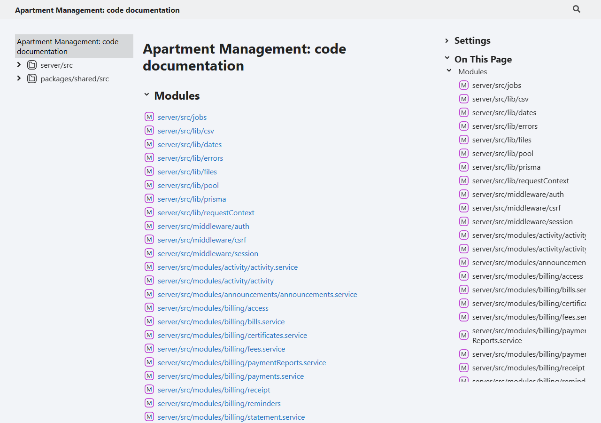
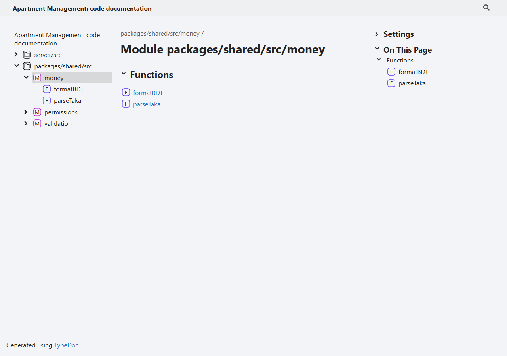
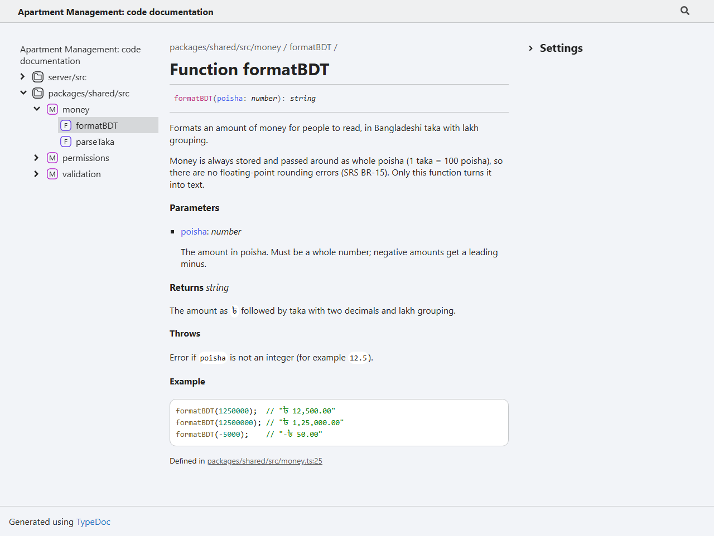
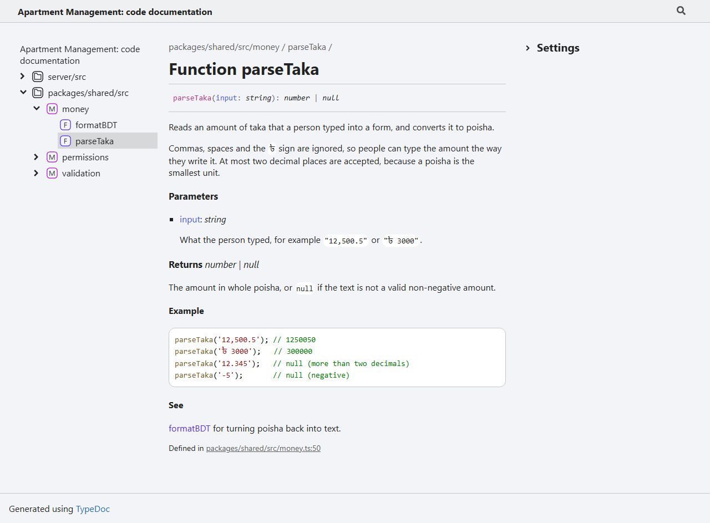
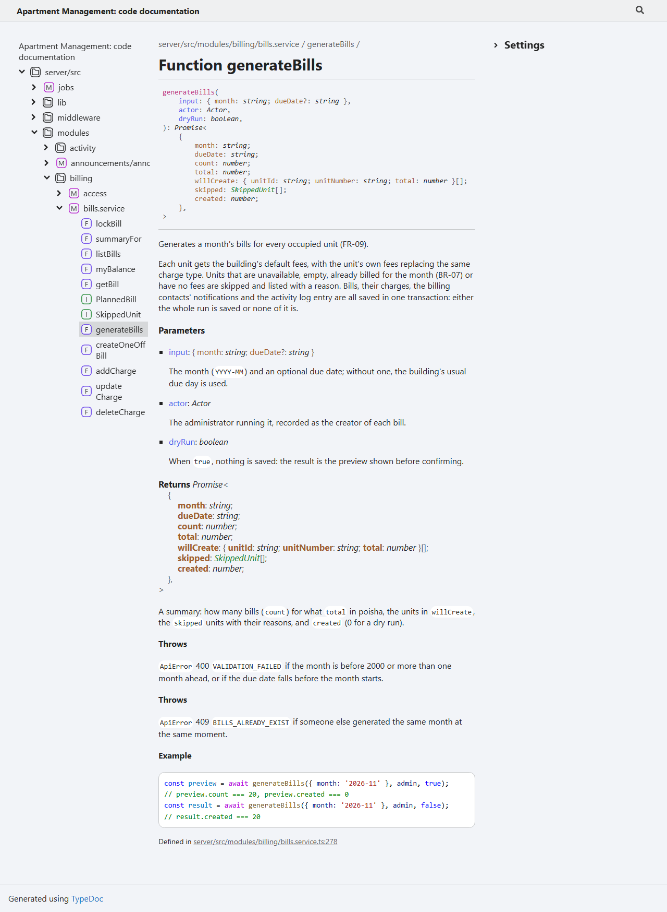

# 6. Source Code Documentation Tool: TypeDoc

## 6.1 The tool

The project uses **[TypeDoc](https://typedoc.org)** (version 0.28), the standard documentation generator for TypeScript. It reads the code and its **TSDoc comments** (`/** ... */` blocks written above functions, types and constants) and generates a searchable HTML website. It also uses the TypeScript types themselves: parameter types, return types and optional values appear in the documentation automatically, so the comments only need to explain meaning and behaviour.

**Why TypeDoc:** the whole project is TypeScript. JSDoc (for plain JavaScript) cannot read TypeScript types, and Doxygen or Sphinx are made for other languages. TypeDoc is free and open source, and runs with one command.

**What is documented:** the shared package (money, permissions, validation) and the server's building blocks: every module's services, plus `lib`, `middleware`, `pdf` and `jobs`. Route files are left out, because they only connect URLs to service functions.

## 6.2 Installation and setup

**1. Install** (once, as a development dependency of the repository):

```bash
npm install --save-dev typedoc
```

**2. Configure.** `typedoc.json` at the repository root says what to document and where to write the website:

```json
{
  "$schema": "https://typedoc.org/schema.json",
  "name": "Apartment Management: code documentation",
  "tsconfig": "tsconfig.typedoc.json",
  "entryPointStrategy": "expand",
  "entryPoints": [
    "packages/shared/src/money.ts",
    "packages/shared/src/permissions.ts",
    "packages/shared/src/validation.ts",
    "server/src/lib",
    "server/src/middleware",
    "server/src/modules",
    "server/src/pdf",
    "server/src/jobs"
  ],
  "exclude": ["**/*.test.ts", "**/*.routes.ts"],
  "out": "docs/api",
  "excludePrivate": true,
  "validation": { "invalidLink": true }
}
```

`tsconfig.typedoc.json` lets TypeDoc see the shared package and the server as one program, so links between them work.

**3. Add a script** to `package.json`:

```json
"scripts": { "docs": "typedoc" }
```

**4. Generate:**

```bash
npm run docs
```

The output is written to `docs/api/` (364 HTML pages). Open `docs/api/index.html` in a browser. The folder is in `.gitignore`, because anyone can regenerate it from the code. TypeDoc also reports **warnings** for broken documentation, for example a `{@link}` to something that does not exist; the project generates with 0 warnings.

## 6.3 Documentation format and conventions

Comments use the **TSDoc** format: a `/**` block directly above the item it describes.

| Element | Convention |
|---|---|
| Summary | The first sentence says what the function does, in plain words |
| Details | Further paragraphs explain rules, edge cases and the requirement ID (FR-xx, BR-xx, NFR-xx) |
| `@param name -` | One for each parameter: its meaning and accepted values (the type comes from TypeScript) |
| `@returns` | What comes back, and what each part means |
| `@throws` | Each error it can throw, and when |
| `@example` | A short, real example in a fenced `ts` code block, with the result in a comment |
| `@see` / `{@link Name}` | Links to related functions |
| Inline code | Names and literal values in backticks, so `@` signs inside them are not read as tags |

**What gets a TSDoc comment:** every exported function, type and constant whose purpose or rules are not obvious from its name. Simple one-line helpers get a one-line `/** ... */` summary. Private helpers get ordinary `//` comments only where the reason is not obvious.

## 6.4 Sample source code with documentation comments

**`packages/shared/src/money.ts`:**

```ts
/**
 * Formats an amount of money for people to read, in Bangladeshi taka with lakh grouping.
 *
 * Money is always stored and passed around as whole poisha (1 taka = 100 poisha), so there
 * are no floating-point rounding errors (SRS BR-15). Only this function turns it into text.
 *
 * @param poisha - The amount in poisha. Must be a whole number; negative amounts get a leading minus.
 * @returns The amount as `৳` followed by taka with two decimals and lakh grouping.
 * @throws Error if `poisha` is not an integer (for example `12.5`).
 *
 * @example
 * ```ts
 * formatBDT(1250000);  // "৳ 12,500.00"
 * formatBDT(12500000); // "৳ 1,25,000.00"
 * formatBDT(-5000);    // "-৳ 50.00"
 * ```
 */
export function formatBDT(poisha: number): string {
  if (!Number.isInteger(poisha)) throw new Error('poisha must be an integer');
  const sign = poisha < 0 ? '-' : '';
  return `${sign}৳ ${fmt.format(Math.abs(poisha) / 100)}`;
}

/**
 * Reads an amount of taka that a person typed into a form, and converts it to poisha.
 *
 * Commas, spaces and the `৳` sign are ignored, so people can type the amount the way they write it.
 * At most two decimal places are accepted, because a poisha is the smallest unit.
 *
 * @param input - What the person typed, for example `"12,500.5"` or `"৳ 3000"`.
 * @returns The amount in whole poisha, or `null` if the text is not a valid non-negative amount.
 *
 * @example
 * ```ts
 * parseTaka('12,500.5'); // 1250050
 * parseTaka('৳ 3000');   // 300000
 * parseTaka('12.345');   // null (more than two decimals)
 * parseTaka('-5');       // null (negative)
 * ```
 *
 * @see {@link formatBDT} for turning poisha back into text.
 */
export function parseTaka(input: string): number | null { /* ... */ }
```

Every example in these comments was run and gives exactly the result shown.

**`server/src/modules/billing/bills.service.ts`** (a server-side business operation):

```ts
/**
 * Generates a month's bills for every occupied unit (FR-09).
 *
 * Each unit gets the building's default fees, with the unit's own fees replacing the same charge type.
 * Units that are unavailable, empty, already billed for the month (BR-07) or have no fees are skipped
 * and listed with a reason. Bills, their charges, the billing contacts' notifications and the activity
 * log entry are all saved in one transaction: either the whole run is saved or none of it is.
 *
 * @param input - The month (`YYYY-MM`) and an optional due date; without one, the building's usual due day is used.
 * @param actor - The administrator running it, recorded as the creator of each bill.
 * @param dryRun - When `true`, nothing is saved: the result is the preview shown before confirming.
 * @returns A summary: how many bills (`count`) for what `total` in poisha, the units in `willCreate`,
 *   the `skipped` units with their reasons, and `created` (0 for a dry run).
 * @throws `ApiError` 400 `VALIDATION_FAILED` if the month is before 2000 or more than one month ahead,
 *   or if the due date falls before the month starts.
 * @throws `ApiError` 409 `BILLS_ALREADY_EXIST` if someone else generated the same month at the same moment.
 *
 * @example
 * ```ts
 * const preview = await generateBills({ month: '2026-11' }, admin, true);
 * // preview.count === 20, preview.created === 0
 * const result = await generateBills({ month: '2026-11' }, admin, false);
 * // result.created === 20
 * ```
 */
export async function generateBills(input: GenerateBillsInput, actor: Actor, dryRun: boolean) { /* ... */ }
```

## 6.5 Generated documentation

**The documentation home page**, listing every documented module:



**The `money` module page**, generated from `money.ts`:



**The `formatBDT` page.** Compare it with the comment above: the summary, the parameter, the return value, the error and the example all come from the comment, and the signature `formatBDT(poisha: number): string` comes from the TypeScript code itself.



**The `parseTaka` page**, including the `@see` link to `formatBDT`:



**The `generateBills` page**, a server-side business operation with its errors listed:


