# 7. UI Design

## 7.1 Design approach

| Goal | How the design meets it |
|---|---|
| Most residents use a phone | Every screen is designed for a 360 px phone first and grows to a sidebar layout on a computer. Buttons and links are at least 44 px tall, so they are easy to tap. |
| Many users prefer Bangla | Every screen, message and PDF is available in **English and Bangla**, switched with one tap. Numbers use Western digits in both languages, so amounts read the same everywhere. |
| Some users find small text hard to read | A **large-text** setting (A / A+) makes all text and controls about 25% bigger, and nothing overflows the screen. |
| Money must be unambiguous | Amounts always appear as taka with lakh grouping (`৳ 1,50,000.00`), and every bill shows total, paid and balance side by side. |
| Status must be clear at a glance | Statuses (Paid, Overdue, In progress and so on) are labelled chips. Colour only reinforces the word, so meaning never depends on colour alone. |
| Calm, consistent look | One design system ("dusk"): dark green glass panels over a dim apartment-tower background, one accent colour, and a warm "lit window" colour for the current page. Colours, sizes and spacing are defined once as design tokens. |

The interface is a single-page React app styled with Tailwind CSS, with the icon set *lucide* and the *Manrope* and *Noto Sans Bengali* fonts. All screenshots below are from the live demo.

## 7.2 Key screens

### Login

The login page accepts an email address or mobile number. The language and text-size switches are available before logging in.

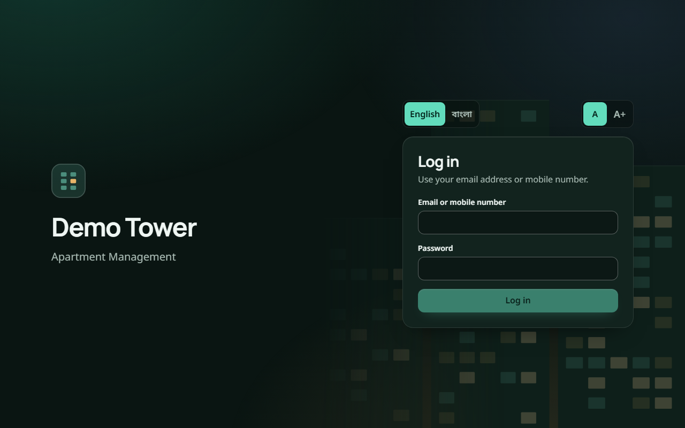

### Administrator dashboard

The first screen for administrators: the month's billing (billed, collected, still to collect, collection rate with a progress bar), overdue bills, payments waiting to be checked, building occupancy and the maintenance workload. The payment reports and maintenance sections link straight to their lists. The search box searches residents, units, bills and requests at once.

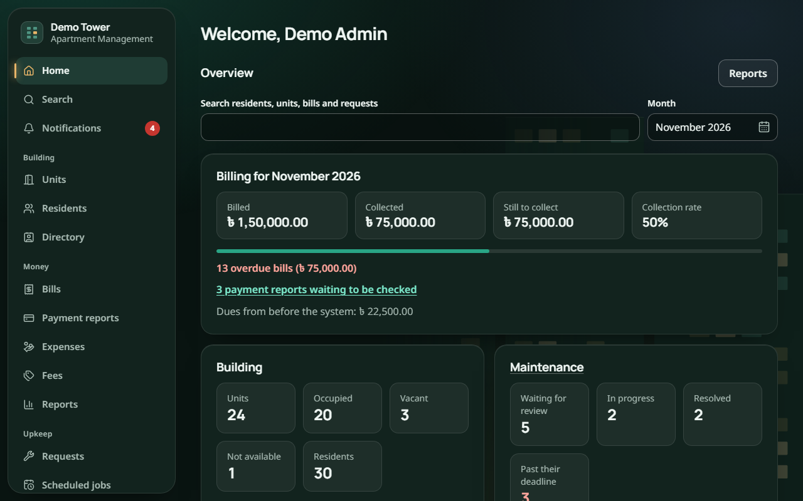

### Bills and a bill's details

The bills list can be filtered by status, month, unit and text, with totals for what is found. A bill's page shows its charges and payments side by side, with a receipt PDF for every payment.

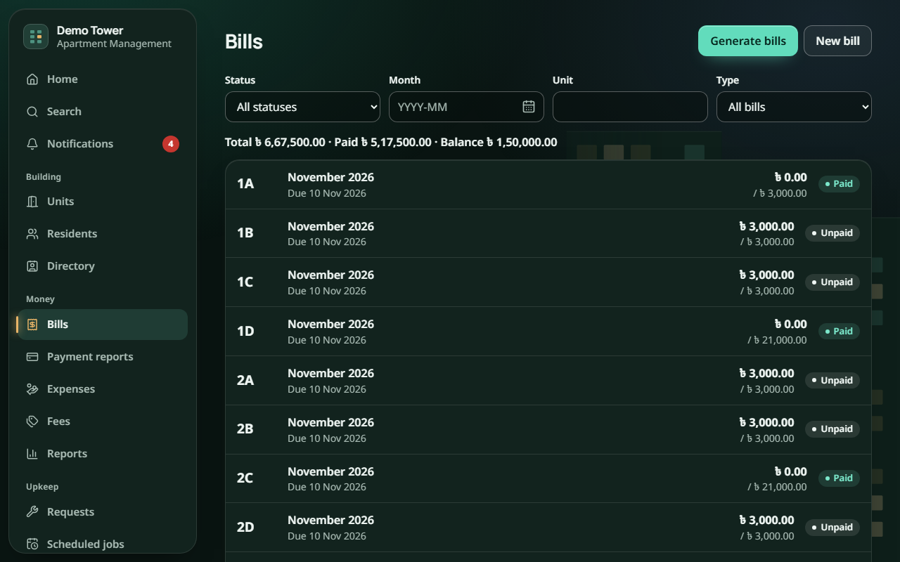

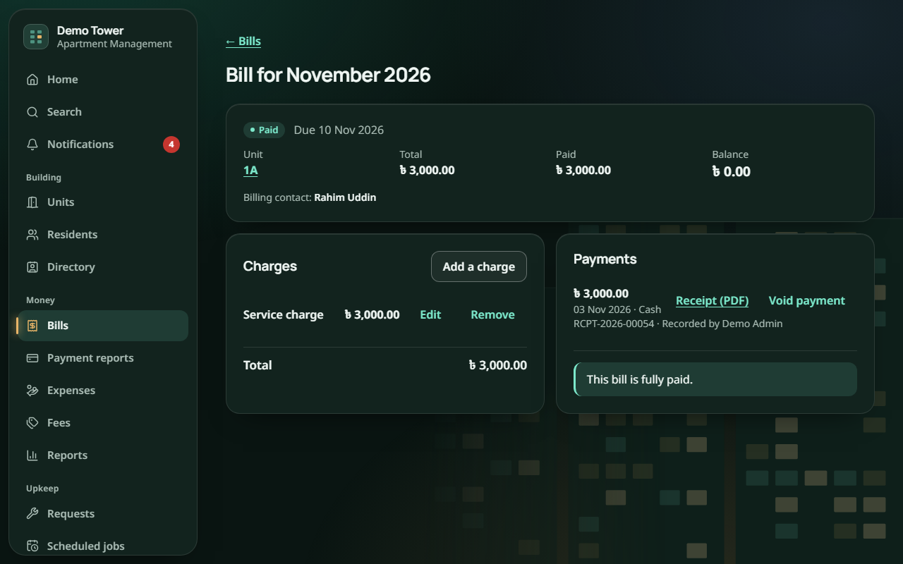

### Maintenance requests

Requests show their number, title, place, date and who is assigned, with chips for priority, status and **Overdue**. Quick filters (New requests, Overdue, Assigned to me) cover the most common views.

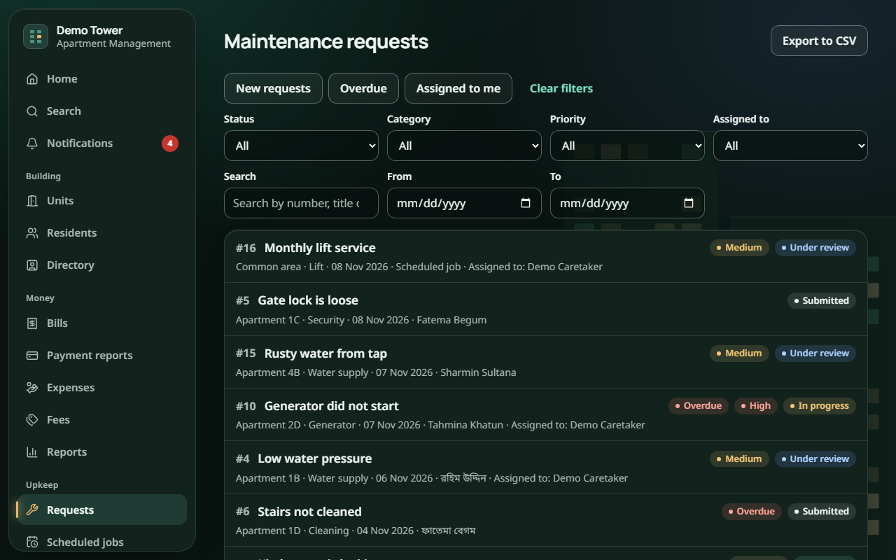

### Reports

The collection report shows each month's bills, amounts billed and collected, the outstanding amount and the collection rate, plus totals by charge type and payment method. It can be exported to CSV and printed.

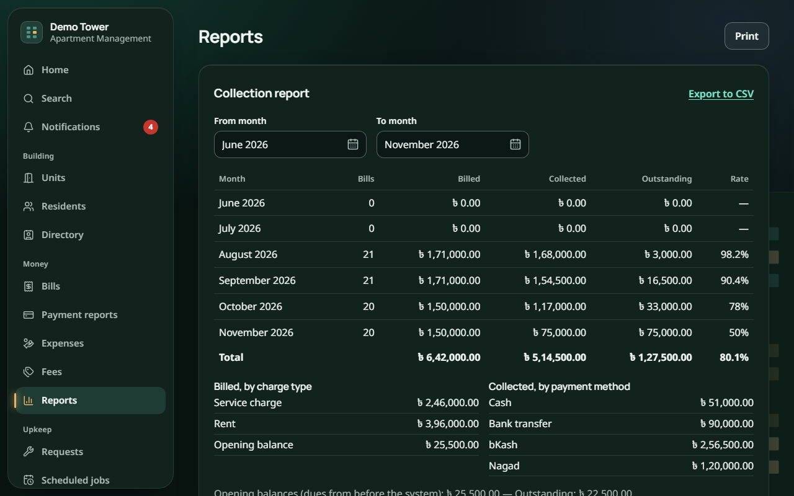

The month fields use a month picker that works in every browser (Firefox and Safari have no built-in one). It can also be used with the keyboard: arrow keys move between months, Page Up and Page Down change the year.

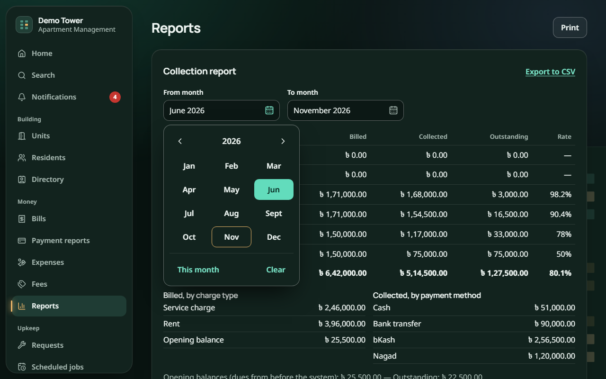

### Units, announcements and notifications

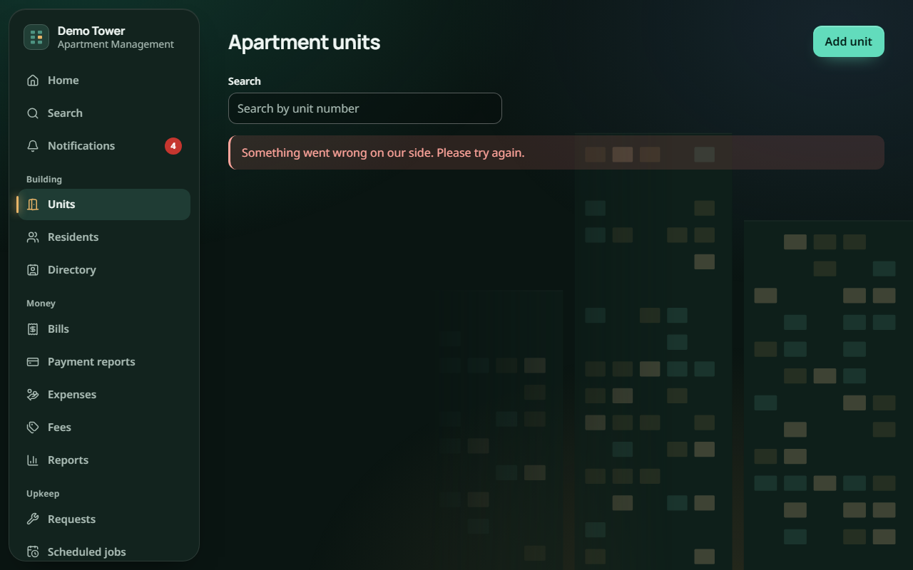

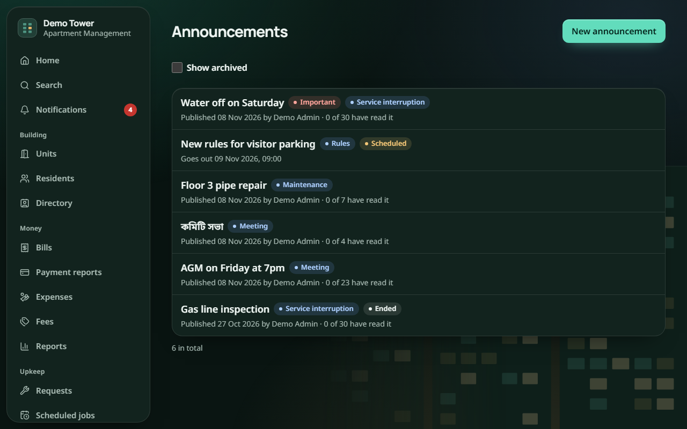

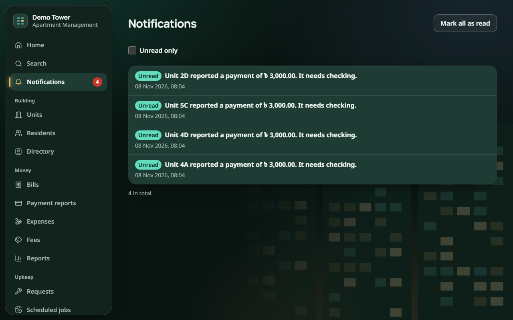

### Resident screens on a phone

The resident's home shows what they owe (with overdue bills highlighted), their apartment, and the two most common actions. The same screen in Bangla:

| English | Bangla |
|---|---|
| 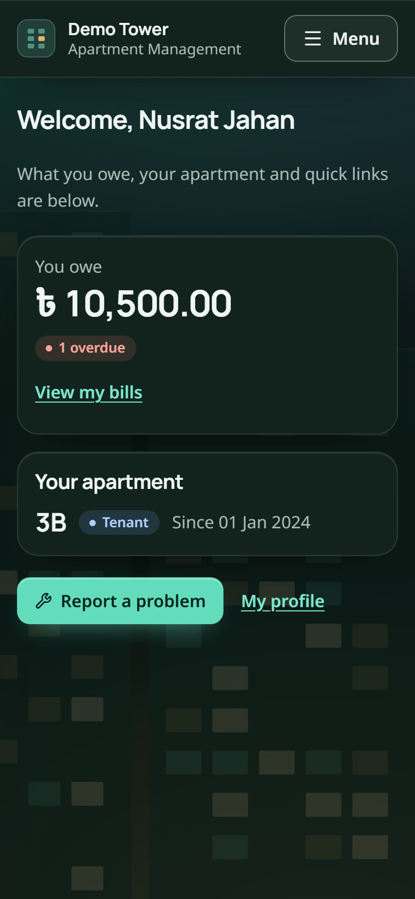 | 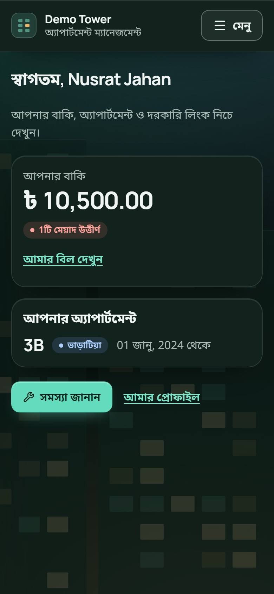 |

Reporting a problem: the resident's name and apartment are filled in automatically. They choose a category and place, describe the problem and can add photos.

| Report a problem | My bills | Menu |
|---|---|---|
| 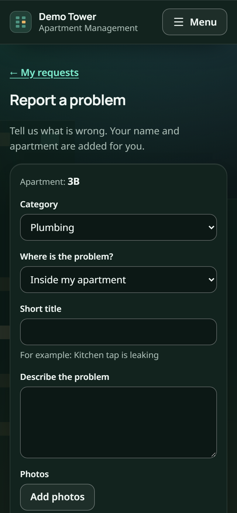 | 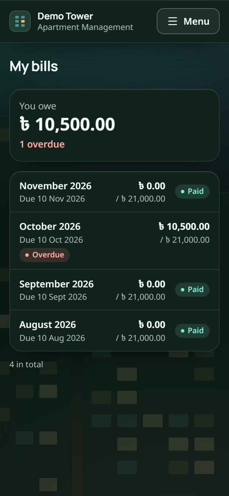 | 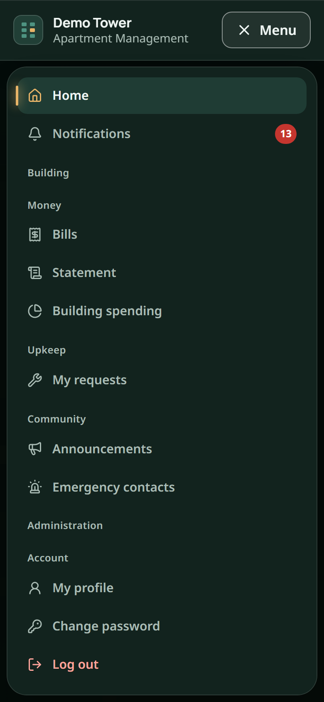 |

## 7.3 Screens and the requirements they serve

| Screen | Main users | Requirements |
|---|---|---|
| Login | Everyone | FR-01, FR-31, FR-47, FR-55 |
| Dashboard | Administrator, committee | FR-27, FR-28, FR-29, FR-58 |
| Bills, bill details | Administrator, cashier, resident | FR-09 to FR-14, FR-33 |
| Payment reports | Resident, office | FR-39, FR-40 |
| Maintenance requests, report a problem | Resident, staff, administrator | FR-16 to FR-22, FR-35 |
| Reports | Administrator, committee | FR-15, FR-38, FR-44, FR-57 |
| Units, residents, directory | Administrator, office staff | FR-03 to FR-05, FR-08 |
| Announcements, notifications | Everyone | FR-23 to FR-26, FR-51 |
| Resident home | Resident | FR-07, FR-13 |
