# 8. Nielsen's Usability Heuristics

## 8.1 Tools used

| Tool | Type | How it was used |
|---|---|---|
| **Google Lighthouse** 12 | Built into Chrome DevTools (*Lighthouse* tab), also a command-line tool | Audits a page for **accessibility**, **best practices** and **performance**. Run on 7 pages of the live site, logged in as administrator and as resident, with desktop and phone settings. |
| **axe-core** (Deque) via `@axe-core/playwright` | Accessibility engine, the same one used by the *axe DevTools* browser extension | Runs inside the automated browser tests (`e2e/accessibility.spec.ts`) on every administrator and resident page, at desktop and phone size, against the WCAG 2.1 AA rules. The tests fail on any violation. |
| **Playwright** browser tests | Automated user journeys | Check that every page works at 360 px phone width without sideways scrolling, in Bangla, and with large text |
| **SonarQube** accessibility rules | Static analysis | Flags interactive behaviour on non-interactive elements, which keyboard users cannot reach (see the [Code Review page](09-Code-Review)) |
| **Manual heuristic review** with Nielsen's checklist | Expert review | Every screen was walked through against the 10 heuristics; the evidence is the screenshots below |

**What the tools can and cannot do.** Automated tools only measure what can be calculated: contrast, labels, keyboard access, layout stability and speed. These map most directly to *visibility of system status* (H1), *consistency and standards* (H4) and *error prevention* (H5). Heuristics such as *match with the real world* (H2) or *help and documentation* (H10) need human judgement, so they were checked by manual review. Each heuristic below states which source the evidence came from.

## 8.2 Tool results

**Lighthouse scores on the live site** (0 to 100, higher is better):

| Page | Device | Accessibility | Best practices | Performance |
|---|---|---|---|---|
| Login | Desktop | **100** | 96 | 99 |
| Login | Phone | **100** | 96 | 96 |
| Admin dashboard | Desktop | **100** | 100 | 99 |
| Bills | Desktop | **100** | 100 | 96 |
| Maintenance requests | Desktop | **100** | 100 | 94 |
| Resident home | Phone | **100** | 100 | 89 |
| Report a problem | Phone | **100** | 100 | 95 |

The SRS target NFR-12 is a Lighthouse accessibility score of at least 90; every audited page scores 100.

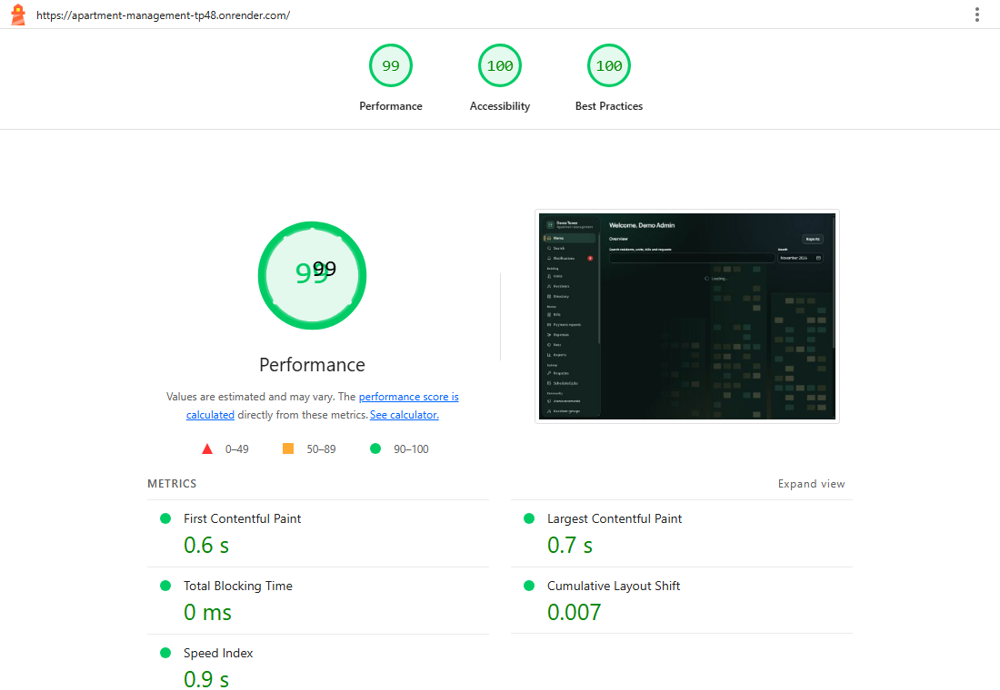

**axe-core:** 0 violations on every administrator and resident page, at desktop and phone size. These scans run in the browser test suite, and all 152 browser tests pass.

## 8.3 Issues the tools found, and what was done

| # | Tool | Finding | Heuristic | Action |
|---|---|---|---|---|
| 1 | Lighthouse | **Layout shift of 0.124** on the resident home (phone). The good limit is 0.1. While loading, the balance card took no space, then appeared and pushed the rest of the page down: a user about to tap "Report a problem" could tap the wrong thing. | H1 visibility of system status, H5 error prevention | **Fixed.** Each card now shows a placeholder of the same size while loading. Layout shift is now **0**. |
| 2 | axe-core | **Month buttons' spoken names did not match their visible text** ("Jan" was announced as "January 2026"). Voice-control users say what they see, so "click Jan" would not work. | H4 consistency and standards | **Fixed.** Each button is now announced as "Jan 2026", which contains the visible word. |
| 3 | SonarQube | The month picker's arrow-key handling was on a non-interactive container instead of the buttons. | H7 flexibility and efficiency | **Fixed.** The handler moved onto each month button. |
| 4 | Manual testing (Firefox) | The month fields had **no calendar in Firefox and Safari**, which do not support the browser's built-in month picker. Users had to type `2026-06` from memory. | H6 recognition rather than recall | **Fixed.** A month picker that works in every browser: a 12-month grid with year arrows and a "This month" button. Typing still works. |
| 5 | Lighthouse | One large JavaScript file (unused code on first load) | H7 flexibility and efficiency (speed) | **Not yet done.** Splitting the code by page would speed up the first visit on slow phones. Scores are already 89 to 99. |
| 6 | Lighthouse | A console error on the login page (a 401 response from the "who am I?" check made before anyone has logged in) | none: it is expected behaviour | **Kept.** This request is how the app knows nobody is logged in yet. |

**Finding 1, before:** Lighthouse measured a layout shift of 0.124 on the live site.

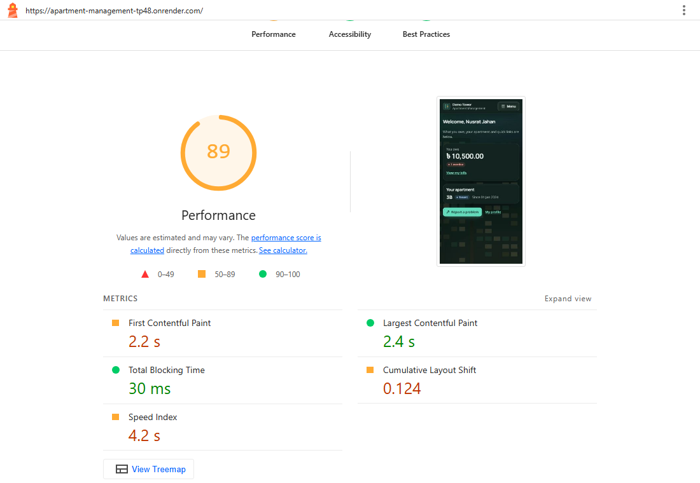

**Finding 1, after:** placeholders hold each card's space while the data loads, and Lighthouse measures a layout shift of 0.

| While loading (after the fix) | Lighthouse after the fix |
|---|---|
| 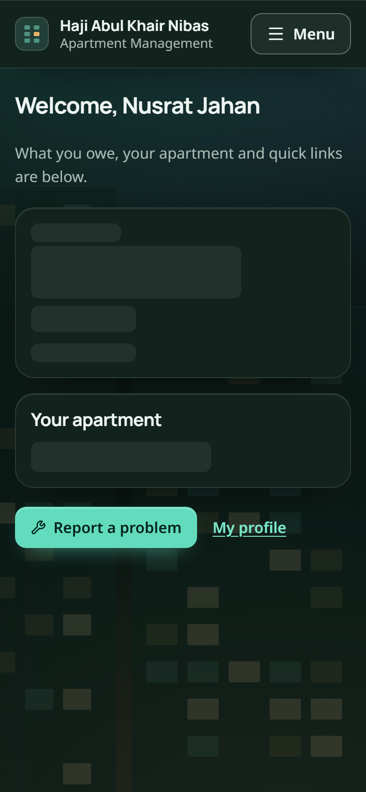 | 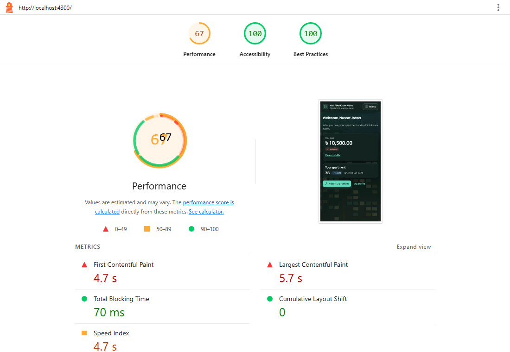 |

*The "after" run was on a local server, which does not compress files the way the live host does, so its performance score cannot be compared with the live run. The layout-shift figure can, because it does not depend on network speed.*

## 8.4 The ten heuristics

### H1. Visibility of system status

*The system keeps users informed about what is going on.*

- Every bill shows its status as a labelled chip (Unpaid, Partly paid, Paid, Overdue), and every request shows its status, priority and an **Overdue** chip once its deadline passes.
- Loading shows a spinner or a same-size placeholder. Long actions say what is happening ("Logging in…", "Checking the file…", "Importing…", "Sending…"), and buttons are disabled while a save is in progress, so nothing is sent twice.
- The dashboard's collection-rate bar and the notification count in the menu show the state of the building at a glance.

**Evidence:** Lighthouse (layout stability, finding 1), manual review. 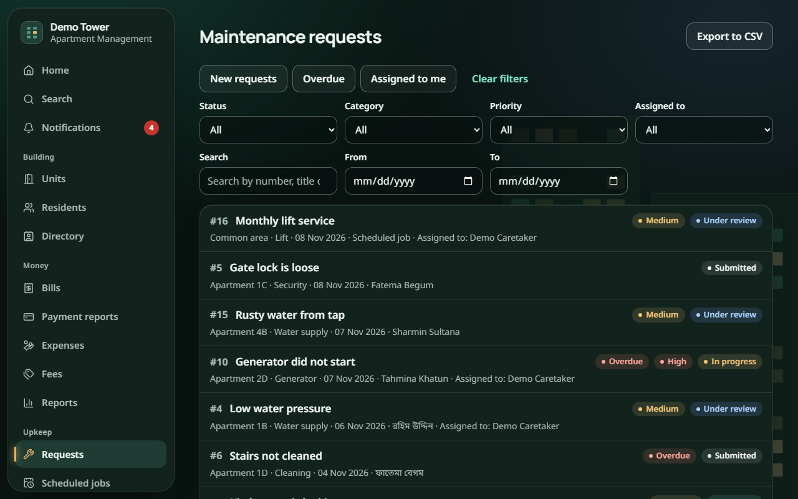

### H2. Match between the system and the real world

*Use the users' language, words and conventions.*

- Full **Bangla** translation, and amounts in taka with **lakh grouping** (`৳ 1,50,000.00`), as people in Bangladesh write them.
- The payment methods people actually use: cash, bank transfer, **bKash** and **Nagad**.
- Everyday words instead of system words: "Report a problem", "You owe", "Where is the problem?".

**Evidence:** manual review. 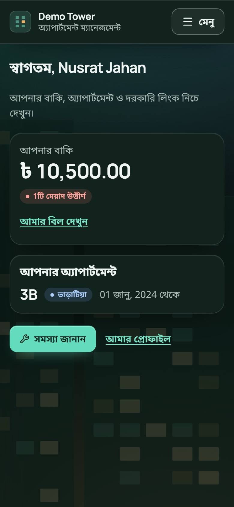

### H3. User control and freedom

*Provide a clearly marked way out.*

- Every dialog has **Cancel**, closes with **Escape**, and closes when you click outside it.
- A mistaken payment can be **voided** (with a reason), not lost. A resident can **cancel** a request, or **reopen** it if the fix did not work.
- The month picker can be closed with Escape, and the menu by tapping outside it.

**Evidence:** manual review, browser tests. 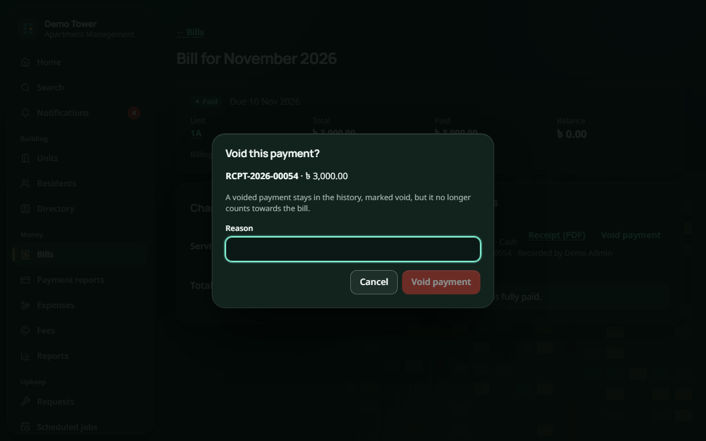

### H4. Consistency and standards

*Follow platform conventions; the same thing should always look and work the same.*

- One design system: the same buttons, fields, chips and dialogs on every page, built from shared components.
- WCAG 2.1 AA accessibility standards: checked by axe on every page, Lighthouse accessibility score 100.
- The same date and money formats everywhere, in both languages.

**Evidence:** axe-core, Lighthouse, SonarQube (findings 2 and 3).

### H5. Error prevention

*Prevent problems before they happen.*

- **Generating bills shows a preview first**, with every skipped unit and the reason, and nothing is saved until the user confirms.
- A bKash or Nagad transaction ID that was already used triggers a warning before saving, which prevents double entry.
- Dates in the future cannot be chosen for payments; amounts above the balance are refused; destructive actions ask for confirmation.

**Evidence:** manual review, server tests. 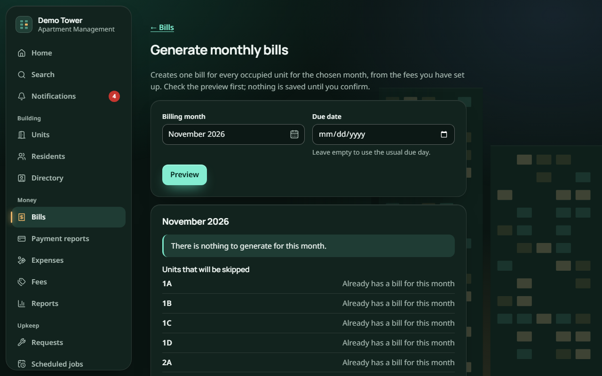

### H6. Recognition rather than recall

*Make options visible instead of making people remember them.*

- Choose from lists instead of typing codes: categories, places, payment methods and units are all choices.
- The month picker shows the months to pick from instead of asking for `YYYY-MM` (finding 4).
- The resident's name and apartment are filled in automatically on a new request.

**Evidence:** manual testing in Firefox. 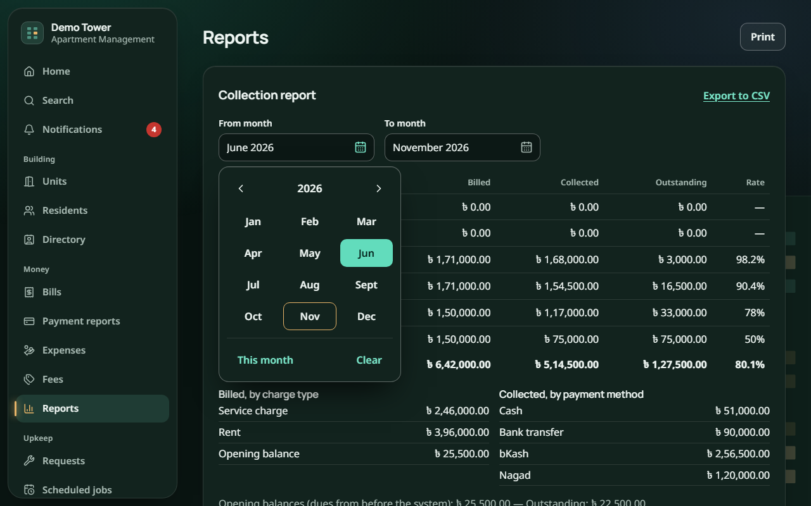

### H7. Flexibility and efficiency of use

*Shortcuts for experienced users, without confusing new ones.*

- Global search finds residents, units, bills and requests from one box.
- Quick filters on lists (New requests, Overdue, Assigned to me).
- Everything works by keyboard; the month picker supports arrow keys, Page Up and Page Down.
- The app can be installed on a phone's home screen.

**Evidence:** SonarQube, axe-core, manual review.

### H8. Aesthetic and minimalist design

*Show only what is needed.*

- Each screen has one main purpose and one primary (highlighted) button.
- The resident home shows three things only: what you owe, your apartment, and the two most common actions.
- Secondary information (internal notes, payment details) is shown only to staff who need it.

**Evidence:** manual review. 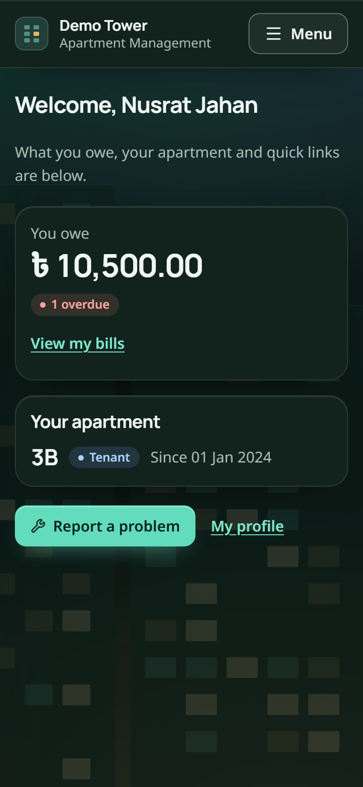

### H9. Help users recognise, diagnose and recover from errors

*Error messages in plain language that suggest a solution.*

- Errors appear next to the field they belong to, in the user's language, without technical codes (NFR-11).
- They say how to fix the problem: for example, "The amount is more than the balance due (৳ 3,000.00)."
- Wrong login details show one clear message that does not reveal which part was wrong.

**Evidence:** manual review, server tests. 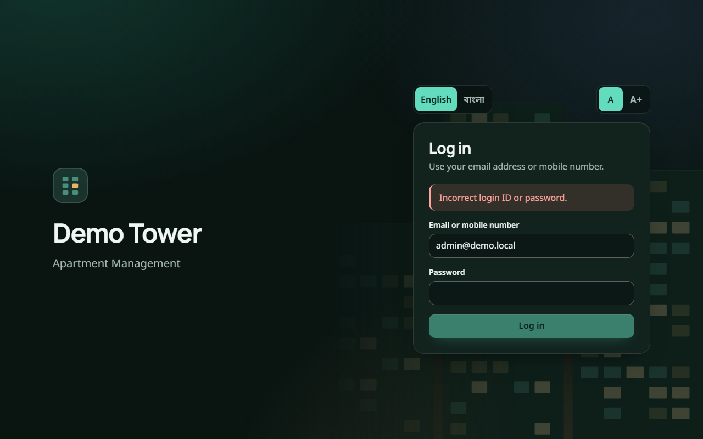

### H10. Help and documentation

*Help that is easy to find and focused on the task.*

- Short hints under the fields that need them, for example "For example: Kitchen tap is leaking" and "Leave empty to use the usual due day".
- Most pages start with one sentence saying what the page is for, for example "Check the preview first; nothing is saved until you confirm."
- The README and the demo script explain the system for new users.

**Evidence:** manual review. 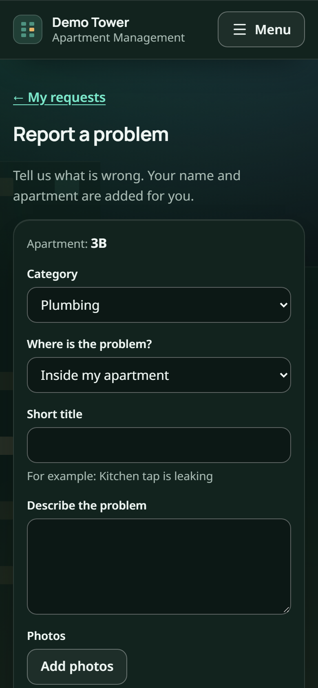

## 8.5 How the tools helped

- **They find what people miss.** The layout shift lasted less than a second and was hard to notice by eye, but Lighthouse measured it exactly.
- **They keep problems from coming back.** The axe scans run in the browser tests on every push, so a new page without labels, or text with too little contrast, fails the build.
- **They give numbers to compare.** Before-and-after scores show that a change really helped.
- **They do not replace people.** The missing calendar in Firefox was found by a person using the app, not by a tool. So the team used the tools together with a manual review against each heuristic.
