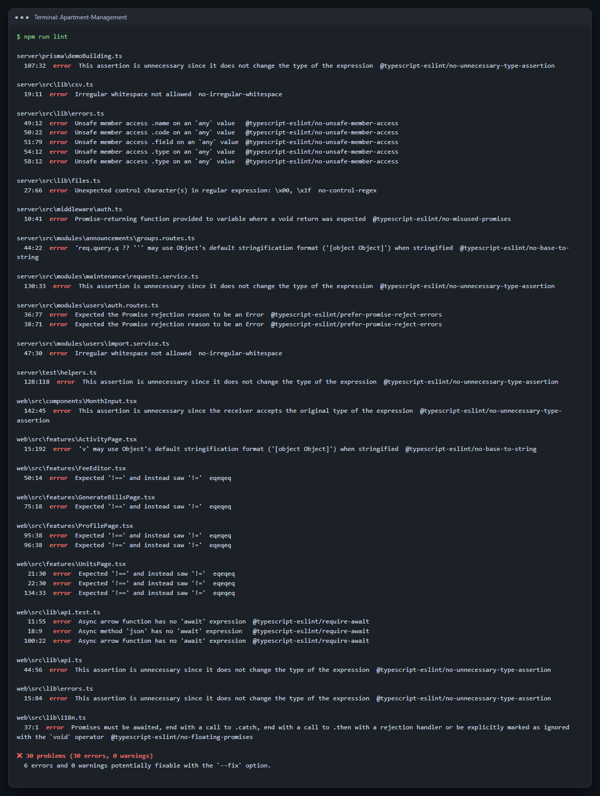
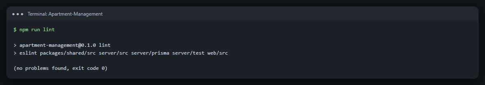
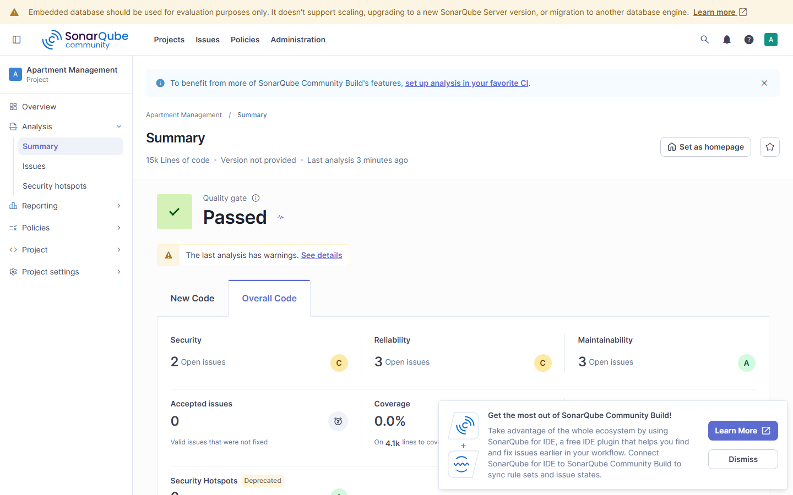
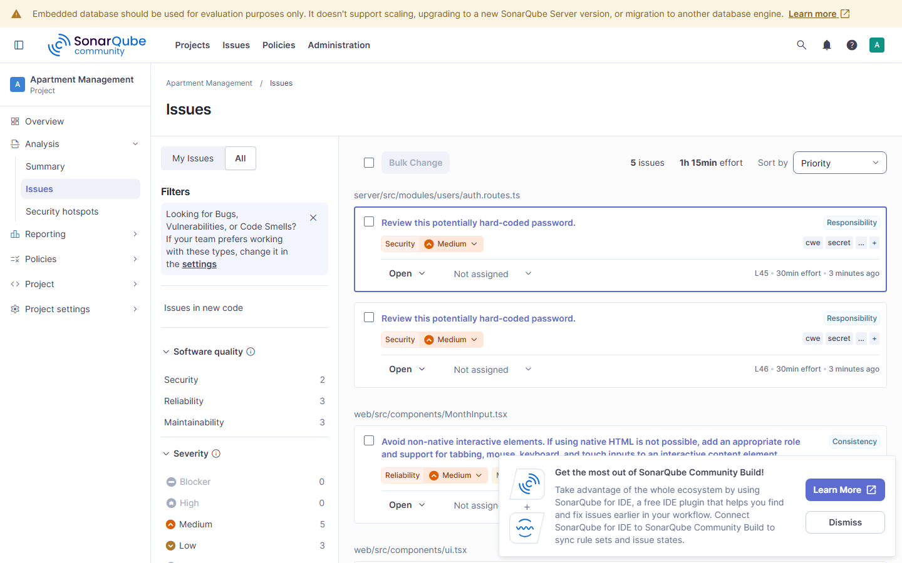
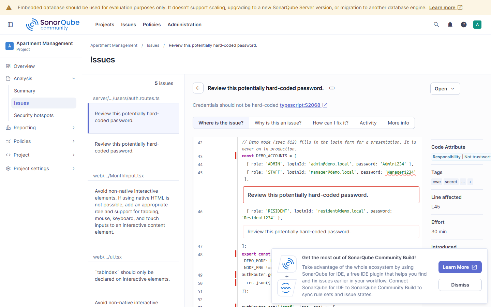
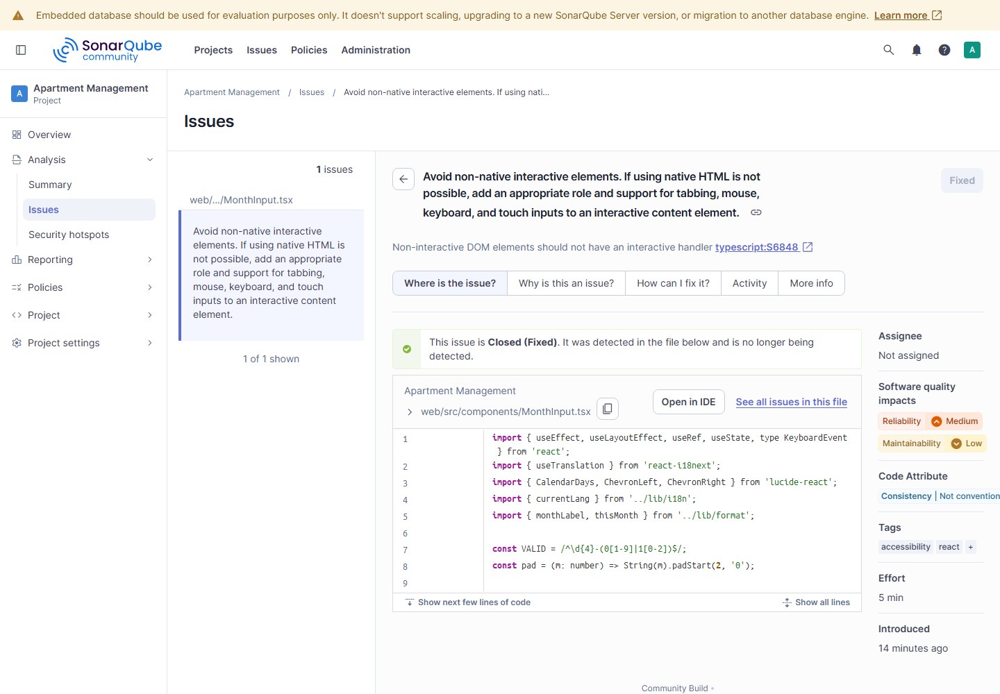
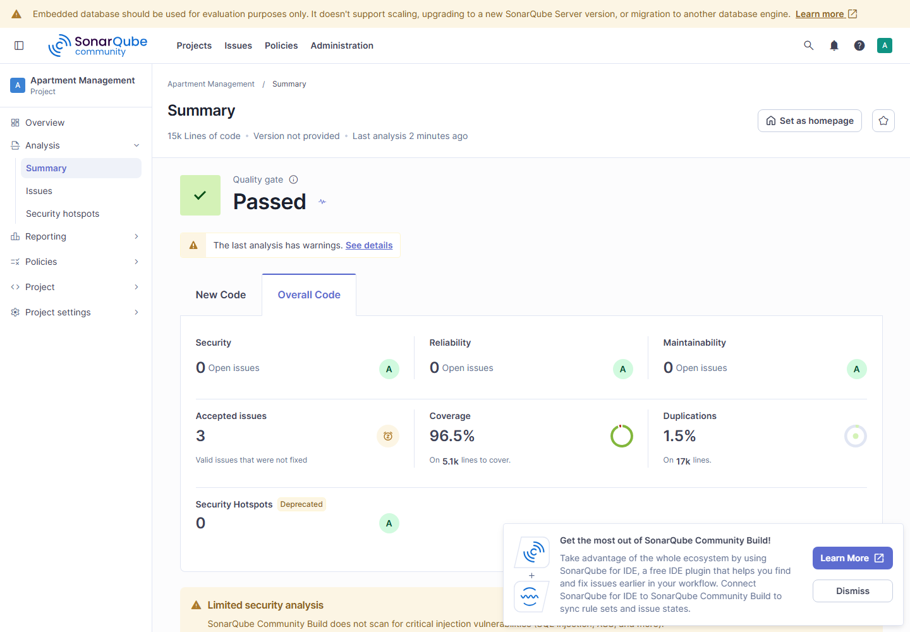
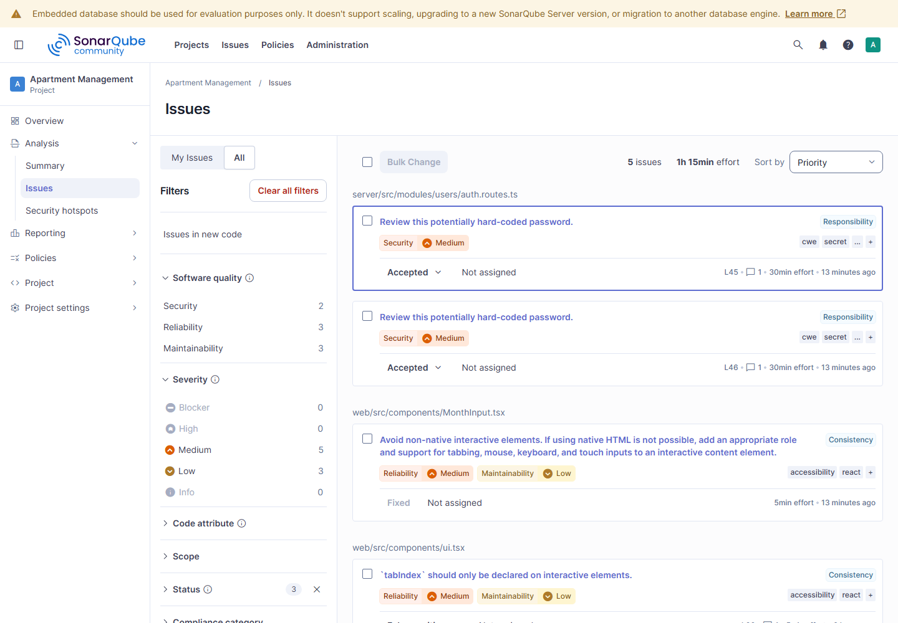

# 9. Code Review Tools and Findings

Two automated code review tools were used, alongside reading each other's pull requests:

| Tool | What it checks | When it runs |
|---|---|---|
| **ESLint** 10 with **typescript-eslint** and **eslint-plugin-react-hooks** | Bugs and risky patterns found by reading the code *and its TypeScript types*: promises nobody waits for, values that print as `[object Object]`, unsafe `any`, React hook misuse | `npm run lint` locally, in VS Code as you type, and in GitHub Actions on every push |
| **SonarQube** Community Build 26.11 | Bugs, security vulnerabilities, code smells, accessibility problems, duplicated code and test coverage, with a web dashboard and quality ratings | A scan of the whole repository; findings are reviewed and marked in the dashboard |

## 9.1 Setup

**ESLint.** Installed as development dependencies and configured in `eslint.config.mjs`:

```bash
npm install --save-dev eslint @eslint/js typescript-eslint eslint-plugin-react-hooks globals
npm run lint
```

```js
export default tseslint.config(
  js.configs.recommended,                       // ESLint's recommended rules
  ...tseslint.configs.recommendedTypeChecked,   // rules that read the TypeScript types
  {
    files: ['packages/shared/src/**/*.ts', 'server/src/**/*.ts', 'web/src/**/*.{ts,tsx}' /* ... */],
    languageOptions: { parserOptions: { projectService: true } },
    rules: { eqeqeq: ['error', 'always', { null: 'ignore' }] },
  },
  { files: ['web/src/**/*.{ts,tsx}'], plugins: { 'react-hooks': reactHooks }, rules: { 'react-hooks/rules-of-hooks': 'error' } },
);
```

**SonarQube.** The free SonarQube Community Build runs locally in Docker. The scanner reads `sonar-project.properties` in the repository root, which lists the source and test folders and the coverage report:

```bash
docker run -d --name sonarqube -p 9000:9000 sonarqube:community      # dashboard at http://localhost:9000
npm run test:coverage                                                 # unit-test coverage for SonarQube
docker run --rm -e SONAR_HOST_URL=http://host.docker.internal:9000 -e SONAR_TOKEN=<token> \
  -v "<repository folder>:/usr/src" sonarsource/sonar-scanner-cli
```

## 9.2 ESLint results

The first full run found **30 problems under 12 rules** in 153 files.



After the fixes below, ESLint reports **no problems**. It now runs in GitHub Actions, so new problems are caught on every push.



### Finding 1 (bug): a search value could become "[object Object]"

**Rule:** `@typescript-eslint/no-base-to-string` · **File:** `server/src/modules/announcements/groups.routes.ts`

A query string like `?q[a]=1` makes Express parse `q` as an *object*, not a string. `String(...)` then turned it into the text `"[object Object]"`, which was used as a search.

```ts
// Before
const q = String(req.query.q ?? '').trim().slice(0, 100);
// After: only a plain string is a search
const q = (typeof req.query.q === 'string' ? req.query.q : '').trim().slice(0, 100);
```

### Finding 2 (bug): the activity log could show "[object Object]"

**Rule:** `@typescript-eslint/no-base-to-string` · **File:** `web/src/features/ActivityPage.tsx`

The activity log shows the details of each recorded action. Any detail that was an object (not text or a number) would have been displayed as `[object Object]`.

```ts
// Before: one long expression ending in String(v)
const show = (key: string, v: unknown) => ... : Array.isArray(v) ? v.join(', ') : String(v);

// After: each kind of value is handled; anything else is written out as JSON
function show(key: string, v: unknown): string {
  if (v === null || v === undefined) return '–';
  if (typeof v === 'string') return key === 'publishAt' ? formatDateTime(v) : v;
  if (typeof v === 'number') return MONEY.includes(key) ? formatBDT(v) : String(v);
  if (typeof v === 'boolean') return String(v);
  if (Array.isArray(v)) return v.map((x) => show('', x)).join(', ');
  return JSON.stringify(v);
}
```

### Finding 3 (code smell): an async function where Express does not wait for it

**Rule:** `@typescript-eslint/no-misused-promises` · **File:** `server/src/middleware/auth.ts`

The middleware that loads the logged-in user was an `async` function. Express 4 does not wait for promises, so error handling depended on a hand-written `try`/`catch` inside it. It was safe, but easy to break when someone edits it later. It now uses the project's `asyncHandler`, like every route, which passes any error to the error handler automatically.

```ts
// Before
export const loadUser: RequestHandler = async (req, _res, next) => {
  try { /* ... */ next(); } catch (e) { next(e); }
};
// After
export const loadUser: RequestHandler = asyncHandler(async (req, _res, next) => {
  /* ... */ next();
});
```

### Finding 4 (code smell): errors without a stack trace

**Rule:** `@typescript-eslint/prefer-promise-reject-errors` · **File:** `server/src/modules/users/auth.routes.ts`

The session library reports failures as an untyped value. Rejecting with that value directly could lose the stack trace that shows where the error came from.

```ts
// Before
new Promise<void>((resolve, reject) => req.session.save((e) => (e ? reject(e) : resolve())));
// After: always a real Error
const asError = (e: unknown) => (e instanceof Error ? e : new Error(String(e)));
new Promise<void>((resolve, reject) => req.session.save((e) => (e ? reject(asError(e)) : resolve())));
```

### Finding 5 (code smell): reading fields of an untyped value

**Rule:** `@typescript-eslint/no-unsafe-member-access` (5 places) · **File:** `server/src/lib/errors.ts`

The central error handler read `err.name`, `err.code`, `err.field` and `err.type` from a value of type `any`, so TypeScript could not check any of them.

```ts
// Before
if (err?.name === 'MulterError') { const code = err.code === 'LIMIT_FILE_SIZE' ? ... ; /* err.field ?? 'photos' */ }
// After: name the fields we read, and check their types
const known = (typeof err === 'object' && err !== null ? err : {}) as { name?: unknown; code?: unknown; field?: unknown; type?: unknown };
if (known.name === 'MulterError') {
  const field = typeof known.field === 'string' ? known.field : 'photos';
  /* ... */
}
```

### Finding 6 (code smell): invisible characters in the source

**Rule:** `no-irregular-whitespace` (2 places) · **Files:** `server/src/lib/csv.ts`, `server/src/modules/users/import.service.ts`

The CSV code contained an invisible byte-order-mark character typed directly into the code. It is needed (it makes Excel read Bangla correctly), but nobody reading the code could see it.

```ts
// Before: the first character inside the quotes is invisible
return `${rows}\r\n`;
// After: visible and searchable
return `${rows}\r\n`;
```

### Finding 7 (promise not handled)

**Rule:** `@typescript-eslint/no-floating-promises` · **File:** `web/src/lib/i18n.ts`

`i18n.init(...)` returns a promise that nothing waited for. The translations are bundled into the app, so initialisation finishes immediately. The fix marks the promise as deliberately not awaited, with a comment saying why, so the next reader does not wonder.

```ts
// The translations are bundled, so init finishes at once; its promise has nothing left to wait for.
void i18n.use(initReactI18next).init({ /* ... */ });
```

### Findings 8 to 11: smaller items and decisions

| # | Rule | Finding | Action |
|---|---|---|---|
| 8 | `no-unnecessary-type-assertion` (6) | Type casts (`as ...`, `!`) that changed nothing | Removed with `eslint --fix`. **One of these automatic fixes was wrong:** in `requests.service.ts`, removing the cast widened a type and the TypeScript compiler then failed. It was restored as a clearly typed variable. This shows why tool fixes are always re-checked with the compiler and the tests. |
| 9 | `eqeqeq` (7) | `x != null` instead of `!==` | Reviewed: `!= null` deliberately means "neither null nor undefined". The rule now allows that one form (`{ null: 'ignore' }`) and still rejects every other `==` and `!=`. |
| 10 | `no-control-regex` (1) | A regular expression matching control characters | Reviewed: it removes control characters from uploaded file names, which is the point. Kept, with a comment explaining why the rule is switched off on that line. |
| 11 | `require-await` (3) | Fake `fetch` functions in tests marked `async` without `await` | Reviewed: the fakes are `async` to match the real `fetch`. The rule is switched off for test files only. |

## 9.3 SonarQube results

**Before:** the first scan of 15,215 lines found 5 open issues. The security and reliability ratings were **C**.





### Finding 12 (vulnerability, reviewed and accepted): hard-coded passwords

**Rule:** `typescript:S2068` *Credentials should not be hard-coded* (2 issues) · **File:** `server/src/modules/users/auth.routes.ts`



**Review:** these are the public passwords of the demo accounts. They are listed in the README on purpose, so people can try the demo. The server only sends them when `DEMO_MODE` is on **and** it is not running in production (`demoAccountsFor`), so a real deployment never exposes them. **Decision:** marked *Accepted*, with that reason recorded in SonarQube.


### Finding 13 (accessibility, fixed): keyboard handling on a non-interactive element

**Rule:** `typescript:S6848` · **File:** `web/src/components/MonthInput.tsx`

The month picker's arrow-key handler was attached to the grid container (a `<div>`) instead of the month buttons. **Fix:** the handler moved onto each month `<button>`, which is a native, focusable control. On the next scan SonarQube marked the issue **Fixed**.

```tsx
// Before
<div ref={grid} className="grid grid-cols-3 gap-1.5" onKeyDown={onGridKey}>
  <button ... onClick={() => pick(m)}>
// After
<div ref={grid} className="grid grid-cols-3 gap-1.5">
  <button ... onClick={() => pick(m)} onKeyDown={onGridKey}>
```



### Finding 14 (false positive): `tabIndex` on a scrolling table

**Rule:** `typescript:S6845` · **File:** `web/src/components/ui.tsx`

SonarQube says `tabIndex` belongs only on interactive elements. But a table that scrolls sideways on a phone **must** be focusable, or keyboard users cannot scroll it. WCAG 2.1 (2.1.1 Keyboard) requires this, and axe's rule `scrollable-region-focusable` reports the opposite problem if it is missing. The element also has `role="region"` and a label. **Decision:** marked *False positive*, with the reason. Two tools disagreeing like this is why findings are reviewed rather than fixed blindly.


### Finding 15 (reviewed and accepted): closing a dialog by clicking the backdrop

**Rule:** `typescript:S6848` · **File:** `web/src/components/ui.tsx`

Clicking the dark backdrop around a dialog closes it, which is a mouse shortcut on a non-interactive element. Keyboard users close the same dialog with **Escape**, and every dialog also has a Cancel or Close button. **Decision:** marked *Accepted*, with that reason.

### After the review

All issues are fixed or reviewed. **0 open issues; A ratings for security, reliability and maintainability; quality gate passed.** Unit-test coverage of the server and shared code is **96.5%**, and duplicated code is **1.5%**.





## 9.4 Summary

| | ESLint | SonarQube |
|---|---|---|
| Findings | 30 (12 rules) | 5 (3 rules) |
| Real bugs fixed | 2 (`[object Object]` in search and in the activity log) | 0 |
| Code smells fixed | 17 | 1 (accessibility) |
| Reviewed, kept on purpose, rule adjusted with a reason | 11 | 3 accepted, 1 false positive |
| After | 0 problems | 0 open issues, A / A / A, quality gate passed |

Every fix was checked with the TypeScript compiler and the full test suites: 550 unit and integration tests and 152 browser tests, all passing.
