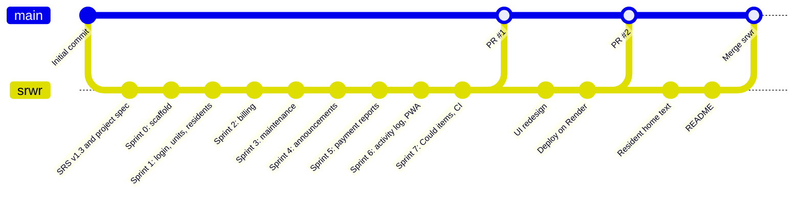
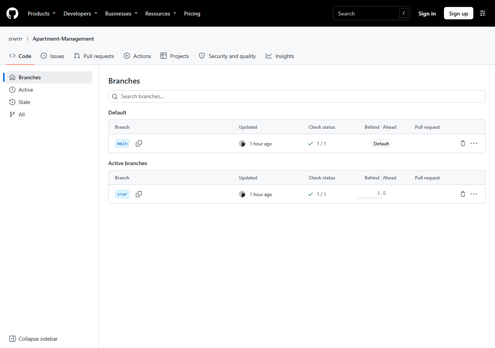
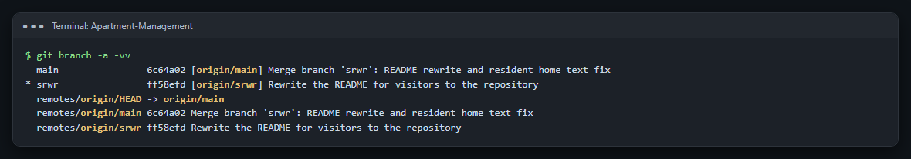
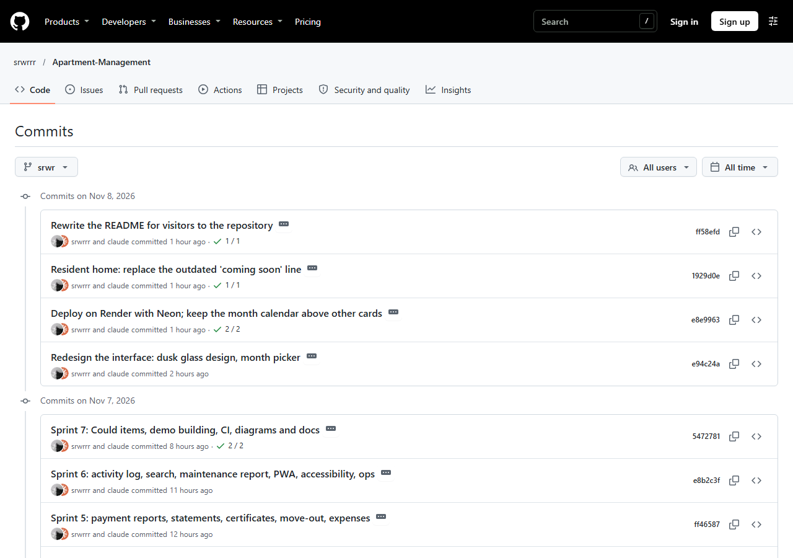
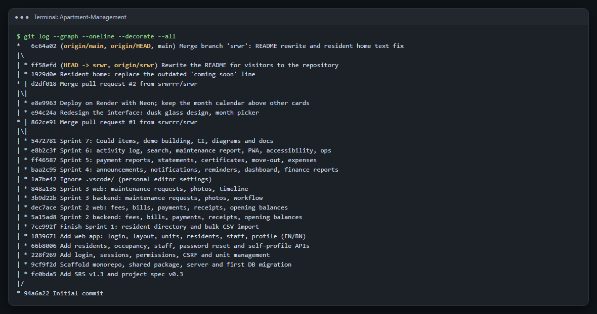
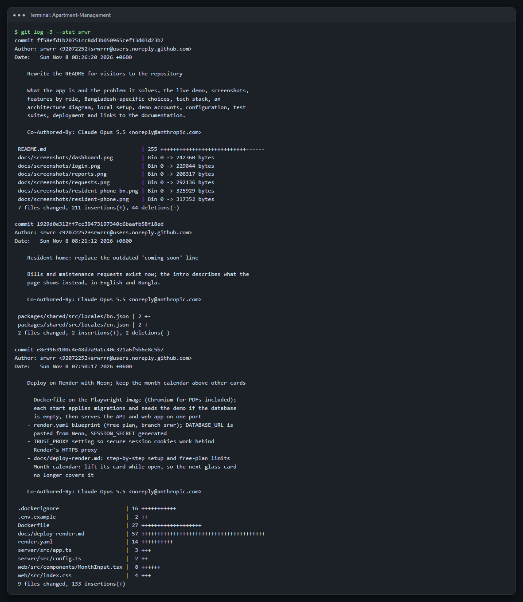
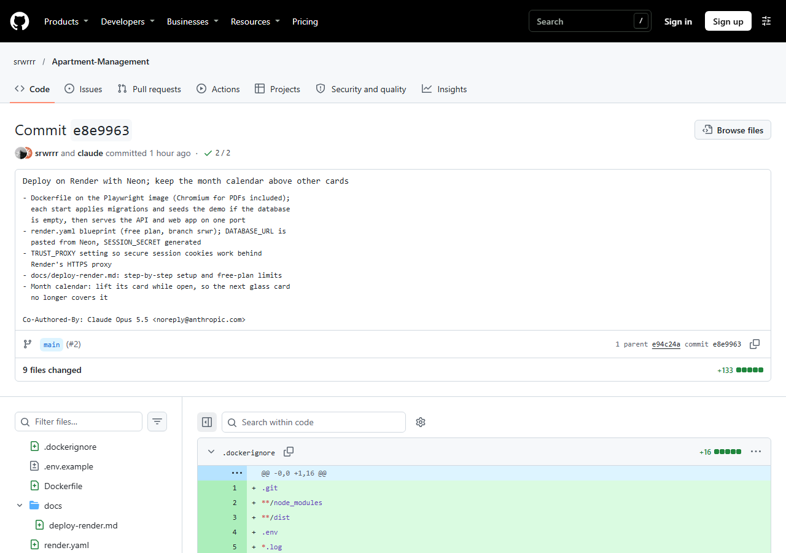
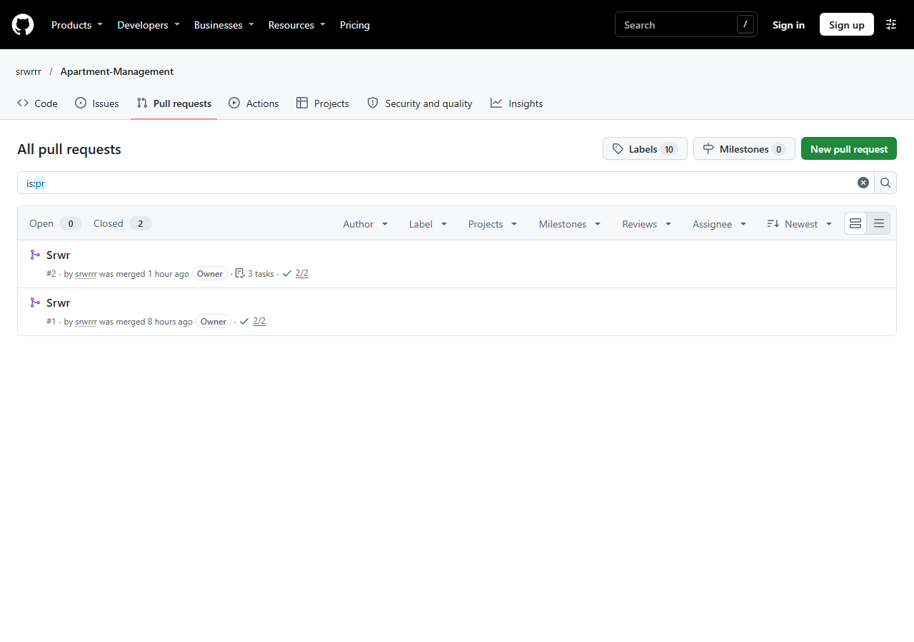
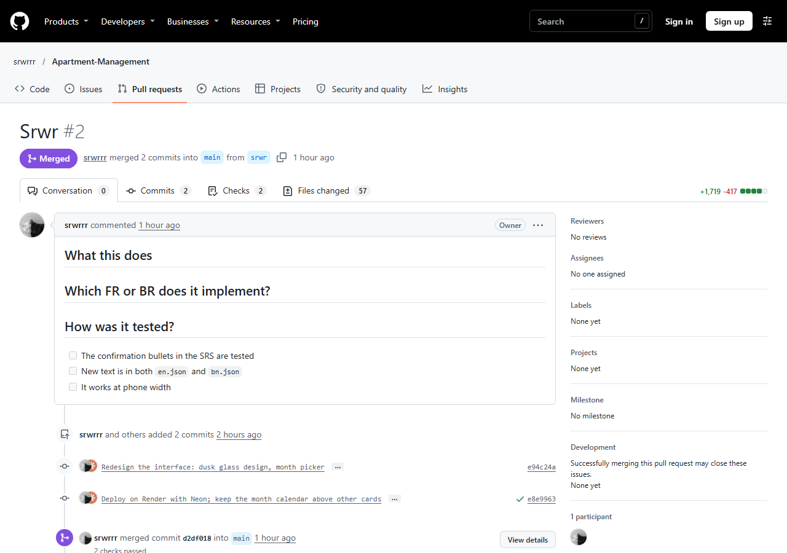
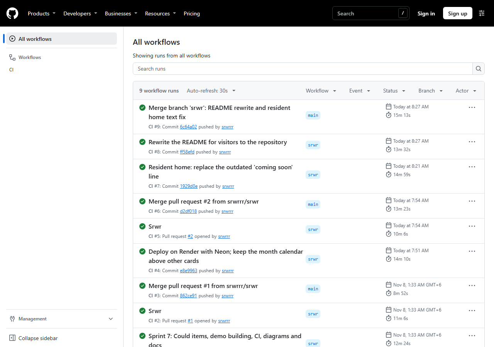

# 10. Evidence of Usage of Git

The project is version-controlled with **Git** and hosted on **GitHub** at <https://github.com/srwrrr/Apartment-Management>.

## 10.1 Workflow

| Practice | How it was done |
|---|---|
| **Branches** | `main` holds the reviewed, working version. Development happens on the feature branch `srwr` and reaches `main` through pull requests. |
| **Commits** | One commit per completed piece of work, usually one sprint (or one side of it: backend, then web). Each message has a short summary line and a body listing what changed. |
| **Pull requests** | `srwr` → `main` through pull requests (#1 and #2), using the template in `.github/pull_request_template.md`, which asks which requirement the change implements and how it was tested. |
| **Continuous integration** | GitHub Actions (`.github/workflows/ci.yml`) runs on every push and pull request: install, lint, database migrations, unit and integration tests, browser tests and installable-app (PWA) tests. |
| **Ignored files** | `.gitignore` keeps secrets (`.env`), dependencies, builds, uploads, coverage and generated documentation out of the repository. |

## 10.2 Branches

GitHub's branch page: `main` is the default branch and `srwr` is the development branch. Both pass their checks (green tick).

The same from the command line, showing each branch's latest commit and its link to GitHub:

## 10.3 Commit history

The commit history on the `srwr` branch, newest first. Each commit is one sprint or one feature, with a green tick when GitHub Actions passed:

The whole history as a graph, with both branches, the merges of pull requests #1 and #2, and the sprint-by-sprint commits from the initial commit to the latest:

## 10.4 Inside a commit

Each commit has a summary line, then a body explaining what changed. `git log --stat` also shows which files changed and how much:

On GitHub, a commit shows exactly which lines changed in each file:

## 10.5 Pull requests

Work reaches `main` through pull requests:

Pull request #2 merged two commits (the interface redesign and the Render deployment) from `srwr` into `main`, after GitHub Actions passed on both:

## 10.6 Continuous integration

Every push and pull request runs the full check in GitHub Actions. All nine runs passed:

## 10.7 Version history summary

| Commit | Summary |
|---|---|
| `94a6a22` | Initial commit |
| `fc0bda5` | Add SRS v1.3 and project spec v0.3 |
| `9cf9f2d` | Scaffold monorepo, shared package, server and first database migration |
| `228f269` | Add login, sessions, permissions, CSRF and unit management |
| `66b8006` | Add residents, occupancy, staff, password reset and self-profile APIs |
| `1839671` | Add web app: login, layout, units, residents, staff, profile (English/Bangla) |
| `7ce992f` | Finish Sprint 1: resident directory and bulk CSV import |
| `5a15ad8` / `dec7ace` | Sprint 2, backend / web: fees, bills, payments, receipts, opening balances |
| `3b9d22b` / `848a135` | Sprint 3, backend / web: maintenance requests, photos, timeline |
| `baa2c95` | Sprint 4: announcements, notifications, reminders, dashboard, finance reports |
| `ff46587` | Sprint 5: payment reports, statements, certificates, move-out, expenses |
| `e8b2c3f` | Sprint 6: activity log, search, maintenance report, PWA, accessibility, operations |
| `5472781` | Sprint 7: Could items, demo building, CI, diagrams and documentation |
| `862ce91` | Merge pull request #1 |
| `e94c24a` | Redesign the interface; month picker that works in every browser |
| `e8e9963` | Deploy on Render with Neon |
| `d2df018` | Merge pull request #2 |
| `1929d0e` | Resident home: replace an outdated line |
| `ff58efd` | Rewrite the README |
| `6c64a02` | Merge `srwr` into `main` |
