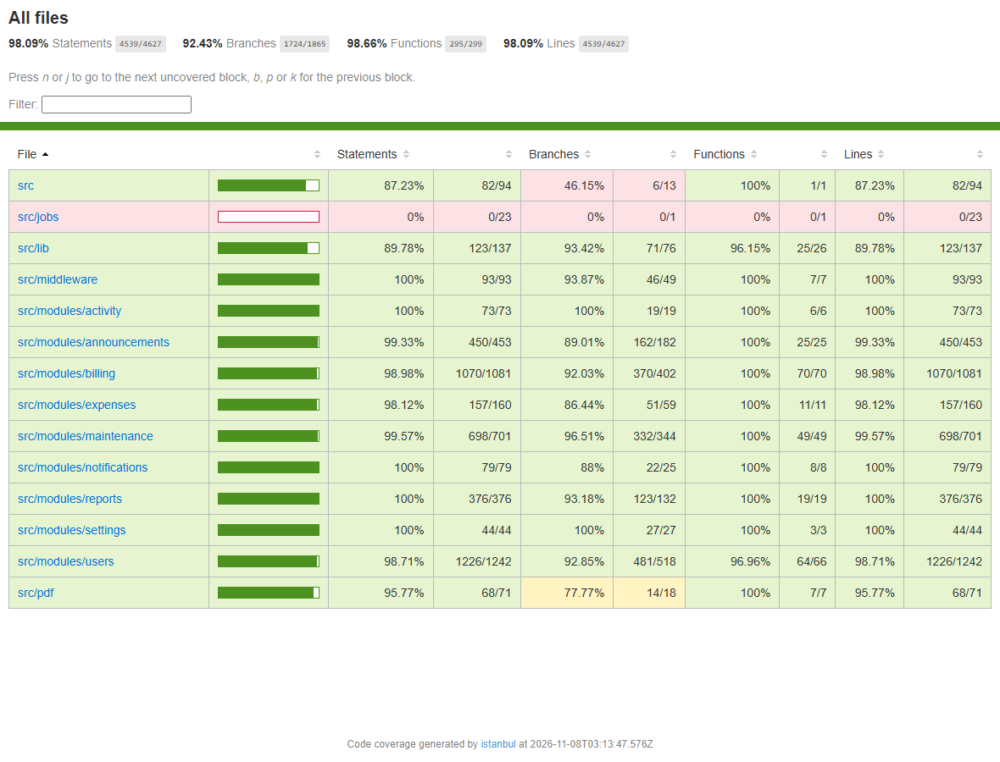
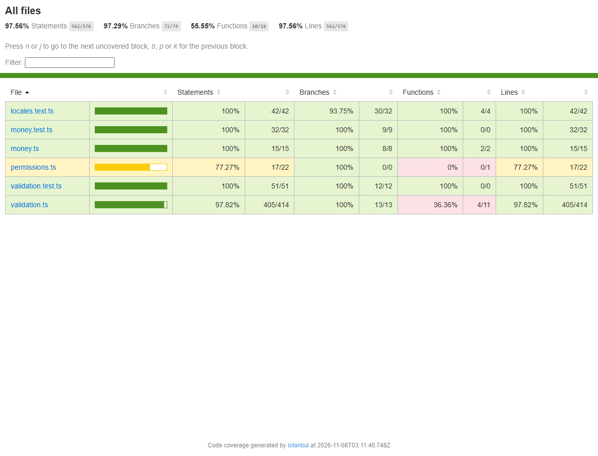
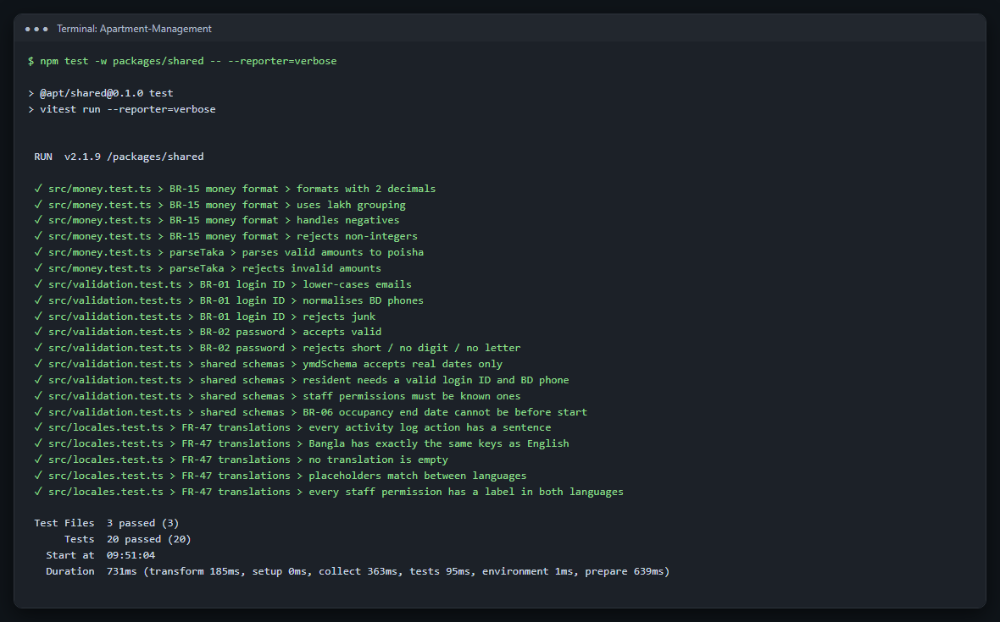
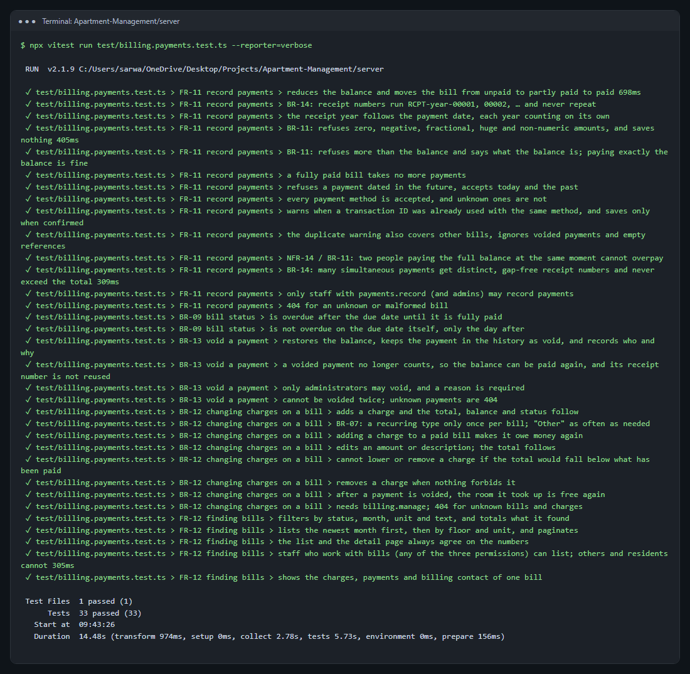

# 11. Unit Testing: Test Coverage and Quality

## 11.1 Testing approach

| Level | Tool | What it tests | Tests |
|---|---|---|---|
| **Unit tests** | Vitest | Single functions in isolation, with no database or network: money formatting, validation rules, translations, the web API client | 30 (shared 20, web 10) |
| **Integration tests** | Vitest + Supertest | Each API route through the real server code and a real PostgreSQL test database: business rules, permissions, transactions, concurrency | 520 |
| **End-to-end tests** | Playwright | Complete user journeys in a real browser, at desktop and phone size, with accessibility scans | 152 |
| **PWA tests** | Playwright | The production build: installable app, offline page, security policy | 5 |

All **707** tests pass, and GitHub Actions runs them on every push. Tests are named after the requirement they prove (FR-xx, BR-xx, NFR-xx), so a failing test points straight to the broken rule. The server tests use their own `apartment_test` database, which is emptied before each test (`beforeEach(resetDb)`), so tests cannot affect each other.

```bash
npm test                # unit and integration tests
npm run test:coverage   # the same, with coverage reports
npm run test:e2e        # browser tests
npm run test:pwa        # installable-app tests
```

## 11.2 Test coverage

Coverage is measured with Vitest's V8 coverage provider (`npm run test:coverage`).

| Package | Lines | Branches | Functions |
|---|---|---|---|
| Server (`server/src`) | **98.1%** (4,539 / 4,627) | **92.4%** (1,724 / 1,865) | **98.7%** (295 / 299) |
| Shared (`packages/shared/src`) | **97.6%** (562 / 576) | **97.3%** (72 / 74) | 55.6% (10 / 18) |
| Server and shared combined, in SonarQube | **96.5%** | | |



**Reading the numbers honestly:**

- `src/jobs` shows 0%. This is only the timer that starts the background jobs. The jobs themselves (`sendBillReminders`, `autoCloseResolved` and so on) live in their modules and are tested there.
- The shared package's function coverage is lower because several small helpers are exercised through the server tests rather than through the shared package's own tests.
- The web app's line coverage is not measured by unit tests: its screens are tested in a real browser by the 152 Playwright tests.



## 11.3 How the tests cover different kinds of input

| Category | What it means | Examples (below) |
|---|---|---|
| **Normal cases** | Typical, valid use gives the right result | T1, T5 |
| **Boundary conditions** | Values exactly at, just under and just over a limit | T2, T6, T7 |
| **Invalid inputs** | Wrong type, wrong format, out of range, missing | T3, T4, T8 |
| **Exceptional situations** | Concurrency, failures and permissions | T9, T10, T11 |

## 11.4 Unit tests (shared package)

These test pure functions directly, with no server or database. File: `packages/shared/src/money.test.ts`.

### T1. Normal case: formatting money

```ts
it('formats with 2 decimals', () => {
  expect(formatBDT(1250000)).toBe('৳ 12,500.00');
  expect(formatBDT(5)).toBe('৳ 0.05');
  expect(formatBDT(0)).toBe('৳ 0.00');
});
it('uses lakh grouping', () => {
  expect(formatBDT(12500000)).toBe('৳ 1,25,000.00');
  expect(formatBDT(1000000000)).toBe('৳ 1,00,00,000.00');
});
```

**Verifies:** amounts in poisha are shown as taka with two decimals and Bangladeshi lakh grouping (BR-15). It includes the smallest amount (5 poisha) and zero.

### T2. Boundary conditions: dates and occupancy

File: `packages/shared/src/validation.test.ts`

```ts
it('ymdSchema accepts real dates only', () => {
  expect(ymdSchema.safeParse('2026-02-28').success).toBe(true);   // last day of February: valid
  expect(ymdSchema.safeParse('2026-02-30').success).toBe(false);  // one past a real date: invalid
  expect(ymdSchema.safeParse('2026-13-01').success).toBe(false);  // month 13
  expect(ymdSchema.safeParse('2026-00-10').success).toBe(false);  // month 0
});
it('BR-06 occupancy end date cannot be before start', () => {
  const base = { residentId: '3ed6d62d-…', type: 'TENANT' as const, startDate: '2026-05-10' };
  expect(occupancyCreateSchema.safeParse({ ...base, endDate: '2026-05-01' }).success).toBe(false); // before start
  expect(occupancyCreateSchema.safeParse({ ...base, endDate: '2026-05-10' }).success).toBe(true);  // same day: allowed
  expect(occupancyCreateSchema.safeParse(base).success).toBe(true);                                // no end date
});
```

**Verifies:** the edges of each rule. February 28 is accepted and February 30 is not; an end date on the start date itself is allowed, while one day earlier is refused.

### T3. Invalid inputs: amounts typed into a form

```ts
it('rejects invalid amounts', () => {
  expect(parseTaka('abc')).toBeNull();    // not a number
  expect(parseTaka('1.234')).toBeNull();  // three decimals: smaller than one poisha
  expect(parseTaka('-5')).toBeNull();     // negative
  expect(parseTaka('')).toBeNull();       // empty
});
it('rejects non-integers', () => {
  expect(() => formatBDT(10.5)).toThrow(); // poisha must be whole
});
```

**Verifies:** bad input is refused clearly (`null` or an error) instead of being turned into a wrong amount.

### T4. Invalid inputs: login IDs and passwords

```ts
it('normalises BD phones', () => {
  expect(normalizeLoginId('01712345678')).toBe('+8801712345678');
  expect(normalizeLoginId('8801712 345678')).toBe('+8801712345678');
});
it('rejects junk', () => {
  expect(normalizeLoginId('12345')).toBeNull();
  expect(normalizeLoginId('01212345678')).toBeNull(); // not a Bangladeshi mobile prefix
});
it('rejects short / no digit / no letter', () => {
  expect(passwordSchema.safeParse('Ab1').success).toBe(false);
  expect(passwordSchema.safeParse('abcdefgh').success).toBe(false);
  expect(passwordSchema.safeParse('12345678').success).toBe(false);
});
```

**Verifies:** the same phone number typed different ways becomes one login ID (BR-01), invalid numbers are refused, and weak passwords are rejected (BR-02).

**Result:**



## 11.5 Integration tests (server and database)

These send real HTTP requests to the server, which uses a real PostgreSQL database. File: `server/test/billing.payments.test.ts`. Each test starts with a fresh database holding one occupied unit with a ৳5,000 bill.

### T5. Normal case: a payment moves a bill from unpaid to partly paid to paid

```ts
it('reduces the balance and moves the bill from unpaid to partly paid to paid', async () => {
  const { bill } = await setup();
  const { c } = await cashier();
  expect((await billOf(c, bill.id)).status).toBe('UNPAID');

  const first = await pay(c, bill.id, { amount: 200000, method: 'BKASH', reference: 'TX1001' });
  expect(first.status).toBe(201);
  expect(first.body.bill).toMatchObject({ total: 500000, paid: 200000, balance: 300000, status: 'PARTIALLY_PAID' });

  const second = await pay(c, bill.id, { amount: 300000 });
  expect(second.body.bill).toMatchObject({ paid: 500000, balance: 0, status: 'PAID' });
});
```

**Verifies:** FR-11 and BR-09. Each payment lowers the balance and the status follows.

### T6. Boundary: one poisha over the balance, and exactly the balance

```ts
it('BR-11: refuses more than the balance and says what the balance is; paying exactly the balance is fine', async () => {
  const over = await pay(c, bill.id, { amount: 500001 });            // balance + 1 poisha
  expect(over.status).toBe(400);
  expect(over.body.error.fields.amount).toEqual({ code: 'AMOUNT_EXCEEDS_BALANCE', params: { balance: 500000 } });
  await pay(c, bill.id, { amount: 200000 });
  expect((await pay(c, bill.id, { amount: 300001 })).body.error.fields.amount.params.balance).toBe(300000);
  expect((await pay(c, bill.id, { amount: 300000 })).status).toBe(201); // exactly the balance: accepted
});
```

**Verifies:** the limit is exact. One poisha too much is refused, and the error tells the user the real balance; exactly the balance is accepted.

### T7. Boundary: overdue starts the day *after* the due date

```ts
it('is not overdue on the due date itself, only the day after', async () => {
  const dueToday = await makeBill(unit.id, THIS, [['SERVICE', 100000]], { dueDate: today });
  const dueYesterday = await makeBill(u2.id, THIS, [['SERVICE', 100000]], { dueDate: yesterday });
  expect((await billOf(c, dueToday.id)).status).toBe('UNPAID');
  expect((await billOf(c, dueYesterday.id)).status).toBe('OVERDUE');
});
```

**Verifies:** BR-09 at the exact edge of the due date, in Bangladesh time.

### T8. Invalid inputs: amounts the server must refuse

```ts
it('BR-11: refuses zero, negative, fractional, huge and non-numeric amounts, and saves nothing', async () => {
  for (const amount of [0, -100, 1.5, 1_000_000_001, '1000', null, undefined]) {
    const res = await pay(c, bill.id, { amount });
    expect(res.status, String(amount)).toBe(400);
    expect(res.body.error.code).toBe('VALIDATION_FAILED');
  }
  expect(await prisma.payment.count()).toBe(0); // nothing was saved
});
```

**Verifies:** seven kinds of invalid amount: zero, negative, a fraction of a poisha, above the maximum, text, `null` and missing. Each is refused, and the database is checked afterwards to prove that nothing was saved.

### T9. Exceptional: two cashiers pay the full balance at the same moment

```ts
it('NFR-14 / BR-11: two people paying the full balance at the same moment cannot overpay', async () => {
  const [x, y] = [await cashier(), await cashier()];
  const [r1, r2] = await Promise.all([pay(x.c, bill.id, { amount: 500000 }), pay(y.c, bill.id, { amount: 500000 })]);
  expect([r1.status, r2.status].sort()).toEqual([201, 400]);       // exactly one succeeds
  const b = await billOf(x.c, bill.id);
  expect(b).toMatchObject({ paid: 500000, balance: 0, status: 'PAID' });
  expect(b.payments).toHaveLength(1);
});
```

**Verifies:** the bill lock works. Without it, both payments could pass the balance check at once and the bill would be paid twice.

### T10. Exceptional: six payments at once get gap-free receipt numbers

```ts
it('BR-14: many simultaneous payments get distinct, gap-free receipt numbers and never exceed the total', async () => {
  const people = await Promise.all([1, 2, 3, 4, 5, 6].map(() => cashier()));
  const results = await Promise.all(people.map((p) => pay(p.c, bill.id, { amount: 100000 })));
  expect(results.filter((r) => r.status === 201)).toHaveLength(5);  // 5 × ৳1,000 fills the ৳5,000 bill
  expect(results.filter((r) => r.status === 400)).toHaveLength(1);  // the sixth would overpay
  const nos = (await prisma.payment.findMany({ select: { receiptNo: true } })).map((p) => p.receiptNo).sort();
  expect(nos).toEqual([1, 2, 3, 4, 5].map((n) => receiptNo(YEAR, n))); // RCPT-2026-00001 … 00005
});
```

**Verifies:** under real concurrency, receipt numbers never repeat or skip (BR-14) and the total paid never goes over the bill.

### T11. Exceptional: permissions

```ts
it('only staff with payments.record (and admins) may record payments', async () => {
  expect((await pay(await client(app), bill.id, { amount: 100 })).status).toBe(401);                 // not logged in
  expect((await pay((await loginAs(app, 'RESIDENT')).c, bill.id, { amount: 100 })).status).toBe(403); // a resident
  for (const perm of ['billing.view', 'billing.manage', 'residents.manage']) {                         // staff, other permissions
    expect((await pay((await loginAs(app, 'STAFF', [perm])).c, bill.id, { amount: 100 })).status, perm).toBe(403);
  }
  expect((await pay((await loginAs(app, 'ADMIN')).c, bill.id, { amount: 100 })).status).toBe(201);    // an administrator
  expect(await prisma.payment.count()).toBe(1);
});
it('404 for an unknown or malformed bill', async () => {
  expect((await pay(c, '00000000-0000-0000-0000-000000000000', { amount: 100 })).status).toBe(404);
  expect((await pay(c, 'nope', { amount: 100 })).status).toBe(404);
});
```

**Verifies:** NFR-02. Someone not logged in gets 401; a resident, and staff with other money permissions, get 403; only an administrator (or staff with `payments.record`) succeeds, and only that one payment is saved. An unknown or badly formed bill ID returns 404 instead of a server error.

**Result:** all 33 payment tests pass.



## 11.6 What makes the tests good

- **They test behaviour, not implementation:** most tests go through the public API exactly as the web app does, so the code can be restructured without rewriting the tests.
- **They check what was saved, not only the response:** T8 counts payments in the database after every refused request.
- **They test real concurrency:** T9 and T10 fire requests at the same moment against a real database, which is where money bugs usually hide.
- **They are independent:** each test resets the database and builds only the data it needs.
- **They are fast enough to run on every push:** the 520 integration tests take under two minutes; the full GitHub Actions run with browser tests takes 10 to 15 minutes.
