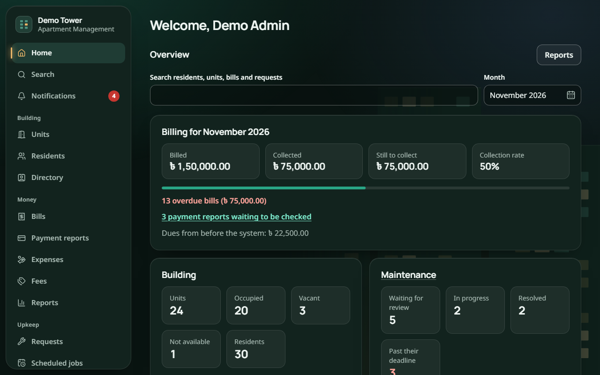

# Apartment Management: Project Wiki

**Apartment Management** is a web application for running a residential apartment building in Bangladesh. Residents see and report their bill payments, download receipts and report repair problems from their phones. Staff handle maintenance work, and the management committee gets dues tracking, finance reports and building notices in one place. The whole app works in English and Bangla and can be installed on a phone like an app.

- **Course:** CSE327 Software Engineering
- **Repository:** <https://github.com/srwrrr/Apartment-Management>
- **Live demo:** <https://apartment-management-tp48.onrender.com> (free server: the first visit after a quiet period can take up to a minute)
- **Demo login:** administrator `admin@demo.local` / `Admin1234`, resident `resident@demo.local` / `Resident1234`

## Final report sections

Each section of the final report has its own page:

| # | Page | What it covers |
|---|---|---|
| 1 | [Software Requirements Specification](01-Software-Requirements-Specification) | All 58 requirements, business rules, quality targets and appendices |
| 2 | [Software Design Specification](02-Software-Design-Specification) | Architecture, modules, data design, API, key algorithms, diagrams, security, deployment |
| 3 | [Trello and Discord](03-Trello-and-Discord) | How the team planned, tracked and communicated |
| 4 | [Architectural Pattern](04-Architectural-Pattern) | The layered, modular client-server pattern and how it is applied |
| 5 | [Coding Standards](05-Coding-Standards) | The team's coding rules, each with real code examples |
| 6 | [Source Code Documentation](06-Source-Code-Documentation) | TypeDoc: setup, comment conventions, sample code and generated output |
| 7 | [UI Design](07-UI-Design) | Screenshots of the key screens and what each does |
| 8 | [Nielsen's Usability Heuristics](08-Nielsen-Usability-Heuristics) | Lighthouse and axe evaluation, mapped to the 10 heuristics |
| 9 | [Code Review](09-Code-Review) | ESLint and SonarQube: findings, screenshots and fixes |
| 10 | [Git Usage](10-Git-Usage) | Branches, commits, pull requests and history |
| 11 | [Unit Testing](11-Unit-Testing) | Representative tests, coverage, boundary and error cases |
| 12 | [Team Contributions](12-Team-Contributions) | Each member's responsibilities and contributions |

## At a glance

| | |
|---|---|
| Front end | React 18, TypeScript, Vite, Tailwind CSS, installable PWA |
| Back end | Node.js 22, Express, Zod validation shared with the front end |
| Database | PostgreSQL with Prisma |
| Quality | ESLint and SonarQube (0 open issues, A ratings), 96.5% server unit-test coverage, about 700 automated tests |
| Hosting | Docker on Render, database on Neon |
